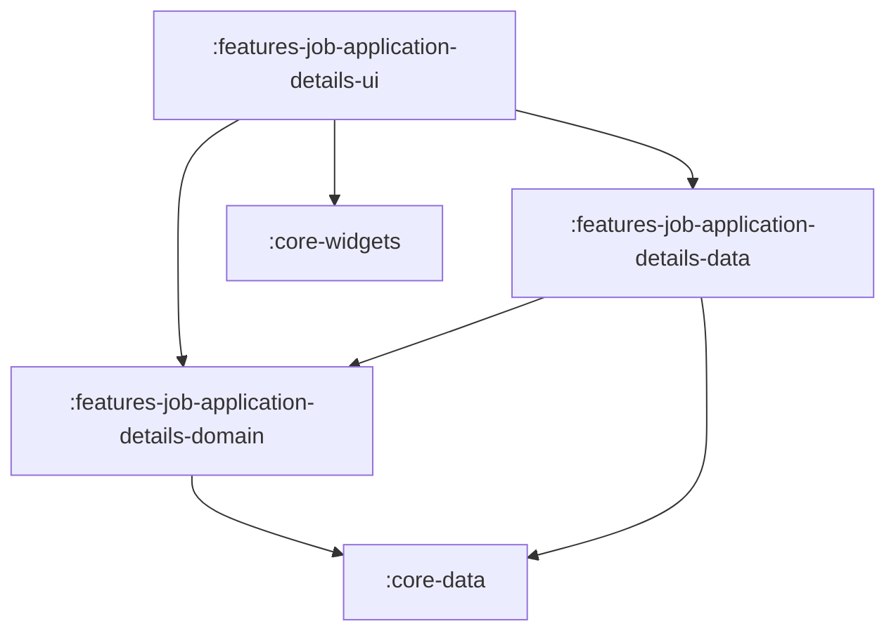

# Feature: Job Applications Details

> [!NOTE]
> **Quick Facts**
> - **Gradle Project IDs**: `:frontend:features-job-application-details-domain`, `:frontend:features-job-application-details-data`, `:frontend:features-job-application-details-ui`
> - **Module Tier**: Feature / User Experience (Clean Architecture: Domain, Data, UI)
> - **Package Base**: `dev.fnc314.tools.jobtracker.features.jobapplicationdetails`
> - **Target Platforms**: Android (`androidTarget`), Desktop JVM (`jvm`), iOS (`iosX64`, `iosArm64`, `iosSimulatorArm64`), Web (`js`, `wasmJs`)
> - **Internal Project Dependencies**:
>   - Domain: `:frontend:core-data`
>   - Data: `:frontend:features-job-application-details-domain`, `:frontend:core-data`
>   - UI: `:frontend:features-job-application-details-domain`, `:frontend:features-job-application-details-data`, `:frontend:core-widgets`, `:frontend:core-navigation`, `:frontend:core-data`

---

## Overview

The `features/job-application-details` module presents the deep-dive record of an individual job application. It enables inspecting metadata, tracking interview stages, modifying application statuses with notes, adjusting fit scores, viewing generated artifacts (CVs and cover letters via signed cloud storage URLs), recording audit events, and reviewing associated company details.

---

## Architectural Breakdown & Subprojects

The feature is divided into three Clean Architecture layers adhering to the `.impl.` package convention:



### 1. `:features-job-application-details-domain`
Houses pure Kotlin business logic contracts:
- [`JobApplicationDetailsRepository`](file:///Users/fnc314/Work/Search/waleedtarbosh-ai-job-search/frontend/features/job-application-details/domain/src/commonMain/kotlin/dev/fnc314/tools/jobtracker/features/jobapplicationdetails/domain/repository/JobApplicationsDetailsRepository.kt): Central domain repository interface defining operations for loading details, updating status and fit score, appending timeline events, and fetching signed artifact URLs.
- [`LoadJobApplicationUseCase`](file:///Users/fnc314/Work/Search/waleedtarbosh-ai-job-search/frontend/features/job-application-details/domain/src/commonMain/kotlin/dev/fnc314/tools/jobtracker/features/jobapplicationdetails/domain/usecase/LoadJobApplicationUseCase.kt): Retrieves a single `JobApplication` by unique ID (`LoadJobApplicationUseCaseImpl` in `usecase.impl`).
- [`LoadCompaniesUseCase`](file:///Users/fnc314/Work/Search/waleedtarbosh-ai-job-search/frontend/features/job-application-details/domain/src/commonMain/kotlin/dev/fnc314/tools/jobtracker/features/jobapplicationdetails/domain/usecase/LoadCompaniesUseCase.kt): Fetches company profiles and metadata (`LoadCompaniesUseCaseImpl` in `usecase.impl`).
- [`UpdateApplicationStatusUseCase`](file:///Users/fnc314/Work/Search/waleedtarbosh-ai-job-search/frontend/features/job-application-details/domain/src/commonMain/kotlin/dev/fnc314/tools/jobtracker/features/jobapplicationdetails/domain/usecase/UpdateApplicationStatusUseCase.kt): Transitions application status (`TrackerStatus`) with audit timestamps and optional notes (`UpdateApplicationStatusUseCaseImpl` in `usecase.impl`).
- [`UpdateFitScoreUseCase`](file:///Users/fnc314/Work/Search/waleedtarbosh-ai-job-search/frontend/features/job-application-details/domain/src/commonMain/kotlin/dev/fnc314/tools/jobtracker/features/jobapplicationdetails/domain/usecase/UpdateFitScoreUseCase.kt): Adjusts candidate-job fit rating (`UpdateFitScoreUseCaseImpl` in `usecase.impl`).
- [`RecordEventUseCase`](file:///Users/fnc314/Work/Search/waleedtarbosh-ai-job-search/frontend/features/job-application-details/domain/src/commonMain/kotlin/dev/fnc314/tools/jobtracker/features/jobapplicationdetails/domain/usecase/RecordEventUseCase.kt): Appends a timeline event (`TrackerEvent`) to the application record (`RecordEventUseCaseImpl` in `usecase.impl`).
- [`GetArtifactSignedUrlUseCase`](file:///Users/fnc314/Work/Search/waleedtarbosh-ai-job-search/frontend/features/job-application-details/domain/src/commonMain/kotlin/dev/fnc314/tools/jobtracker/features/jobapplicationdetails/domain/usecase/GetArtifactSignedUrlUseCase.kt): Generates signed URLs for cloud-stored documents (`GetArtifactSignedUrlUseCaseImpl` in `usecase.impl`).
- [`jobApplicationsDetailsDomainModule`](file:///Users/fnc314/Work/Search/waleedtarbosh-ai-job-search/frontend/features/job-application-details/domain/src/commonMain/kotlin/dev/fnc314/tools/jobtracker/features/jobapplicationdetails/domain/di/JobApplicationsDetailsDomainModule.kt): Koin DI module registering use cases.

### 2. `:features-job-application-details-data`
Provides concrete data sources and repository implementations:
- [`JobApplicationDetailsRepositoryImpl`](file:///Users/fnc314/Work/Search/waleedtarbosh-ai-job-search/frontend/features/job-application-details/data/src/commonMain/kotlin/dev/fnc314/tools/jobtracker/features/jobapplicationdetails/data/repository/impl/JobApplicationsDetailsRepositoryImpl.kt): `internal` repository implementation coordinating `RemoteJobApplicationDetailsDataSource`, `NetworkJobApplicationsDetailsDataSource`, and `LocalJobApplicationsDetailsDataSource` housed in `repository.impl`.
- [`RemoteJobApplicationDetailsDataSource`](file:///Users/fnc314/Work/Search/waleedtarbosh-ai-job-search/frontend/features/job-application-details/data/src/commonMain/kotlin/dev/fnc314/tools/jobtracker/features/jobapplicationdetails/data/source/RemoteJobApplicationsDetailsDataSource.kt): `internal` remote data source interface and `internal class RemoteJobApplicationsDetailsDataSourceImpl` housed in `source.impl`.
- [`NetworkJobApplicationsDetailsDataSource`](file:///Users/fnc314/Work/Search/waleedtarbosh-ai-job-search/frontend/features/job-application-details/data/src/commonMain/kotlin/dev/fnc314/tools/jobtracker/features/jobapplicationdetails/data/source/NetworkJobApplicationsDetailsDataSource.kt): `internal` network data source interface and `internal class NetworkJobApplicationsDetailsDataSourceImpl` housed in `source.impl`.
- [`LocalJobApplicationsDetailsDataSource`](file:///Users/fnc314/Work/Search/waleedtarbosh-ai-job-search/frontend/features/job-application-details/data/src/commonMain/kotlin/dev/fnc314/tools/jobtracker/features/jobapplicationdetails/data/source/LocalJobApplicationsDetailsDataSource.kt): `internal` local data source interface and `internal class LocalJobApplicationsDetailsDataSourceImpl` housed in `source.impl`.
- [`jobApplicationDetailsDataModule`](file:///Users/fnc314/Work/Search/waleedtarbosh-ai-job-search/frontend/features/job-application-details/data/src/commonMain/kotlin/dev/fnc314/tools/jobtracker/features/jobapplicationdetails/data/di/JobApplicationsDetailsDataModule.kt): Koin DI declarations registering internal data sources and repository.

### 3. `:features-job-application-details-ui`
Renders detail presentation, interactive editing dialogs, and artifact launchers following an MVI pattern with decoupled UI models:
- [`JobApplicationDetailsScreen`](file:///Users/fnc314/Work/Search/waleedtarbosh-ai-job-search/frontend/features/job-application-details/ui/src/commonMain/kotlin/dev/fnc314/tools/jobtracker/features/jobapplicationdetails/ui/JobApplicationsDetailsScreen.kt): Comprehensive screen observing `JobApplicationDetailUiState` and dispatching `JobApplicationDetailUiIntent` to `JobApplicationDetailViewModel`.
- [`JobApplicationDetailViewModel`](file:///Users/fnc314/Work/Search/waleedtarbosh-ai-job-search/frontend/features/job-application-details/ui/src/commonMain/kotlin/dev/fnc314/tools/jobtracker/features/jobapplicationdetails/ui/JobApplicationDetailViewModel.kt): Coordinates MVI flow, exposing `uiState: StateFlow<JobApplicationDetailUiState>` and `onIntent(intent: JobApplicationDetailUiIntent): Unit`.
- [`JobApplicationDetailUiState`](file:///Users/fnc314/Work/Search/waleedtarbosh-ai-job-search/frontend/features/job-application-details/ui/src/commonMain/kotlin/dev/fnc314/tools/jobtracker/features/jobapplicationdetails/ui/JobApplicationDetailUiState.kt): Sealed interface representing UI states (`Loading`, `Content`, `Error`, `NavigateBack`).
- [`JobApplicationDetailUiIntent`](file:///Users/fnc314/Work/Search/waleedtarbosh-ai-job-search/frontend/features/job-application-details/ui/src/commonMain/kotlin/dev/fnc314/tools/jobtracker/features/jobapplicationdetails/ui/JobApplicationDetailUiIntent.kt): Sealed interface defining user intents (`Load`, `UpdateStatus`, `UpdateFitScore`, `RecordEvent`, `OpenArtifact`, `ClickBack`).
- [`JobApplicationDetailUiModel`](file:///Users/fnc314/Work/Search/waleedtarbosh-ai-job-search/frontend/features/job-application-details/ui/src/commonMain/kotlin/dev/fnc314/tools/jobtracker/features/jobapplicationdetails/ui/JobApplicationDetailUiModel.kt): Dedicated `@Immutable` UI model holding pre-formatted details.
- [`DetailRoute`](file:///Users/fnc314/Work/Search/waleedtarbosh-ai-job-search/frontend/features/job-application-details/ui/src/commonMain/kotlin/dev/fnc314/tools/jobtracker/features/jobapplicationdetails/ui/JobApplicationsDetailsNavigation.kt): Type-safe destination key (`applicationId: String`) implementing `NavKeyRoute`.
- [`jobApplicationDetailsNavHook`](file:///Users/fnc314/Work/Search/waleedtarbosh-ai-job-search/frontend/features/job-application-details/ui/src/commonMain/kotlin/dev/fnc314/tools/jobtracker/features/jobapplicationdetails/ui/JobApplicationsDetailsNavigation.kt): `FeatureNavigationHook` registering the `composable<DetailRoute>` entry in the root `NavGraphBuilder`.
- [`jobApplicationsDetailsUiModule`](file:///Users/fnc314/Work/Search/waleedtarbosh-ai-job-search/frontend/features/job-application-details/ui/src/commonMain/kotlin/dev/fnc314/tools/jobtracker/features/jobapplicationdetails/ui/JobApplicationsDetailsUiModule.kt): Koin DI factory for `JobApplicationDetailViewModel`.
- [`jobApplicationsDetailsFeatureModule`](file:///Users/fnc314/Work/Search/waleedtarbosh-ai-job-search/frontend/features/job-application-details/ui/src/commonMain/kotlin/dev/fnc314/tools/jobtracker/features/jobapplicationdetails/ui/JobApplicationsDetailsUiModule.kt): Umbrella module uniting data, domain, and UI layers.

---

## Deep-Link Support

The details destination requires a parameterized target application ID:

| Route Type | URI Pattern | Description |
| :--- | :--- | :--- |
| `DetailRoute(val applicationId: String)` | `jobtracker://applications/{id}` | Direct deep link to a specific job application record. |

---

## Key Gradle Tasks

Run the following commands from the repository root:

```bash
# Compile CommonMain Kotlin metadata across all 3 subprojects
./gradlew :frontend:features-job-application-details-domain:compileCommonMainKotlinMetadata \
          :frontend:features-job-application-details-data:compileCommonMainKotlinMetadata \
          :frontend:features-job-application-details-ui:compileCommonMainKotlinMetadata

# Run unit tests
./gradlew :frontend:features-job-application-details-domain:allTests \
          :frontend:features-job-application-details-data:allTests \
          :frontend:features-job-application-details-ui:allTests

# Assemble Android debug variant for UI module
./gradlew :frontend:features-job-application-details-ui:assembleDebug
```
