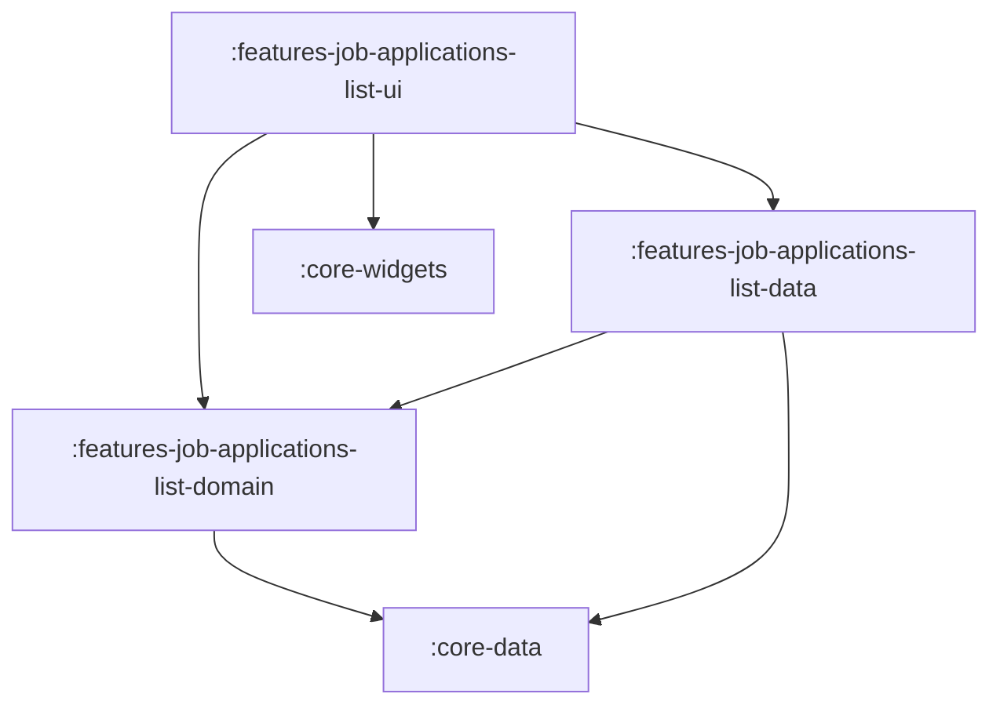

# Feature: Job Applications List

> [!NOTE]
> **Quick Facts**
> - **Gradle Project IDs**: `:frontend:features-job-applications-list-domain`, `:frontend:features-job-applications-list-data`, `:frontend:features-job-applications-list-ui`
> - **Module Tier**: Feature / User Experience (Clean Architecture: Domain, Data, UI)
> - **Package Base**: `dev.fnc314.tools.jobtracker.features.jobapplicationslist`
> - **Target Platforms**: Android (`androidTarget`), Desktop JVM (`jvm`), iOS (`iosX64`, `iosArm64`, `iosSimulatorArm64`), Web (`js`, `wasmJs`)
> - **Internal Project Dependencies**:
>   - Domain: `:frontend:core-data`
>   - Data: `:frontend:features-job-applications-list-domain`, `:frontend:core-data`
>   - UI: `:frontend:features-job-applications-list-domain`, `:frontend:features-job-applications-list-data`, `:frontend:core-widgets`, `:frontend:core-navigation`, `:frontend:core-data`

---

## Overview

The `features/job-applications-list` module delivers the central cockpit for tracking, searching, filtering, and organizing the candidate's active job search pipeline. It renders application summaries, status badges, fit indicators, and activity timelines with responsive adaptive layouts across mobile, tablet, desktop, and web viewports.

---

## Architectural Breakdown & Subprojects

The feature is decomposed into three Clean Architecture layers:



### 1. `:features-job-applications-list-domain`
Houses pure Kotlin business rules and filtering algorithms:
- [`JobApplicationsListRepository`](file:///Users/fnc314/Work/Search/ai-job-search/frontend/features/job-applications-list/domain/src/commonMain/kotlin/dev/fnc314/tools/jobtracker/features/jobapplicationslist/domain/repository/JobApplicationsListRepository.kt): Domain repository abstraction interface defining the contract for loading, caching, and filtering job applications.
- [`LoadAllJobApplicationsUseCase`](file:///Users/fnc314/Work/Search/ai-job-search/frontend/features/job-applications-list/domain/src/commonMain/kotlin/dev/fnc314/tools/jobtracker/features/jobapplicationslist/domain/usecase/LoadAllJobApplicationsUseCase.kt): Contract for fetching the complete set of applications with optional forced remote refresh.
- [`FilterJobApplicationsUseCase`](file:///Users/fnc314/Work/Search/ai-job-search/frontend/features/job-applications-list/domain/src/commonMain/kotlin/dev/fnc314/tools/jobtracker/features/jobapplicationslist/domain/usecase/FilterJobApplicationsUseCase.kt): Multi-criteria filter engine evaluating status, application age (`ApplicationAge`), and freeform search queries across company, role, tags, and notes.
- [`SortJobApplicationsUseCase`](file:///Users/fnc314/Work/Search/ai-job-search/frontend/features/job-applications-list/domain/src/commonMain/kotlin/dev/fnc314/tools/jobtracker/features/jobapplicationslist/domain/usecase/SortJobApplicationsUseCase.kt): Column-based sorting supporting `DATE_CREATED`, `DATE_UPDATED`, `COMPANY`, `STATUS`, `FIT`, and `ROLE` in ascending or descending order.

### 2. `:features-job-applications-list-data`
Provides concrete data sources and repository implementations:

- [
  `JobApplicationsListRepository`](file:///Users/fnc314/Work/Search/ai-job-search/frontend/features/job-applications-list/data/src/commonMain/kotlin/dev/fnc314/tools/jobtracker/features/jobapplicationslist/data/repository/JobApplicationsListRepository.kt):
  `internal` repository implementation coordinating `LocalJobApplicationsListDataSource` and
  `RemoteJobApplicationsListDataSource`.
- [`JobApplicationsListRepositoryImpl`](file:///Users/fnc314/Work/Search/ai-job-search/frontend/features/job-applications-list/data/src/commonMain/kotlin/dev/fnc314/tools/jobtracker/features/jobapplicationslist/data/repository/impl/JobApplicationsListRepositoryImpl.kt): `internal` repository implementation coordinating `LocalJobApplicationsListDataSource` and `RemoteJobApplicationsListDataSource`.
- [`LocalJobApplicationsListDataSource`](file:///Users/fnc314/Work/Search/ai-job-search/frontend/features/job-applications-list/data/src/commonMain/kotlin/dev/fnc314/tools/jobtracker/features/jobapplicationslist/data/source/LocalJobApplicationsListDataSource.kt): Local data source interface and `internal class LocalJobApplicationsListDataSourceImpl` backed by Room 3 SQLite database (`DatabaseHolder` / `JobApplicationDao`) with in-memory fallback.
- [`RemoteJobApplicationsListDataSource`](file:///Users/fnc314/Work/Search/ai-job-search/frontend/features/job-applications-list/data/src/commonMain/kotlin/dev/fnc314/tools/jobtracker/features/jobapplicationslist/data/source/RemoteJobApplicationsListDataSource.kt): Remote data source interface and `internal class RemoteJobApplicationsListDataSourceImpl` backed by `RemoteDataSource` / Firestore.
- [`LoadAllJobApplicationsUseCaseImpl`](file:///Users/fnc314/Work/Search/ai-job-search/frontend/features/job-applications-list/data/src/commonMain/kotlin/dev/fnc314/tools/jobtracker/features/jobapplicationslist/data/LoadAllJobApplicationsUseCaseImpl.kt): Queries `JobApplicationsListRepository`.
- [`FilterJobApplicationsUseCaseImpl`](file:///Users/fnc314/Work/Search/ai-job-search/frontend/features/job-applications-list/data/src/commonMain/kotlin/dev/fnc314/tools/jobtracker/features/jobapplicationslist/data/FilterJobApplicationsUseCaseImpl.kt): In-memory filtering implementation.
- [`SortJobApplicationsUseCaseImpl`](file:///Users/fnc314/Work/Search/ai-job-search/frontend/features/job-applications-list/data/src/commonMain/kotlin/dev/fnc314/tools/jobtracker/features/jobapplicationslist/data/SortJobApplicationsUseCaseImpl.kt): In-memory multi-column sorting implementation.
- [`jobApplicationsListDataModule`](file:///Users/fnc314/Work/Search/ai-job-search/frontend/features/job-applications-list/data/src/commonMain/kotlin/dev/fnc314/tools/jobtracker/features/jobapplicationslist/data/di/JobApplicationsListModule.kt): Koin DI definitions registering data layer dependencies.

### 3. `:features-job-applications-list-ui`
Delivers the Compose presentation and responsive UI components using strict MVI architecture:
- [`JobApplicationsListUiState`](file:///Users/fnc314/Work/Search/ai-job-search/frontend/features/job-applications-list/ui/src/commonMain/kotlin/dev/fnc314/tools/jobtracker/features/jobapplicationslist/ui/JobApplicationsListUiState.kt): Sealed interface modeling UI states (`Loading`, `Content`, `Error`) and navigation side-effects (`NavigateToDetail`, `NavigateToAddApplication`, `NavigateToAddLead`, `NavigateToEdits`, `NavigateToSettings`).
- [`JobApplicationsListUiIntent`](file:///Users/fnc314/Work/Search/ai-job-search/frontend/features/job-applications-list/ui/src/commonMain/kotlin/dev/fnc314/tools/jobtracker/features/jobapplicationslist/ui/JobApplicationsListUiIntent.kt): Sealed interface capturing user interactions (`SelectApplication`, `ChangeFilter`, `ChangeSort`, `Refresh`, `ClickAddApplication`, `ClickAddLead`, `ClickEdits`, `ClickSettings`).
- [`JobApplicationItemUiModel`](file:///Users/fnc314/Work/Search/ai-job-search/frontend/features/job-applications-list/ui/src/commonMain/kotlin/dev/fnc314/tools/jobtracker/features/jobapplicationslist/ui/JobApplicationItemUiModel.kt): Immutable presentation model separating UI rendering from raw domain models with pre-formatted dates, status labels, fit score text, and click intents.
- [`JobApplicationsListViewModel`](file:///Users/fnc314/Work/Search/ai-job-search/frontend/features/job-applications-list/ui/src/commonMain/kotlin/dev/fnc314/tools/jobtracker/features/jobapplicationslist/ui/JobApplicationsListViewModel.kt): MVI ViewModel strictly exposing a single `uiState: StateFlow<JobApplicationsListUiState>` and intent handler `onIntent(JobApplicationsListUiIntent): Unit`.
- [`JobApplicationsListScreen`](file:///Users/fnc314/Work/Search/ai-job-search/frontend/features/job-applications-list/ui/src/commonMain/kotlin/dev/fnc314/tools/jobtracker/features/jobapplicationslist/ui/JobApplicationsListScreen.kt): Adaptive screen switching between a single-column `LazyColumn` for compact screens and a multi-column `LazyVerticalGrid` for expanded displays based on `WindowWidthSizeClass`. Renders `JobApplicationsListUiState` and delegates all actions through `onIntent`.
- [`JobApplicationRow`](file:///Users/fnc314/Work/Search/ai-job-search/frontend/features/job-applications-list/ui/src/commonMain/kotlin/dev/fnc314/tools/jobtracker/features/jobapplicationslist/ui/component/JobApplicationRow.kt): Pure stateless card row consuming `JobApplicationItemUiModel` with zero inline formatting or calculations.
- [`ListRoute`](file:///Users/fnc314/Work/Search/ai-job-search/frontend/features/job-applications-list/ui/src/commonMain/kotlin/dev/fnc314/tools/jobtracker/features/jobapplicationslist/ui/JobApplicationsListNavigation.kt): Type-safe destination key implementing `NavKeyRoute`.
- [`jobApplicationsListNavHook`](file:///Users/fnc314/Work/Search/ai-job-search/frontend/features/job-applications-list/ui/src/commonMain/kotlin/dev/fnc314/tools/jobtracker/features/jobapplicationslist/ui/JobApplicationsListNavigation.kt): `FeatureNavigationHook` registering the `composable<ListRoute>` entry in the root `NavGraphBuilder`.
- [`jobApplicationsListUiModule`](file:///Users/fnc314/Work/Search/ai-job-search/frontend/features/job-applications-list/ui/src/commonMain/kotlin/dev/fnc314/tools/jobtracker/features/jobapplicationslist/ui/JobApplicationsListUiModule.kt): Koin DI module registering `JobApplicationsListViewModel`.
- [`jobApplicationsListFeatureModule`](file:///Users/fnc314/Work/Search/ai-job-search/frontend/features/job-applications-list/ui/src/commonMain/kotlin/dev/fnc314/tools/jobtracker/features/jobapplicationslist/ui/JobApplicationsListUiModule.kt): Umbrella module including data, domain, and UI modules.

---

## Deep-Link Support

The applications list is the primary authenticated home destination in the navigation graph:

| Route Type | URI Pattern | Description |
| :--- | :--- | :--- |
| `ListRoute` | `jobtracker://applications` | Navigates to the main applications list cockpit. |

The route supports automatic redirection from `SignInRoute` upon authentication, as well as return navigation from detail or creation screens.

---

## Key Gradle Tasks

Run the following commands from the repository root:

```bash
# Compile CommonMain Kotlin metadata across all 3 subprojects
./gradlew :frontend:features-job-applications-list-domain:compileCommonMainKotlinMetadata \
          :frontend:features-job-applications-list-data:compileCommonMainKotlinMetadata \
          :frontend:features-job-applications-list-ui:compileCommonMainKotlinMetadata

# Run unit tests
./gradlew :frontend:features-job-applications-list-domain:allTests \
          :frontend:features-job-applications-list-data:allTests \
          :frontend:features-job-applications-list-ui:allTests

# Assemble Android debug variant for UI module
./gradlew :frontend:features-job-applications-list-ui:assembleDebug
```
