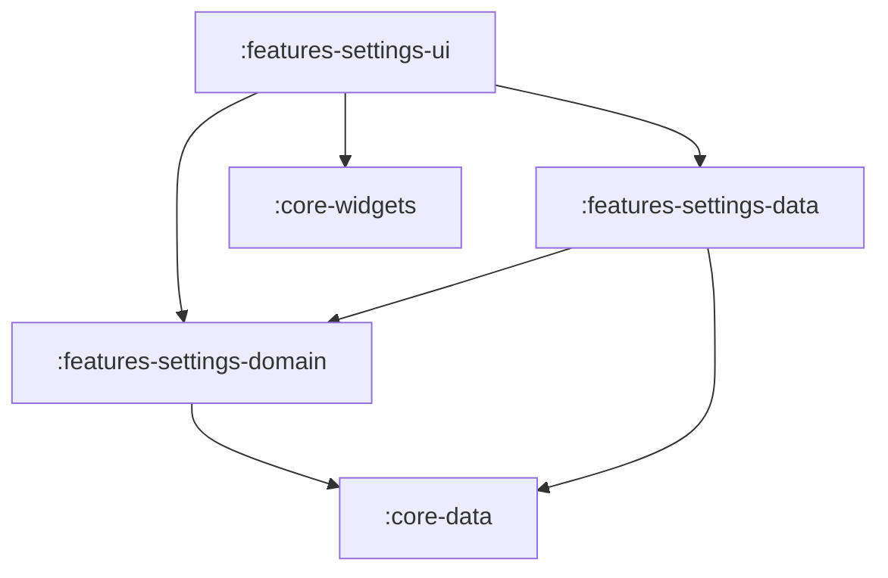

# Feature: Settings

> [!NOTE]
> **Quick Facts**
> - **Gradle Project IDs**: `:frontend:features-settings-domain`, `:frontend:features-settings-data`, `:frontend:features-settings-ui`
> - **Module Tier**: Feature / User Experience (Clean Architecture: Domain, Data, UI)
> - **Package Base**: `dev.fnc314.tools.jobtracker.features.settings`
> - **Target Platforms**: Android (`androidTarget`), Desktop JVM (`jvm`), iOS (`iosX64`, `iosArm64`, `iosSimulatorArm64`), Web (`js`, `wasmJs`)
> - **Internal Project Dependencies**:
>   - Domain: `:frontend:core-data`
>   - Data: `:frontend:features-settings-domain`, `:frontend:core-data`
>   - UI: `:frontend:features-settings-domain`, `:frontend:features-settings-data`, `:frontend:core-widgets`, `:frontend:core-navigation`, `:frontend:core-data`

---

## Overview

The `features/settings` module provides configuration and preference management for the application. It governs UI theme mode (System, Light, Dark), dynamic Material 3 color seed selection (persisted via hexadecimal strings), backend environment preferences, and session sign-out.

---

## Architectural Breakdown & Subprojects

The feature is organized into three Clean Architecture layers adhering to the `.impl.` package convention:



### 1. `:features-settings-domain`
Defines contracts for observing and mutating user preferences:
- [`SettingsRepository`](file:///Users/fnc314/Work/Search/waleedtarbosh-ai-job-search/frontend/features/settings/domain/src/commonMain/kotlin/dev/fnc314/tools/jobtracker/features/settings/domain/repository/SettingsRepository.kt): Core interface exposing `val settings: StateFlow<AppSettings>` and `fun updateSettings(settings: AppSettings)`.
- [`ObserveSettingsUseCase`](file:///Users/fnc314/Work/Search/waleedtarbosh-ai-job-search/frontend/features/settings/domain/src/commonMain/kotlin/dev/fnc314/tools/jobtracker/features/settings/domain/usecase/ObserveSettingsUseCase.kt): Provides reactive observation of application settings (`ObserveSettingsUseCaseImpl` housed in `usecase.impl`).
- [`UpdateSettingsUseCase`](file:///Users/fnc314/Work/Search/waleedtarbosh-ai-job-search/frontend/features/settings/domain/src/commonMain/kotlin/dev/fnc314/tools/jobtracker/features/settings/domain/usecase/UpdateSettingsUseCase.kt): Dispatches setting mutations to the repository (`UpdateSettingsUseCaseImpl` housed in `usecase.impl`).
- [`settingsDomainModule`](file:///Users/fnc314/Work/Search/waleedtarbosh-ai-job-search/frontend/features/settings/domain/src/commonMain/kotlin/dev/fnc314/tools/jobtracker/features/settings/domain/di/SettingsDomainModule.kt): Koin DI module registering use cases.

### 2. `:features-settings-data`
Provides concrete data source and repository implementations:
- [`SettingsRepositoryImpl`](file:///Users/fnc314/Work/Search/waleedtarbosh-ai-job-search/frontend/features/settings/data/src/commonMain/kotlin/dev/fnc314/tools/jobtracker/features/settings/data/repository/impl/SettingsRepositoryImpl.kt): `internal` repository implementation coordinating `LocalSettingsDataSource` housed in `repository.impl`.
- [`LocalSettingsDataSource`](file:///Users/fnc314/Work/Search/waleedtarbosh-ai-job-search/frontend/features/settings/data/src/commonMain/kotlin/dev/fnc314/tools/jobtracker/features/settings/data/source/LocalSettingsDataSource.kt): Local data source interface and `internal class LocalSettingsDataSourceImpl` housed in `source.impl` serializing `AppSettings` using `kotlinx.serialization`.
- [`settingsDataModule`](file:///Users/fnc314/Work/Search/waleedtarbosh-ai-job-search/frontend/features/settings/data/src/commonMain/kotlin/dev/fnc314/tools/jobtracker/features/settings/data/di/SettingsDataModule.kt): Koin DI declarations registering `LocalSettingsDataSource` and `SettingsRepository`.

### 3. `:features-settings-ui`
Renders the preference controls adhering to MVI architecture:
- [`SettingsUiModel`](file:///Users/fnc314/Work/Search/waleedtarbosh-ai-job-search/frontend/features/settings/ui/src/commonMain/kotlin/dev/fnc314/tools/jobtracker/features/settings/ui/SettingsUiModel.kt): Immutable presentation model (`uiMode`, `seedColorHex`, `isSystemDark`, `randomSeedSuggestions`, `kmpInspectorEnabled`) isolating the UI layer from domain entities.
- [`SettingsUiState`](file:///Users/fnc314/Work/Search/waleedtarbosh-ai-job-search/frontend/features/settings/ui/src/commonMain/kotlin/dev/fnc314/tools/jobtracker/features/settings/ui/SettingsUiState.kt): Sealed interface representing UI screen states (`Loading`, `Content`, `NavigateBack`, `NavigateToSignIn`).
- [`SettingsUiIntent`](file:///Users/fnc314/Work/Search/waleedtarbosh-ai-job-search/frontend/features/settings/ui/src/commonMain/kotlin/dev/fnc314/tools/jobtracker/features/settings/ui/SettingsUiIntent.kt): Sealed interface capturing user interactions (`ChangeUiMode`, `ChangeSeedColor`, `ClickSignOut`, `ClickBack`, `ToggleKmpInspector`).
- [`SettingsViewModel`](file:///Users/fnc314/Work/Search/waleedtarbosh-ai-job-search/frontend/features/settings/ui/src/commonMain/kotlin/dev/fnc314/tools/jobtracker/features/settings/ui/SettingsViewModel.kt): MVI ViewModel exposing `uiState: StateFlow<SettingsUiState>` and `onIntent(SettingsUiIntent)`.
- [`SettingsScreen`](file:///Users/fnc314/Work/Search/waleedtarbosh-ai-job-search/frontend/features/settings/ui/src/commonMain/kotlin/dev/fnc314/tools/jobtracker/features/settings/ui/SettingsScreen.kt): Composable view binding `SettingsUiState` and forwarding user actions through `SettingsUiIntent`.
- [`SettingsRoute`](file:///Users/fnc314/Work/Search/waleedtarbosh-ai-job-search/frontend/features/settings/ui/src/commonMain/kotlin/dev/fnc314/tools/jobtracker/features/settings/ui/SettingsNavigation.kt): Type-safe destination key implementing `NavKeyRoute`.
- [`settingsNavHook`](file:///Users/fnc314/Work/Search/waleedtarbosh-ai-job-search/frontend/features/settings/ui/src/commonMain/kotlin/dev/fnc314/tools/jobtracker/features/settings/ui/SettingsNavigation.kt): `FeatureNavigationHook` registering the `composable<SettingsRoute>` entry in the root `NavGraphBuilder`.
- [`settingsUiModule`](file:///Users/fnc314/Work/Search/waleedtarbosh-ai-job-search/frontend/features/settings/ui/src/commonMain/kotlin/dev/fnc314/tools/jobtracker/features/settings/ui/SettingsUiModule.kt): Koin DI factory for `SettingsViewModel`.
- [`settingsFeatureModule`](file:///Users/fnc314/Work/Search/waleedtarbosh-ai-job-search/frontend/features/settings/ui/src/commonMain/kotlin/dev/fnc314/tools/jobtracker/features/settings/ui/SettingsUiModule.kt): Umbrella DI module including data, domain, and UI modules.

---

## Deep-Link Support

The settings screen is registered in the Compose Navigation graph:

| Route Type | URI Pattern | Description |
| :--- | :--- | :--- |
| `SettingsRoute` | `jobtracker://settings` | Navigates to user preferences and theme settings. |

---

## Key Gradle Tasks

Run the following commands from the repository root:

```bash
# Compile CommonMain Kotlin metadata across all 3 subprojects
./gradlew :frontend:features-settings-domain:compileCommonMainKotlinMetadata \
          :frontend:features-settings-data:compileCommonMainKotlinMetadata \
          :frontend:features-settings-ui:compileCommonMainKotlinMetadata

# Run unit tests
./gradlew :frontend:features-settings-domain:allTests \
          :frontend:features-settings-data:allTests \
          :frontend:features-settings-ui:allTests

# Assemble Android debug variant for UI module
./gradlew :frontend:features-settings-ui:assembleDebug
```
