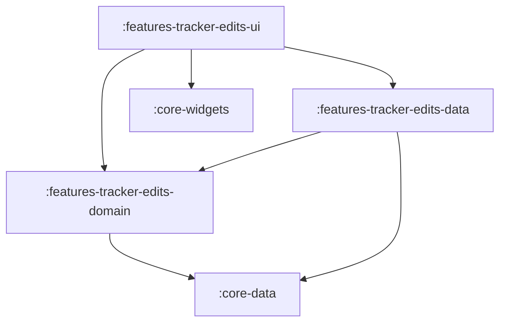

# Feature: Tracker Edits

> [!NOTE]
> **Quick Facts**
> - **Gradle Project IDs**: `:frontend:features-tracker-edits-domain`, `:frontend:features-tracker-edits-data`, `:frontend:features-tracker-edits-ui`
> - **Module Tier**: Feature / User Experience (Clean Architecture: Domain, Data, UI)
> - **Package Base**: `dev.fnc314.tools.jobtracker.features.trackeredits`
> - **Target Platforms**: Android (`androidTarget`), Desktop JVM (`jvm`), iOS (`iosX64`, `iosArm64`, `iosSimulatorArm64`), Web (`js`, `wasmJs`)
> - **Internal Project Dependencies**:
>   - Domain: `:frontend:core-data`
>   - Data: `:frontend:features-tracker-edits-domain`, `:frontend:core-data`
>   - UI: `:frontend:features-tracker-edits-domain`, `:frontend:features-tracker-edits-data`, `:frontend:core-widgets`, `:frontend:core-navigation`, `:frontend:core-data`

---

## Overview

The `features/tracker-edits` module manages proposed edits, automated status sync suggestions (e.g. from Gmail scraper jobs or Composio workflows), and human-in-the-loop review queues. It allows candidates to review suggested modifications to their application pipeline, approve changes with optional audit notes, reject proposals with reasons, and expire stale edits.

---

## Architectural Breakdown & Subprojects

The feature is organized across three Clean Architecture subprojects:



### 1. `:features-tracker-edits-domain`
Defines contracts for reviewing and managing pending edits:
- [`TrackerEditsRepository`](file:///Users/fnc314/Work/Search/waleedtarbosh-ai-job-search/frontend/features/tracker-edits/domain/src/commonMain/kotlin/dev/fnc314/tools/jobtracker/features/trackeredits/domain/repository/TrackerEditsRepository.kt): Domain repository interface contract defining operations for loading pending edits, approving, rejecting, and expiring stale edits.
- [`LoadPendingEditsUseCase`](file:///Users/fnc314/Work/Search/waleedtarbosh-ai-job-search/frontend/features/tracker-edits/domain/src/commonMain/kotlin/dev/fnc314/tools/jobtracker/features/trackeredits/domain/usecase/LoadPendingEditsUseCase.kt): Fetches all active pending proposal edits (`List<TrackerEdit>`).
- [`ApproveEditUseCase`](file:///Users/fnc314/Work/Search/waleedtarbosh-ai-job-search/frontend/features/tracker-edits/domain/src/commonMain/kotlin/dev/fnc314/tools/jobtracker/features/trackeredits/domain/usecase/ApproveEditUseCase.kt): Applies a proposed edit to the underlying application document.
- [`RejectEditUseCase`](file:///Users/fnc314/Work/Search/waleedtarbosh-ai-job-search/frontend/features/tracker-edits/domain/src/commonMain/kotlin/dev/fnc314/tools/jobtracker/features/trackeredits/domain/usecase/RejectEditUseCase.kt): Dismisses a proposed edit with a rejection reason.
- [`ExpireStaleEditsUseCase`](file:///Users/fnc314/Work/Search/waleedtarbosh-ai-job-search/frontend/features/tracker-edits/domain/src/commonMain/kotlin/dev/fnc314/tools/jobtracker/features/trackeredits/domain/usecase/ExpireStaleEditsUseCase.kt): Automatically expires unreviewed edits beyond the retention window.

### 2. `:features-tracker-edits-data`
Provides concrete data sources and repository implementations:
- [`TrackerEditsRepositoryImpl`](file:///Users/fnc314/Work/Search/waleedtarbosh-ai-job-search/frontend/features/tracker-edits/data/src/commonMain/kotlin/dev/fnc314/tools/jobtracker/features/trackeredits/data/repository/TrackerEditsRepositoryImpl.kt): `internal` repository implementation coordinating `RemoteTrackerEditsDataSource` and `LocalTrackerEditsDataSource`.
- [`RemoteTrackerEditsDataSource`](file:///Users/fnc314/Work/Search/waleedtarbosh-ai-job-search/frontend/features/tracker-edits/data/src/commonMain/kotlin/dev/fnc314/tools/jobtracker/features/trackeredits/data/source/RemoteTrackerEditsDataSource.kt): Remote data source interface and `internal class RemoteTrackerEditsDataSourceImpl` backed by `RemoteDataSource` / Firestore.
- [`LocalTrackerEditsDataSource`](file:///Users/fnc314/Work/Search/waleedtarbosh-ai-job-search/frontend/features/tracker-edits/data/src/commonMain/kotlin/dev/fnc314/tools/jobtracker/features/trackeredits/data/source/LocalTrackerEditsDataSource.kt): Local data source interface and `internal class LocalTrackerEditsDataSourceImpl` backed by `LocalDataSource`.
- [`LoadPendingEditsUseCaseImpl`](file:///Users/fnc314/Work/Search/waleedtarbosh-ai-job-search/frontend/features/tracker-edits/data/src/commonMain/kotlin/dev/fnc314/tools/jobtracker/features/trackeredits/data/LoadPendingEditsUseCaseImpl.kt): Queries `TrackerEditsRepository`.
- [`ApproveEditUseCaseImpl`](file:///Users/fnc314/Work/Search/waleedtarbosh-ai-job-search/frontend/features/tracker-edits/data/src/commonMain/kotlin/dev/fnc314/tools/jobtracker/features/trackeredits/data/ApproveEditUseCaseImpl.kt): Delegates approval to `TrackerEditsRepository`.
- [`RejectEditUseCaseImpl`](file:///Users/fnc314/Work/Search/waleedtarbosh-ai-job-search/frontend/features/tracker-edits/data/src/commonMain/kotlin/dev/fnc314/tools/jobtracker/features/trackeredits/data/RejectEditUseCaseImpl.kt): Delegates rejection to `TrackerEditsRepository`.
- [`ExpireStaleEditsUseCaseImpl`](file:///Users/fnc314/Work/Search/waleedtarbosh-ai-job-search/frontend/features/tracker-edits/data/src/commonMain/kotlin/dev/fnc314/tools/jobtracker/features/trackeredits/data/ExpireStaleEditsUseCaseImpl.kt): Delegates expiration to `TrackerEditsRepository`.
- [`trackerEditsDataModule`](file:///Users/fnc314/Work/Search/waleedtarbosh-ai-job-search/frontend/features/tracker-edits/data/src/commonMain/kotlin/dev/fnc314/tools/jobtracker/features/trackeredits/data/TrackerEditsDataModule.kt): Koin DI declarations registering data sources and repository.

### 3. `:features-tracker-edits-ui`
Renders review queues, comparison cards, and action controls following MVI architecture:
- [`TrackerEditsUiState`](file:///Users/fnc314/Work/Search/waleedtarbosh-ai-job-search/frontend/features/tracker-edits/ui/src/commonMain/kotlin/dev/fnc314/tools/jobtracker/features/trackeredits/ui/TrackerEditsUiState.kt): Sealed interface representing UI screen states: `Loading`, `Content` (with immutable `TrackerEditItemUiModel` list and action-in-progress indicator), `Error`, and `NavigateBack`.
- [`TrackerEditsUiIntent`](file:///Users/fnc314/Work/Search/waleedtarbosh-ai-job-search/frontend/features/tracker-edits/ui/src/commonMain/kotlin/dev/fnc314/tools/jobtracker/features/trackeredits/ui/TrackerEditsUiIntent.kt): MVI user intent hierarchy: `Refresh`, `ApproveEdit(id, note)`, `RejectEdit(id, note)`, `ExpireStaleEdits`, and `ClickBack`.
- [`TrackerEditItemUiModel`](file:///Users/fnc314/Work/Search/waleedtarbosh-ai-job-search/frontend/features/tracker-edits/ui/src/commonMain/kotlin/dev/fnc314/tools/jobtracker/features/trackeredits/ui/TrackerEditItemUiModel.kt): Immutable presentation models (`TrackerEditItemUiModel`, `TrackerEditChangeUiModel`, `TrackerEditSourceEmailUiModel`) isolating UI components from raw domain entities, paired with intent tokens.
- [`TrackerEditsViewModel`](file:///Users/fnc314/Work/Search/waleedtarbosh-ai-job-search/frontend/features/tracker-edits/ui/src/commonMain/kotlin/dev/fnc314/tools/jobtracker/features/trackeredits/ui/TrackerEditsViewModel.kt): MVI coordinator exposing strictly `uiState: StateFlow<TrackerEditsUiState>` and `onIntent(intent: TrackerEditsUiIntent)`.
- [`TrackerEditsScreen`](file:///Users/fnc314/Work/Search/waleedtarbosh-ai-job-search/frontend/features/tracker-edits/ui/src/commonMain/kotlin/dev/fnc314/tools/jobtracker/features/trackeredits/ui/TrackerEditsScreen.kt): Review queue screen observing `TrackerEditsUiState`, rendering `TrackerEditItemUiModel` rows, and dispatching MVI intents.
- [`EditsRoute`](file:///Users/fnc314/Work/Search/waleedtarbosh-ai-job-search/frontend/features/tracker-edits/ui/src/commonMain/kotlin/dev/fnc314/tools/jobtracker/features/trackeredits/ui/TrackerEditsNavigation.kt): Type-safe destination key implementing `NavKeyRoute`.
- [`trackerEditsNavHook`](file:///Users/fnc314/Work/Search/waleedtarbosh-ai-job-search/frontend/features/tracker-edits/ui/src/commonMain/kotlin/dev/fnc314/tools/jobtracker/features/trackeredits/ui/TrackerEditsNavigation.kt): `FeatureNavigationHook` registering `composable<EditsRoute>` in the root `NavGraphBuilder`.
- [`trackerEditsUiModule`](file:///Users/fnc314/Work/Search/waleedtarbosh-ai-job-search/frontend/features/tracker-edits/ui/src/commonMain/kotlin/dev/fnc314/tools/jobtracker/features/trackeredits/ui/TrackerEditsUiModule.kt): Koin DI factory for `TrackerEditsViewModel`.
- [`trackerEditsFeatureModule`](file:///Users/fnc314/Work/Search/waleedtarbosh-ai-job-search/frontend/features/tracker-edits/ui/src/commonMain/kotlin/dev/fnc314/tools/jobtracker/features/trackeredits/ui/TrackerEditsUiModule.kt): Umbrella DI module.

---

## Deep-Link Support

The review queue destination is registered in the Compose Navigation graph:

| Route Type | URI Pattern | Description |
| :--- | :--- | :--- |
| `EditsRoute` | `jobtracker://edits` | Navigates to the pending tracker edits review queue. |

---

## Key Gradle Tasks

Run the following commands from the repository root:

```bash
# Compile CommonMain Kotlin metadata across all 3 subprojects
./gradlew :frontend:features-tracker-edits-domain:compileCommonMainKotlinMetadata \
          :frontend:features-tracker-edits-data:compileCommonMainKotlinMetadata \
          :frontend:features-tracker-edits-ui:compileCommonMainKotlinMetadata

# Run unit tests
./gradlew :frontend:features-tracker-edits-domain:allTests \
          :frontend:features-tracker-edits-data:allTests \
          :frontend:features-tracker-edits-ui:allTests

# Assemble Android debug variant for UI module
./gradlew :frontend:features-tracker-edits-ui:assembleDebug
```
