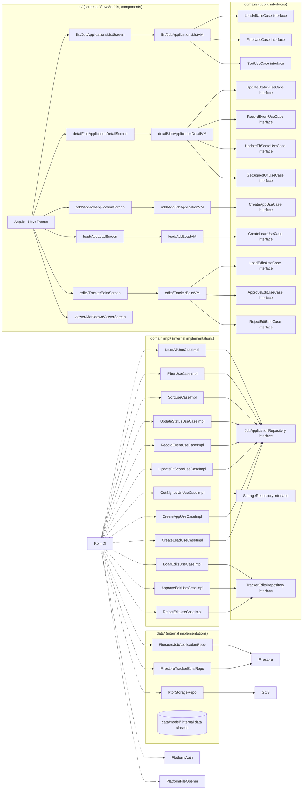

# Progress Summary

**Last updated**: 2026-11-02

| Step | Status | Description |
|------|--------|-------------|
| Step 1 | ✓ Done | Firebase, Auth, Koin, Domain Interfaces, Data Layer & UseCase Implementations |
| Step 2 | ✓ Done | Job Applications List Screen with Theme and Accessibility |
| Step 3 | ✓ Done | Job Application Detail Screen with File Consumption |
| Step 4 | ✓ Done | Add Job Application and Lead Forms |
| Step 5 | ✓ Done | Tracker Edits Review and Final Polish |

### Completed Features & Flows
- **Domain Layer**: All 15 UseCase interfaces and 3 repository interfaces are defined
- **Data Models**: 12 data classes matching `records/proto` definitions, plus enums
- **UseCase Implementations**: All 15 internal implementations with filtering/sorting logic
- **Repository Stubs**: Firestore and GCS repository implementations (methods throw `NotImplementedError` pending Firebase config)
- **DI**: Koin modules wire all interfaces to implementations; Factory methods construct all models
- **Platform Code**: `PlatformAuth` and `PlatformFileOpener` expect/actual for Android, iOS, JVM, JS
- **UI Components**: `JobTrackerTheme`, `StatusBadge`, `JobApplicationsListScreen`, `JobApplicationsListViewModel`, `JobApplicationRow`, `FilterChip`, `ColumnHeader`, `SettingsDialog`
- **Detail Screen**: `JobApplicationDetailScreen`, `JobApplicationDetailViewModel`, `EventsTimeline`, `ArtifactsList`, `DetailDialogs` (UpdateStatusDialog, RecordEventDialog, UpdateFitScoreDialog)
- **Add Forms**: `AddJobApplicationScreen`, `AddJobApplicationViewModel`, `AddLeadScreen`, `AddLeadViewModel` with form validation and enum dropdowns
- **Navigation**: App.kt routes from list → detail, FAB menu → Add Application / Add Lead / Pending Edits, TopAppBar → Edits
- **UI Features**: Sort indicators, filter chips, settings dialog (column visibility, dark mode, seed color), FAB for add, detail screen navigation, action dialogs
- **Build**: JVM compilation succeeds

### Pending Items
- **Firebase Integration**: Repository methods need actual Firestore queries (requires Firebase config)
- **Google Sign-In**: PlatformAuth implementations are stubs
- **GCS Signed URLs**: KtorStorageRepository methods throw `NotImplementedError`
- **Navigation**: App.kt navigates from list to detail screen when an application is tapped
- **ListDetailsPaneScaffold**: Not yet integrated for list-detail pattern
- **Settings Dialog**: Column visibility, theme seed color, dark/light toggle not implemented
- **Detail Screen**: Implemented (Step 3) — summary, company profile, artifacts, events timeline, action dialogs
- **Add Forms**: Implemented (Step 4) — AddJobApplicationScreen, AddLeadScreen with validation and enum dropdowns
- **Proposals Review**: Implemented (Step 5) — TrackerEditsScreen, TrackerEditsViewModel with approve/reject/expire
- **Unit Tests**: UseCase unit tests not yet written
- **EnumDisplay**: Refactored to generic `displayName()` extension on `Enum<T>` with `TrackerStatus` override

# Requirements

### Overview
Build a mobile UI for the AI Job Search tracker using Compose Multiplatform, targeting Android, iOS, Desktop, and Web from a single shared codebase. The app will provide feature parity with the terminal TUI (`tracker_tui.py`) and all `mise tracker` CLI tasks, with full accessibility support and adaptive layouts that work on screens as small as foldable phone outer displays.

### User Stories
- As a user, I want to see all my job applications in a scrollable list so I can track my pipeline at a glance.
- As a user, I want to filter applications by status (open, leads, rejected) so I can focus on what matters.
- As a user, I want to sort applications by date, company, status, or fit rating so I can find what I need.
- As a user, I want to view full application details including company info, timeline events, and attached files.
- As a user, I want to open GCS-hosted files (PDFs, CVs, postings) in the appropriate system app (PDF viewer, browser) — not in a hosted WebView.
- As a user, I want to add new applications interactively (equivalent to `mise tracker add -i`).
- As a user, I want to record recruiter leads (equivalent to `mise tracker lead`).
- As a user, I want to update application status, record events, and adjust fit scores.
- As a user, I want to review and approve/reject Gmail sync proposals.
- As a user with assistive technology, I want all information conveyed through text/labels, not color alone.
- As a user, I want to customize the app's theme with a seed color of my choice.

### Functional Requirements

#### Job Applications List Screen
- Display `JobApplication` records in a scrollable list with columns: date, company, status, fit rating, role
- Quick filter buttons: All, Leads, Open, Rejected
- Sort by any visible column (toggle ascending/descending)
- Column visibility configuration (settings)
- Background refresh (poll Firestore every 60s)
- **Accessibility**: Status indicators use icons + text labels, not color alone. All interactive elements have content descriptions.

#### Job Application Detail Screen
- Application summary: company, role, date, status, fit rating, notes, source URL
- Company profile (from Firestore companies collection)
- Artifacts section: GCS files, local files, external URLs
- Events timeline (append-only history)
- Outreach protocols (recruiter/peer search links and message templates)
- Actions: update status, record event, adjust fit score, recalc fit
- **File consumption**: Tapping a PDF opens the device's PDF viewer; tapping a URL opens the system browser. No hosted WebViews.

#### Add Job Application Screen (Lower Priority)
- Interactive form for creating new `JobApplication` records (equivalent to `tracker add -i`)
- Fields: company, role, sector, roleType, channel, status, source URL, notes
- Status selection from `TrackerStatus` enum
- Channel selection from `ApplicationChannel` enum
- Validation against tracker schema

#### Add Lead Screen (Lower Priority)
- Record recruiter outreach leads (equivalent to `tracker lead`)
- Fields: company (required), contact name, channel, notes, tags

#### Status/Event/Score Actions
- Update application status with optional date and note
- Record timeline events (interview, offer, rejection, etc.)
- Record fit score recalculations
- Dry-run preview before writing

#### Proposals Review (Lower Priority)
- List pending `TrackerEdit` records from Gmail sync
- Show proposal details with proposed changes
- Approve (with optional note) or reject (with reason)
- Expire stale proposals

### Non-Functional Requirements

#### Accessibility
- **No color-only indicators**: All status, fit, and state information is conveyed through text labels, icons, or patterns in addition to color.
- **Content descriptions**: All interactive elements have `contentDescription` for screen readers.
- **Alternative text**: Any imagery has alt text (though imagery is minimal).
- **Input method agnostic**: All functionality works with touch, keyboard, and mouse.

#### Responsive Design
- **Adaptive layouts**: UI adapts from narrow screens (foldable outer displays, ~380dp width) to tablets and desktop.
- **Window-aware**: Uses `WindowSizeClass` and `WindowPostureClass` to adapt layout.
- **Orientation support**: Works in both portrait and landscape.

#### Theming
- **Dark and light modes**: System-following by default, with manual override.
- **Dynamic colors on Android**: Material You dynamic color support via `androidx.compose.material3.dynamicDarkColorScheme` / `dynamicLightColorScheme`.
- **Custom seed color**: Users can input a custom hex color; the app generates a full Material3 theme using `MaterialTheme.colorScheme` from that seed via `colorSchemeFromSeed()`.

#### Platform Code Minimization
- **All UI in shared/commonMain**: No platform-specific UI code unless absolutely required.
- Platform-specific code is limited to: Firebase initialization, Google Auth setup, and file/URL launching.
- Use `expect/actual` only where necessary.

#### Authentication
- **Auto-login via Google**: Attempt to authenticate users using their local Google account via Firebase Auth with Google Sign-In.
- On Android: Use Google Sign-In SDK.
- On iOS: Use Sign In with Apple / Google Sign-In.
- On Desktop/Web: Use Firebase Auth popup or custom token.
- Fall back to anonymous auth if Google sign-in is not available.

#### Data & Storage
- **Firebase Kotlin SDK**: Direct Firestore access (no intermediary API).
- **Koin for DI**: All dependencies (repositories, ViewModels) are provided via Koin.
- **Offline-friendly**: Cache last known data for offline viewing.

### Out of Scope (Future)
- Scraping integration (no scraper endpoint available yet)
- Cloud Functions backend (documented as migration path, not implemented)
- Push notifications

# Technical Design

### Current Implementation

#### Completed (Step 1)
- **KMP Project**: Compose Multiplatform 1.12.2, Kotlin 2.4.21, targets Android, iOS, JVM, JS, Wasm
- **Dependencies**: Firebase BoM 33.10.0, Firestore, Auth, Koin 4.0.3, Ktor 3.1.2, Navigation Compose 2.8.0-alpha10, Kotlinx Serialization 1.8.0, Mockk 1.13.17
- **Domain layer** (`domain/`): 15 public UseCase interfaces + 3 public repository interfaces (`JobApplicationRepository`, `StorageRepository`, `TrackerEditsRepository`) + `UseCase<in Params, out Result>` base interface
- **Domain implementations** (`domain.impl/`): 15 internal UseCase implementations + `FilterUtil` and `SortUtil` with filtering/sorting logic
- **Data models** (`data/model/`): 12 data classes (`JobApplication`, `TrackerEvent`, `TrackerArtifact`, `TrackerEdit`, `Company`, `Contact`, `Compensation`, `Location`, `TrackerFit`, `TrackerCounts`, `Timeline`) + enums (`TrackerStatus`, `ApplicationChannel`, `TrackerEventType`, etc.)
- **Repository stubs** (`data/firestore/`, `data/gcs/`): `FirestoreJobApplicationRepository`, `FirestoreTrackerEditsRepository`, `KtorStorageRepository` — methods throw `NotImplementedError` pending Firebase config
- **DI layer** (`di/`): `KoinModule.kt` wires all interfaces to implementations, `Factory.kt` with factory methods for all models
- **Platform code** (`platform/`): `PlatformAuth` and `PlatformFileOpener` expect/actual for Android, iOS, JVM, JS — Auth stubs pending Google Sign-In integration
- **UI layer** (`ui/`): `JobTrackerTheme` (Material3), `StatusBadge` (icon + text), `JobApplicationsListScreen`, `JobApplicationsListViewModel`, `JobApplicationRow`, `FilterChip`
- **Utilities**: `EnumDisplay.kt` for enum-to-display-name mapping
- **App.kt**: Koin-initialized, displays `JobApplicationsListScreen` with `JobTrackerTheme`; detail screen navigation marked as TODO
- **Build**: JVM compilation succeeds (`:shared:compileKotlinJvm`). Wasm build has pre-existing infrastructure issue (missing binaryen dependency).

#### Pending
- **TUI Reference**: `tracker_tui.py` (1703 lines) - curses-based with Textual loading screen
- **Data Model**: `tracker.schema.json` - Firestore collections: applications, events, artifacts, companies, contacts, pending-proposals, sync-requests, meta
- **Python Scripts**: `scripts/tracker.py` (writes), `scripts/reader.py` (reads), `scripts/client.py` (Firestore client), `scripts/artifacts.py` (GCS)
- **Records module**: `records/proto` contains Protocol Buffers definitions with generated Kotlin models (`JobApplication`, `TrackerEvent`, `TrackerArtifact`, `TrackerEdit`, `Company`, `Contact`, etc.) and `records/parser` has `EnumMapping` for converting between namespaced strings and proto enums

### Key Decisions

**1. Proto-aligned naming in commonMain** — The `records/proto` module is JVM-only and cannot be included in the multiplatform shared module (JS/Wasm targets don't support protobuf Kotlin). Instead, create plain Kotlin data classes in `commonMain` that **mirror the proto model names exactly**: `JobApplication`, `TrackerEvent`, `TrackerArtifact`, `TrackerEdit`, `Company`, `Contact`, `TrackerStatus`, `ApplicationChannel`, `TrackerEventType`, etc. This ensures naming consistency and simplifies the future Cloud Functions migration.

**2. Direct Firebase Kotlin SDK** — User confirmed direct Firestore access via Firebase Kotlin SDK in the shared module. No intermediary API. Cloud Functions migration documented for future.

**3. Koin for Dependency Injection** — All repositories, ViewModels, and Firebase services are provided via Koin. Koin works across all KMP targets and integrates with `lifecycle-viewmodel-compose`.

**4. All UI in shared/commonMain** — User confirmed all UI should be Multiplatform Compose. Platform-specific code is limited to Firebase initialization, Google Auth, and file/URL launching. Use `expect/actual` only where necessary.

**5. UseCase domain layer** — A strict UseCase layer sits between ViewModels and Repositories. Each UseCase encapsulates a single business operation (e.g., filtering, sorting, creating an application, updating status). ViewModels orchestrate UseCases and UI state; Repositories handle raw data access only. This layer is the primary target for unit tests.

**6. ViewModel-per-screen architecture** — Each screen gets its own ViewModel that orchestrates UseCases and manages UI state. Follows existing `lifecycle-viewmodel-compose` dependency.

**7. Ktor for HTTP/GCS** — Will use Ktor client for GCS signed URL generation and file downloads, since the Firebase Kotlin SDK doesn't include Storage on all platforms.

**8. Navigation via Compose Navigation** — Use Compose Navigation for screen transitions (list → detail, list → add, etc.)

**9. Material3 with custom seed color** — Theme uses `colorSchemeFromSeed()` from a user-provided color. On Android, dynamic color (Material You) is offered as an option. Dark/light mode follows system by default with manual override.

**10. File consumption via platform intents** — PDFs and other files are opened in the system's native app (not hosted WebViews). On Android: `Intent.ACTION_VIEW`; on iOS: `UIDocumentInteractionController`; on Desktop: `Desktop.browse()`; on Web: `window.open()`.

**11. Firebase Auth with Google Sign-In** — Auto-login via local Google account. Platform-specific Google Sign-In wrappers use `expect/actual`. Fall back to anonymous auth if unavailable.

### Proposed Changes

#### Modular Monolith Structure
Even though all code lives in a single `shared` Gradle module, organize packages as if they were separate modules. This enables clean extraction into actual Gradle modules later.

**Package structure:**
```
shared/src/commonMain/kotlin/dev/fnc314/tools/jobtracker/
├── ui/                          # UI layer — screens, components, ViewModels
│   ├── list/                    # Job applications list feature
│   │   ├── JobApplicationsListScreen.kt
│   │   ├── JobApplicationsListViewModel.kt
│   │   └── component/
│   │       ├── JobApplicationRow.kt
│   │       ├── FilterChip.kt
│   │       └── ColumnHeader.kt
│   ├── detail/                  # Job application detail feature
│   │   ├── JobApplicationDetailScreen.kt
│   │   ├── JobApplicationDetailViewModel.kt
│   │   └── component/
│   │       ├── EventsTimeline.kt
│   │       └── ArtifactsList.kt
│   ├── add/                     # Add application feature (future: separate module)
│   │   ├── AddJobApplicationScreen.kt
│   │   └── AddJobApplicationViewModel.kt
│   ├── lead/                    # Add lead feature (future: separate module)
│   │   ├── AddLeadScreen.kt
│   │   └── AddLeadViewModel.kt
│   ├── edits/                   # Tracker edits review feature
│   │   ├── TrackerEditsScreen.kt
│   │   └── TrackerEditsViewModel.kt
│   ├── viewer/                  # Markdown viewer feature
│   │   └── MarkdownViewerScreen.kt
│   └── component/               # Shared UI components
│       ├── StatusBadge.kt
│       └── ...
├── domain/                      # Domain layer — PUBLIC INTERFACES ONLY
│   ├── UseCase.kt               # `interface UseCase<in Params, out Result>`
│   ├── repository/
│   │   ├── JobApplicationRepository.kt  # `interface` — CRUD operations
│   │   ├── StorageRepository.kt         # `interface` — GCS operations
│   │   └── TrackerEditsRepository.kt    # `interface` — edits operations
│   └── usecase/
│       ├── LoadAllJobApplicationsUseCase.kt    # `interface : UseCase<...>`
│       ├── LoadJobApplicationUseCase.kt
│       ├── LoadCompaniesUseCase.kt
│       ├── FilterJobApplicationsUseCase.kt
│       ├── SortJobApplicationsUseCase.kt
│       ├── UpdateApplicationStatusUseCase.kt
│       ├── RecordEventUseCase.kt
│       ├── UpdateFitScoreUseCase.kt
│       ├── GetArtifactSignedUrlUseCase.kt
│       ├── CreateJobApplicationUseCase.kt
│       ├── CreateLeadUseCase.kt
│       ├── LoadPendingEditsUseCase.kt
│       ├── ApproveEditUseCase.kt
│       ├── RejectEditUseCase.kt
│       └── ExpireStaleEditsUseCase.kt
├── domain.impl/                 # Domain implementations — INTERNAL
│   ├── usecase/
│   │   ├── LoadAllJobApplicationsUseCaseImpl.kt   # `internal class`
│   │   ├── FilterJobApplicationsUseCaseImpl.kt    # `internal class`
│   │   ├── SortJobApplicationsUseCaseImpl.kt      # `internal class`
│   │   └── ...                                      # All UseCase impls are `internal`
│   └── filter/
│       ├── FilterUtil.kt                      # Filtering logic (open, rejected, leads)
│       └── SortUtil.kt                        # Sorting logic
├── data/                        # Data layer — INTERNAL IMPLEMENTATIONS
│   ├── firestore/               # Firestore-based repository implementations
│   │   ├── FirestoreJobApplicationRepository.kt  # `internal class : domain.repository.JobApplicationRepository`
│   │   └── FirestoreTrackerEditsRepository.kt    # `internal class : domain.repository.TrackerEditsRepository`
│   ├── gcs/                     # GCS/Storage operations
│   │   └── KtorStorageRepository.kt  # `internal class : domain.repository.StorageRepository`
│   └── model/                   # Data models — INTERNAL DATA CLASSES
│       ├── JobApplication.kt    # `internal data class` (matches tracker.v1.JobApplication)
│       ├── TrackerEvent.kt      # `internal data class`
│       ├── TrackerArtifact.kt   # `internal data class`
│       ├── TrackerEdit.kt       # `internal data class`
│       ├── Company.kt           # `internal data class`
│       ├── Contact.kt           # `internal data class`
│       ├── Compensation.kt      # `internal data class`
│       ├── Location.kt          # `internal data class`
│       ├── TrackerFit.kt        # `internal data class`
│       ├── TrackerCounts.kt     # `internal data class`
│       ├── Timeline.kt          # `internal data class`
│       └── Enums.kt             # `enum class` (TrackerStatus, ApplicationChannel, etc.)
├── di/                          # Dependency injection — FACTORY METHODS
│   ├── KoinModule.kt            # Koin modules: binds interfaces to internal impls
│   ├── Factory.kt               # Factory methods: `createJobApplication(...)`, etc.
│   └── FirebaseModule.kt        # Firebase init
├── platform/                    # Platform-specific expect/actual
│   ├── PlatformAuth.kt          # `expect interface`: Google sign-in
│   └── PlatformFileOpener.kt    # `expect interface`: open files/URLs
└── App.kt                       # Navigation host + theme
```

**Boundary rules:**
- `domain/` exposes **only public interfaces** (no implementations, no data classes)
- `domain.impl/` contains **internal** UseCase implementations with all business logic
- `data/` contains **internal** repository implementations and **internal data class** models
- `ui/` depends on `domain/` interfaces only (never imports `domain.impl/` or `data/`)
- Factory methods in `di/Factory.kt` construct `internal data class` instances — no public constructors on models
- Koin binds domain interfaces to internal implementations in `di/KoinModule.kt`
- **Dependency flow**: `ui/` → `domain/` (interfaces) ← `domain.impl/` ← `data/` (internal impls)

#### Phase 1: Firebase, Auth, Data Layer, Koin & UseCase Foundation
- Add Firebase BoM, Firestore, and Auth dependencies to shared module
- Add Koin dependencies (`koin-core`, `koin-compose`, `koin-viewmodel`)
- Add Ktor client dependency for HTTP/GCS
- Create Koin modules: `FirebaseModule`, `RepositoryModule`, `UseCaseModule`, `ViewModelModule`
- Create platform-specific Firebase initialization using `expect/actual` in `androidMain`, `iosMain`, `jvmMain`, `jsMain`
- Create platform-specific Google Auth using `expect/actual`: `PlatformAuth` interface with `signIn()` and `currentUser()`
- **Create domain layer public interfaces** in `domain/`:
  - `JobApplicationRepository` interface (public): `getAllJobApplications()`, `getJobApplication(id)`, `searchJobApplications(query)`, `getCompanies()`, `saveJobApplication(app)`, `updateStatus()`, `recordEvent()`, `updateFitScore()`
  - `StorageRepository` interface (public): `getSignedUrl(path)`, `downloadText(path)`, `uploadFile(path, file)`
  - `TrackerEditsRepository` interface (public): `getPendingEdits()`, `approveEdit()`, `rejectEdit()`, `expireStaleEdits()`
  - `UseCase<in Params, out Result>` base interface
  - UseCase interfaces: `LoadAllJobApplicationsUseCase`, `LoadJobApplicationUseCase`, `LoadCompaniesUseCase`, `FilterJobApplicationsUseCase`, `SortJobApplicationsUseCase`
- **Create domain.impl layer** (internal implementations):
  - All UseCase implementations are `internal class` accepting repository interfaces
  - Filtering/sorting logic in `domain.impl/filter/`
- **Create data layer** (internal implementations):
  - `FirestoreJobApplicationRepository` (`internal`) implementing `domain.repository.JobApplicationRepository`
  - `KtorStorageRepository` (`internal`) implementing `domain.repository.StorageRepository`
  - `FirestoreTrackerEditsRepository` (`internal`) implementing `domain.repository.TrackerEditsRepository`
- **Create data models** as `internal data class` in `data/model/`:
  - `JobApplication`, `TrackerEvent`, `TrackerArtifact`, `TrackerEdit`, `Company`, `Contact`
  - Nested: `Compensation`, `Location`, `TrackerFit`, `TrackerCounts`, `Timeline`
  - Enums: `TrackerStatus`, `ApplicationChannel`, `TrackerEventType`, `TrackerArtifactKind`, `WorkMode`, `EventActor`, `TrackerEditState`, `TrackerEditKind`, `Trigger`, `Confidence`, `DerivedFrom`, `Tag`
- **Create factory methods** in `di/Factory.kt`:
  - `createJobApplication(...)` — constructs `internal data class JobApplication` from Firestore document
  - `createTrackerEvent(...)` — constructs `internal data class TrackerEvent`
  - Factory methods are the only way to construct model instances
- Create `PlatformFileOpener` (expect/actual) for opening files/URLs in system apps
- Verify Firestore connectivity by fetching and logging application count

#### Phase 2: Job Applications List Screen (`ui/list/`)
- Replace `App.kt` with navigation host wrapped in Material3 theme
- Create `Theme.kt` with `colorSchemeFromSeed()` support, dynamic color on Android, and dark/light toggle
- Use `ListDetailsPaneScaffold` from Material3 Canonical Layouts for the list-detail pattern:
  - List pane shows job applications, detail pane shows selected application
  - On narrow screens, navigate between list and detail; on wide screens, show both side by side
- Add `FAB` for adding new job applications:
  - Ensure FAB does not overlap content, especially at the bottom of the screen
  - Use `Scaffold.fab` with proper padding/margins
- Create `ui/list/JobApplicationsListScreen` composable:
  - `LazyColumn` with application rows inside `ListDetailsPaneScaffold`
  - Filter chips (All, Leads, Open, Rejected)
  - Column header with sort indicators
  - Pull-to-refresh support
  - **Adaptive layout**: Use `WindowSizeClass` to adjust column visibility on narrow screens
- Create `ui/list/JobApplicationsListViewModel` (via Koin):
  - Injects `domain.usecase.LoadAllJobApplicationsUseCase`, `FilterJobApplicationsUseCase`, and `SortJobApplicationsUseCase` **interfaces**
  - State: `jobApplications`, `filteredApplications`, `activeFilter`, `sortColumn`, `sortDirection`
  - No business logic in ViewModel — all filtering/sorting delegated to UseCase interfaces
  - Background refresh via `viewModelScope` launcher
- Create `ui/list/component/`:
  - `JobApplicationRow.kt` — displays visible columns
  - `FilterChip.kt` — filter selection chips
  - `ColumnHeader.kt` — sortable column headers
- Settings dialog for column visibility, theme seed color, and dark/light toggle
- Persist settings via `dataStore`
- **Accessibility**: All filter chips and sort headers have content descriptions. Status badges use icon + text.

#### Phase 3: Job Application Detail Screen (`ui/detail/`)
- **Create Detail UseCase interfaces** in `domain/usecase/`:
  - `UpdateApplicationStatusUseCase` interface — updates status with optional date/note, appends event
  - `RecordEventUseCase` interface — appends timeline event to events subcollection
  - `UpdateFitScoreUseCase` interface — updates fit evaluation score
  - `GetArtifactSignedUrlUseCase` interface — generates GCS signed URL for artifacts
- **Create Detail UseCase implementations** in `domain.impl/usecase/`:
  - `internal class UpdateApplicationStatusUseCaseImpl` — writes to Firestore via repository
  - `internal class RecordEventUseCaseImpl` — appends to events subcollection
  - `internal class UpdateFitScoreUseCaseImpl` — updates fit evaluation
  - `internal class GetArtifactSignedUrlUseCaseImpl` — calls StorageRepository
- Create `ui/detail/JobApplicationDetailScreen` composable:
  - Application summary section
  - Company profile section (expandable)
  - Artifacts section with clickable files
  - Events timeline
  - Action buttons (status, event, score, recalc)
  - **Adaptive layout**: Single column on narrow screens, two-column on wide screens
- Create `ui/detail/JobApplicationDetailViewModel`:
  - Injects UseCase **interfaces** from `domain/usecase/`
  - No business logic in ViewModel — only UI state management
  - Collects results from UseCases and exposes UI state
- File handling: Tapping a `TrackerArtifact` opens it via `PlatformFileOpener`:
  - PDFs → system PDF viewer
  - Markdown → downloaded and rendered inline
  - URLs → system browser
  - No hosted WebViews
- Create `ui/detail/component/EventsTimeline` displaying events chronologically
- Create `ui/detail/component/ArtifactsList` with clickable file entries (GCS, local, external)
- Create dialogs for status update, event recording, and fit score changes
- Create `ui/viewer/MarkdownViewerScreen` for inline markdown rendering

#### Phase 4: Add Job Application & Lead Forms (Lower Priority, Future Modules)
These will be implemented as separate Gradle modules (`:feature-add`, `:feature-lead`) rather than within `shared`. The domain interfaces they depend on will already be extractable into their own module.

- **Create Form UseCase interfaces** in `domain/usecase/`:
  - `CreateJobApplicationUseCase` interface — validates input, creates `JobApplication`, writes to Firestore
  - `CreateLeadUseCase` interface — creates application with `TrackerStatus.DRAFTING` from lead data
- **Create Form UseCase implementations** in `domain.impl/usecase/`:
  - `internal class CreateJobApplicationUseCaseImpl` — validates, uses factory method to create model, writes via repository
  - `internal class CreateLeadUseCaseImpl` — creates lead application with DRAFTING status
- **Future module structure** (not implemented yet, documented for planning):
  - `:feature-add` module depends on `:domain` (interfaces) and `:domain-impl` (implementations)
  - `:feature-lead` module depends on `:domain` and `:domain-impl`
  - Each feature module contains its own `ui/` package with screen, ViewModel, and components
- `ui/add/AddJobApplicationScreen` with interactive form:
  - Text fields: company, role, sector, source URL, notes
  - Dropdown: status (from `TrackerStatus` enum), channel (from `ApplicationChannel` enum), roleType, workMode
  - Date picker for application date
  - Submit delegates to `CreateJobApplicationUseCase` interface
- `ui/lead/AddLeadScreen`:
  - Fields: company (required), contact, channel, notes (repeatable), tags (repeatable)
  - Delegates to `CreateLeadUseCase` interface
- `ui/add/AddJobApplicationViewModel` and `ui/lead/AddLeadViewModel`:
  - Only manage form state and validation UI
  - Delegate creation to UseCase interfaces
- Add dry-run preview showing resolved payload before writing

#### Phase 5: Actions & Proposals (`ui/edits/`, Lower Priority)
- **Create Proposals UseCase interfaces** in `domain/usecase/`:
  - `LoadPendingEditsUseCase` interface — loads pending `TrackerEdit` records
  - `ApproveEditUseCase` interface — applies changes to target application, marks edit as approved
  - `RejectEditUseCase` interface — marks edit as rejected with reason
  - `ExpireStaleEditsUseCase` interface — expires edits past their expiration time
- **Create Proposals UseCase implementations** in `domain.impl/usecase/`:
  - `internal class LoadPendingEditsUseCaseImpl`
  - `internal class ApproveEditUseCaseImpl`
  - `internal class RejectEditUseCaseImpl`
  - `internal class ExpireStaleEditsUseCaseImpl`
- Status update dialog (select new `TrackerStatus`, optional date/note)
- Event recording dialog (select `TrackerEventType`, date, note)
- Fit score dialog (0-100 slider/input)
- `ui/edits/TrackerEditsScreen` listing pending edits with approve/reject actions
- `ui/edits/TrackerEditsViewModel`:
  - Injects UseCase **interfaces** from `domain/usecase/`
  - Delegates all operations to UseCase interfaces
- **Accessibility**: All dialogs have proper focus management and content descriptions

### Data Models / Contracts

Key models in `data/model/`, named to match `records/proto` definitions. All models are **`internal data class`** — constructed only via factory methods in `di/Factory.kt`.

```kotlin
// data/model/JobApplication.kt — internal, constructed via Factory.createJobApplication(...)
internal data class JobApplication(
    val id: String,
    val company: String,
    val role: String?,
    val location: String?,              // simple location string
    val status: TrackerStatus,
    val channel: ApplicationChannel,
    val jobId: String?,
    val jobUrl: String?,
    val description: String?,
    val tags: List<String>,
    val contactIds: List<String>,
    val compensation: Compensation?,
    val locationDetail: Location?,
    val fitEvaluation: TrackerFit?,
    val counters: TrackerCounts?,
    val timeline: Timeline?,
    val notesRendered: String?,
    val createdAt: Instant?,
    val updatedAt: Instant?,
)

// data/model/TrackerEvent.kt
internal data class TrackerEvent(
    val id: String,
    val applicationId: String,
    val type: TrackerEventType,
    val statusFrom: TrackerStatus?,
    val statusTo: TrackerStatus?,
    val note: String?,
    val emailMessageId: String?,
    val actor: EventActor,
    val derivedFrom: DerivedFrom,
    val confidence: Confidence,
    val createdAt: Instant?,
)

// data/model/TrackerArtifact.kt
internal data class TrackerArtifact(
    val id: String,
    val applicationId: String,
    val kind: TrackerArtifactKind,
    val filename: String,
    val contentType: String?,
    val size: Long?,
    val sha256: String?,
    val storage: ArtifactStorage?,
    val localPath: String?,
    val externalUrl: String?,
    val createdAt: Instant?,
)

internal data class ArtifactStorage(
    val bucket: String,
    val path: String,
)

// data/model/TrackerEdit.kt
internal data class TrackerEdit(
    val id: String,
    val applicationId: String,
    val kind: TrackerEditKind,
    val state: TrackerEditState,
    val trigger: Trigger,
    val changes: List<EditChange>,
    val unmatched: List<EditUnmatched>,
    val sourceEmail: SourceEmail?,
    val scope: EditScope?,
    val confidence: Confidence,
    val createdAt: Instant?,
    val expiresAt: Instant?,
)

internal data class EditChange(
    val field: String,
    val oldValue: String,
    val newValue: String,
    val reason: String,
)

// data/model/Company.kt
internal data class Company(
    val id: String,
    val name: String,
    val aliases: List<String>,
    val website: String?,
    val industry: String?,
    val createdAt: Instant?,
    val updatedAt: Instant?,
)

// data/model/Contact.kt
internal data class Contact(
    val id: String,
    val name: String,
    val title: String?,
    val company: String?,
    val email: String?,
    val phone: String?,
    val linkedinUrl: String?,
    val applicationIds: List<String>,
)

// Nested messages — all internal data class
internal data class Compensation(
    val min: Double?,
    val max: Double?,
    val currency: String?,
    val period: String?,
    val bandSource: String?,
    val vsTarget: String?,
)

internal data class Location(
    val city: String?,
    val region: String?,
    val country: String?,
    val workMode: WorkMode,
    val relocation: Boolean,
    val superCommuter: Boolean,
)

internal data class TrackerFit(
    val rubricVersion: Int,
    val evaluatedAt: Instant?,
    val gaps: List<String>,
)

internal data class TrackerCounts(
    val events: Int,
    val followUpsSent: Int,
    val interviews: Int,
    val rejections: Int,
)

internal data class Timeline(
    val firstActivityAt: Instant?,
    val lastActivityAt: Instant?,
    val daysSinceActivity: Int,
    val nextFollowUpAt: Instant?,
)

// Enums mirror tracker.v1 enums exactly — public (needed by UI for display)
enum class TrackerStatus {
    UNSPECIFIED, DRAFTING, APPLIED, INTERVIEW, OFFER_EXPECTED,
    HIRED, REJECTED, NO_RESPONSE, OFFER_DECLINED, APPLICATION_WITHDRAWN
}

enum class ApplicationChannel {
    UNSPECIFIED, GREENHOUSE, WORKDAY, LEVER, ASHBY,
    SMARTRECRUITERS, LINKEDIN, REFERRAL, DIRECT, OTHER
}

enum class TrackerEventType {
    UNSPECIFIED, APPLY, ACKNOWLEDGE, RECRUITER_SCREEN, SCHEDULE_INTERVIEW,
    COMPLETE_INTERVIEW, ASSESS, VISIT_ONSITE, OFFER, ACCEPT_OFFER,
    DECLINE_OFFER, REJECT, GHOST, WITHDRAW, SEND_FOLLOW_UP,
    TAILOR_DOCUMENT, RECALCULATE_FIT, ADD_ARTIFACT, ADD_NOTE,
    IMPORT, CORRECT_STATUS
}

enum class TrackerArtifactKind {
    UNSPECIFIED, CV, COVER_LETTER, OUTCOME, POSTING, ASSESSMENT
}

enum class TrackerEditState {
    UNSPECIFIED, PENDING, APPROVED, REJECTED, EXPIRED
}

enum class WorkMode {
    UNSPECIFIED, ONSITE, HYBRID, REMOTE
}

enum class EventActor {
    UNSPECIFIED, USER, AGENT, EMAIL_SYNC, IMPORT, SCHEDULER
}

enum class Confidence {
    UNSPECIFIED, HIGH, MEDIUM, LOW
}

enum class DerivedFrom {
    UNSPECIFIED, MANUAL, NOTES_REGEX, EMAIL, CSV_IMPORT
}
```

### Domain Interfaces

Public interfaces in `domain/` that define the boundary contracts:

```kotlin
// domain/UseCase.kt
interface UseCase<in Params, out Result> {
    suspend operator fun invoke(params: Params): Result
}

// domain/repository/JobApplicationRepository.kt
interface JobApplicationRepository {
    suspend fun getAllJobApplications(): List<JobApplication>
    suspend fun getJobApplication(id: String): JobApplication?
    suspend fun getCompanies(): List<Company>
    suspend fun saveJobApplication(app: JobApplication): String
    suspend fun updateStatus(id: String, status: TrackerStatus, date: String?, note: String?): JobApplication
    suspend fun recordEvent(event: TrackerEvent): String
    suspend fun updateFitScore(id: String, score: Int): JobApplication
}

// domain/repository/StorageRepository.kt
interface StorageRepository {
    suspend fun getSignedUrl(path: String): String
    suspend fun downloadText(path: String): String
    suspend fun uploadFile(path: String, data: ByteArray): String
}

// domain/repository/TrackerEditsRepository.kt
interface TrackerEditsRepository {
    suspend fun getPendingEdits(): List<TrackerEdit>
    suspend fun approveEdit(id: String, note: String?): TrackerEdit
    suspend fun rejectEdit(id: String, reason: String): TrackerEdit
    suspend fun expireStaleEdits(): Int
}

// domain/usecase/LoadAllJobApplicationsUseCase.kt
interface LoadAllJobApplicationsUseCase : UseCase<LoadAllJobApplicationsUseCase.Params, List<JobApplication>> {
    data class Params(val forceRefresh: Boolean = false)
}

// domain/usecase/FilterJobApplicationsUseCase.kt
interface FilterJobApplicationsUseCase : UseCase<FilterJobApplicationsUseCase.Params, List<JobApplication>> {
    enum class FilterType { ALL, OPEN, LEADS, REJECTED }
    data class Params(val applications: List<JobApplication>, val filter: FilterType)
}

// domain/usecase/SortJobApplicationsUseCase.kt
interface SortJobApplicationsUseCase : UseCase<SortJobApplicationsUseCase.Params, List<JobApplication>> {
    enum class SortColumn { DATE, COMPANY, STATUS, FIT, ROLE }
    data class Params(val applications: List<JobApplication>, val column: SortColumn, val ascending: Boolean)
}

// di/Factory.kt — factory methods for internal data classes
object Factory {
    fun createJobApplication(
        id: String,
        company: String,
        // ... other parameters
    ): JobApplication = JobApplication(
        id = id,
        company = company,
        // ...
    )

    fun createTrackerEvent(
        id: String,
        applicationId: String,
        // ... other parameters
    ): TrackerEvent = TrackerEvent(
        id = id,
        applicationId = applicationId,
        // ...
    )
}
```

### File Structure

New files in `shared/src/`, organized as a modular monolith:
```
commonMain/kotlin/dev/fnc314/tools/jobtracker/
├── App.kt                              (modified: nav host + theme)
│
├── ui/                                 # UI layer — screens, components, ViewModels
│   ├── list/                           # Job applications list feature
│   │   ├── JobApplicationsListScreen.kt
│   │   ├── JobApplicationsListViewModel.kt
│   │   └── component/
│   │       ├── JobApplicationRow.kt
│   │       ├── FilterChip.kt
│   │       └── ColumnHeader.kt
│   ├── detail/                         # Job application detail feature
│   │   ├── JobApplicationDetailScreen.kt
│   │   ├── JobApplicationDetailViewModel.kt
│   │   └── component/
│   │       ├── EventsTimeline.kt
│   │       └── ArtifactsList.kt
│   ├── add/                            # Add application (future: :feature-add module)
│   │   ├── AddJobApplicationScreen.kt
│   │   └── AddJobApplicationViewModel.kt
│   ├── lead/                           # Add lead (future: :feature-lead module)
│   │   ├── AddLeadScreen.kt
│   │   └── AddLeadViewModel.kt
│   ├── edits/                          # Tracker edits review
│   │   ├── TrackerEditsScreen.kt
│   │   └── TrackerEditsViewModel.kt
│   ├── viewer/                         # Markdown viewer
│   │   └── MarkdownViewerScreen.kt
│   └── component/                      # Shared UI components
│       ├── StatusBadge.kt              (icon + text, not color-only)
│       └── Theme.kt                    (Material3, seed color, dynamic)
│
├── domain/                             # Domain layer — PUBLIC INTERFACES ONLY
│   ├── UseCase.kt                      (interface UseCase<in Params, out Result>)
│   ├── repository/
│   │   ├── JobApplicationRepository.kt (interface)
│   │   ├── StorageRepository.kt        (interface)
│   │   └── TrackerEditsRepository.kt   (interface)
│   └── usecase/
│       ├── LoadAllJobApplicationsUseCase.kt   (interface)
│       ├── LoadJobApplicationUseCase.kt       (interface)
│       ├── LoadCompaniesUseCase.kt            (interface)
│       ├── FilterJobApplicationsUseCase.kt    (interface)
│       ├── SortJobApplicationsUseCase.kt      (interface)
│       ├── UpdateApplicationStatusUseCase.kt  (interface)
│       ├── RecordEventUseCase.kt              (interface)
│       ├── UpdateFitScoreUseCase.kt           (interface)
│       ├── GetArtifactSignedUrlUseCase.kt     (interface)
│       ├── CreateJobApplicationUseCase.kt     (interface)
│       ├── CreateLeadUseCase.kt               (interface)
│       ├── LoadPendingEditsUseCase.kt         (interface)
│       ├── ApproveEditUseCase.kt              (interface)
│       ├── RejectEditUseCase.kt               (interface)
│       └── ExpireStaleEditsUseCase.kt         (interface)
│
├── domain.impl/                        # Domain implementations — INTERNAL
│   ├── usecase/
│   │   ├── LoadAllJobApplicationsUseCaseImpl.kt   (internal class)
│   │   ├── LoadJobApplicationUseCaseImpl.kt       (internal class)
│   │   ├── LoadCompaniesUseCaseImpl.kt            (internal class)
│   │   ├── FilterJobApplicationsUseCaseImpl.kt    (internal class)
│   │   ├── SortJobApplicationsUseCaseImpl.kt      (internal class)
│   │   ├── UpdateApplicationStatusUseCaseImpl.kt  (internal class)
│   │   ├── RecordEventUseCaseImpl.kt              (internal class)
│   │   ├── UpdateFitScoreUseCaseImpl.kt           (internal class)
│   │   ├── GetArtifactSignedUrlUseCaseImpl.kt     (internal class)
│   │   ├── CreateJobApplicationUseCaseImpl.kt     (internal class)
│   │   ├── CreateLeadUseCaseImpl.kt               (internal class)
│   │   ├── LoadPendingEditsUseCaseImpl.kt         (internal class)
│   │   ├── ApproveEditUseCaseImpl.kt              (internal class)
│   │   ├── RejectEditUseCaseImpl.kt               (internal class)
│   │   └── ExpireStaleEditsUseCaseImpl.kt         (internal class)
│   └── filter/
│       ├── FilterUtil.kt               (filtering logic: open, rejected, leads)
│       └── SortUtil.kt                 (sorting logic)
│
├── data/                               # Data layer — INTERNAL IMPLEMENTATIONS
│   ├── firestore/
│   │   ├── FirestoreJobApplicationRepository.kt  (internal : domain.repository.JobApplicationRepository)
│   │   └── FirestoreTrackerEditsRepository.kt    (internal : domain.repository.TrackerEditsRepository)
│   ├── gcs/
│   │   └── KtorStorageRepository.kt    (internal : domain.repository.StorageRepository)
│   └── model/                          # Data models — INTERNAL DATA CLASSES
│       ├── JobApplication.kt           (internal data class)
│       ├── TrackerEvent.kt             (internal data class)
│       ├── TrackerArtifact.kt          (internal data class)
│       ├── TrackerEdit.kt              (internal data class)
│       ├── Company.kt                  (internal data class)
│       ├── Contact.kt                  (internal data class)
│       ├── Compensation.kt             (internal data class)
│       ├── Location.kt                 (internal data class)
│       ├── TrackerFit.kt               (internal data class)
│       ├── TrackerCounts.kt            (internal data class)
│       ├── Timeline.kt                 (internal data class)
│       └── Enums.kt                    (enum class — public, needed by UI)
│
├── di/                                 # Dependency injection — FACTORY METHODS
│   ├── KoinModule.kt                   (Koin: binds interfaces → internal impls)
│   ├── Factory.kt                      (createJobApplication(), createTrackerEvent(), etc.)
│   └── FirebaseModule.kt               (Firebase init)
│
├── util/
│   └── EnumDisplay.kt                  (proto enum → display name mapping)
│
└── platform/                           # Platform-specific expect/actual
    ├── PlatformAuth.kt                 (expect interface: Google sign-in)
    └── PlatformFileOpener.kt           (expect interface: open files/URLs)

androidMain/kotlin/dev/fnc314/tools/jobtracker/platform/
├── Firebase.kt                         (Firebase init for Android)
├── PlatformAuth.kt                     (actual: Google Sign-In SDK)
└── PlatformFileOpener.kt               (actual: Intent.ACTION_VIEW)

iosMain/kotlin/dev/fnc314/tools/jobtracker/platform/
├── Firebase.kt                         (Firebase init for iOS)
├── PlatformAuth.kt                     (actual: Sign In with Apple / Google)
└── PlatformFileOpener.kt               (actual: UIDocumentInteractionController)

jvmMain/kotlin/dev/fnc314/tools/jobtracker/platform/
├── Firebase.kt                         (Firebase init for Desktop)
├── PlatformAuth.kt                     (actual: Firebase Auth popup)
└── PlatformFileOpener.kt               (actual: Desktop.browse())

jsMain/kotlin/dev/fnc314/tools/jobtracker/platform/
├── Firebase.kt                         (Firebase Web SDK)
├── PlatformAuth.kt                     (actual: Firebase Auth popup)
└── PlatformFileOpener.kt               (actual: window.open())
```

### Future Module Extraction Plan
When the codebase is stable, extract into separate Gradle modules in this order:

1. **`:domain`** — Extract `domain/` package into its own module. Contains only public interfaces. No dependencies on Firebase, Ktor, or platform code.
2. **`:domain-impl`** — Extract `domain.impl/` into its own module. Depends on `:domain`. Contains all UseCase implementations and filtering/sorting logic. Primary unit test target.
3. **`:data`** — Extract `data/` into its own module. Depends on `:domain`. Contains Firestore/GCS implementations and internal data models.
4. **`:feature-list`** — Extract `ui/list/` into its own module. Depends on `:domain`.
5. **`:feature-detail`** — Extract `ui/detail/` into its own module. Depends on `:domain`.
6. **`:feature-add`** — Extract `ui/add/` into its own module. Depends on `:domain`.
7. **`:feature-lead`** — Extract `ui/lead/` into its own module. Depends on `:domain`.
8. **`:feature-edits`** — Extract `ui/edits/` into its own module. Depends on `:domain`.

The `shared` module then becomes a thin shell containing only `App.kt`, `di/`, `platform/`, and shared `ui/component/`.

### Architecture Diagram



**Dependency flow**: `ui/` → `domain/` (interfaces only) ← `domain.impl/` (internal) ← `data/` (internal)

**Koin bindings** (dotted lines): Bind domain interfaces to internal implementations at runtime.

### Risks
- **Firebase Kotlin SDK platform support**: The SDK supports Android natively, iOS via Cinterop, and Desktop via JVM. Web (JS/Wasm) may require the Firebase Web SDK wrapped differently. **Mitigation**: Use expect/actual for platform-specific Firebase initialization.
- **GCS signed URLs**: Firebase Kotlin SDK doesn't include Storage on all platforms. **Mitigation**: Use Ktor HTTP client to call Firebase Storage REST API for signed URLs.
- **Firestore security rules**: Direct client access requires permissive rules or proper auth. **Mitigation**: Ensure Firestore rules allow read/write for the authenticated user.
- **Proto-model drift**: Kotlin data classes in `commonMain` must stay in sync with `records/proto` definitions. **Mitigation**: Name alignment is enforced by convention; consider code generation from proto in the future.
- **Large data transfers**: Fetching all applications at once may be slow. **Mitigation**: Implement pagination and caching.
- **Google Sign-In on all platforms**: iOS requires Sign In with Apple by Apple policy; Desktop/Web may not support Google Sign-In natively. **Mitigation**: Fall back to Firebase anonymous auth or email/password.
- **Narrow screen usability**: Foldable outer screens (~380dp) may not fit all columns. **Mitigation**: Use `WindowSizeClass` to hide less important columns and provide a settings screen to configure visibility.

### Future: Cloud Functions Migration Path
When the `records` logic moves to Cloud Functions:
1. Replace `JobApplicationsRepository` Firestore calls with HTTP calls to the Cloud Function endpoint
2. The Cloud Function becomes the single source of truth for all reads/writes
3. Both TUI (Python) and mobile app (Kotlin) consume the same API
4. The Cloud Function handles schema validation, business logic, and Firestore access
5. Authentication moves from Firebase Auth in the app to API keys/tokens in requests
6. GCS signed URL generation moves to the Cloud Function
7. The `records/proto` module can be shared directly as a dependency, eliminating the need for duplicate model definitions in `commonMain`

# Testing

### Validation Approach
Build and run the app on available platforms after each phase. Verify Firestore connectivity, auth flow, and data round-trips. **UseCases are the primary unit testing target** — test all business logic in isolation with mocked Repositories.

### UseCase Unit Tests (Primary Testing Target)
All UseCases are tested in isolation with mocked Repositories. These tests validate business logic without Firestore or UI dependencies.

#### Load UseCases
- `LoadAllJobApplicationsUseCase`: Returns all applications from repository
- `LoadJobApplicationUseCase`: Returns application with events and artifacts merged
- `LoadCompaniesUseCase`: Returns all company profiles

#### Filter UseCases
- `FilterJobApplicationsUseCase` with `FilterType.ALL`: Returns all applications
- `FilterJobApplicationsUseCase` with `FilterType.OPEN`: Excludes {REJECTED, NO_RESPONSE, OFFER_DECLINED, APPLICATION_WITHDRAWN, HIRED}
- `FilterJobApplicationsUseCase` with `FilterType.REJECTED`: Returns only terminal statuses
- `FilterJobApplicationsUseCase` with empty input: Returns empty list

#### Sort UseCases
- `SortJobApplicationsUseCase` by date (asc/desc)
- `SortJobApplicationsUseCase` by company (asc/desc)
- `SortJobApplicationsUseCase` by status (asc/desc)
- `SortJobApplicationsUseCase` by fit rating (asc/desc)
- `SortJobApplicationsUseCase` by role (asc/desc)
- Empty input returns empty list

#### Write UseCases
- `UpdateApplicationStatusUseCase`: Updates status and appends event
- `RecordEventUseCase`: Appends event to events subcollection
- `UpdateFitScoreUseCase`: Updates fit evaluation
- `CreateJobApplicationUseCase`: Validates input, creates document
- `CreateLeadUseCase`: Creates application with DRAFTING status
- `ApproveEditUseCase`: Applies changes, marks edit as approved
- `RejectEditUseCase`: Marks edit as rejected with reason

### Key Scenarios (Integration/E2E)

#### Phase 1 (Data Layer & Auth)
- Firebase initializes successfully on target platform
- Google Sign-In works (or falls back to anonymous auth)
- `JobApplicationsRepository.getAllJobApplications()` returns applications from Firestore
- Data models correctly parse Firestore documents
- Company profiles load and merge with applications
- Koin provides all dependencies correctly

#### Phase 2 (List Screen)
- Job applications display in list with correct columns
- Filter chips correctly filter: All shows everything, Open excludes terminal statuses, Rejected shows terminal statuses
- Sorting by each column works (ascending and descending)
- Pull-to-refresh reloads data from Firestore
- Settings dialog toggles column visibility and persists
- Custom seed color generates a valid Material3 theme
- Dark/light mode toggle works
- **Accessibility**: Status badges convey information through icon + text, not color alone
- **Responsive**: Layout adapts to narrow screens (hidden columns on small width)

#### Phase 3 (Detail Screen)
- Detail screen shows all `JobApplication` fields
- Company profile section displays when company data exists
- Artifacts list shows GCS files, local files, and external URLs
- Events timeline displays chronologically
- Clicking a PDF artifact opens the system PDF viewer (not a WebView)
- Clicking a markdown artifact downloads and displays inline
- Clicking a URL opens the system browser
- Status update dialog writes to Firestore and updates UI
- Event recording appends to events subcollection
- Fit score update writes and reflects in list
- **Accessibility**: All dialogs have content descriptions and focus management

#### Phase 4 (Add Forms)
- Add job application form validates required fields (company, date, status)
- Submit creates new `JobApplication` document in Firestore
- `TrackerStatus` enum dropdown shows all valid statuses
- `ApplicationChannel` enum dropdown shows all valid channels
- Add lead form creates application with `TrackerStatus.DRAFTING`
- Dry-run preview shows resolved payload before writing

#### Phase 5 (Actions & Proposals)
- `TrackerEdit` list shows pending edits
- Approve edit applies changes to target application
- Reject edit marks as rejected with reason
- Expire stale edits works correctly

### Edge Cases
- Empty state: no applications, no edits, no artifacts
- Offline: show cached data with indicator
- Network error: show error state with retry
- Large datasets: pagination or virtualization for 100+ applications
- Missing company data: detail screen handles null company gracefully
- GCS access errors: signed URL generation fails gracefully
- Auth failure: graceful fallback to anonymous mode
- Narrow screen: all functionality accessible on ~380dp width

# Delivery Steps

### ✓ Step 1: Firebase, Auth, Koin, Domain Interfaces, Data Layer & UseCase Implementations
Set up Firebase SDK, Google Auth, Koin DI, domain interfaces, internal data models, repository implementations, and UseCase implementations.

- Add Firebase BoM, Firestore, Auth, Koin, and Ktor dependencies to `shared/build.gradle.kts` and `gradle/libs.versions.toml`
- Create Koin modules in `di/`: `FirebaseModule`, `RepositoryModule`, `UseCaseModule`, `ViewModelModule`
- Create platform-specific Firebase initialization using `expect/actual` in `androidMain`, `iosMain`, `jvmMain`, `jsMain`
- Create `PlatformAuth` interface (expect) with `signIn()` and `currentUser()`; implement with Google Sign-In on Android/iOS, Firebase Auth popup on Desktop/Web
- **Create domain interfaces** in `domain/`:
  - `domain/repository/JobApplicationRepository` (interface)
  - `domain/repository/StorageRepository` (interface)
  - `domain/repository/TrackerEditsRepository` (interface)
  - `domain/UseCase.kt` (base interface: `UseCase<in Params, out Result>`)
  - `domain/usecase/` UseCase interfaces: `LoadAllJobApplicationsUseCase`, `LoadJobApplicationUseCase`, `LoadCompaniesUseCase`, `FilterJobApplicationsUseCase`, `SortJobApplicationsUseCase`
- **Create data models** as `internal data class` in `data/model/`:
  - `JobApplication`, `TrackerEvent`, `TrackerArtifact`, `TrackerEdit`, `Company`, `Contact`
  - Nested: `Compensation`, `Location`, `TrackerFit`, `TrackerCounts`, `Timeline`
  - Enums: `TrackerStatus`, `ApplicationChannel`, `TrackerEventType`, etc. (public, needed by UI)
- **Create factory methods** in `di/Factory.kt`: `createJobApplication()`, `createTrackerEvent()`, etc.
- **Create repository implementations** as `internal class` in `data/firestore/` and `data/gcs/`:
  - `FirestoreJobApplicationRepository` implementing `domain.repository.JobApplicationRepository`
  - `FirestoreTrackerEditsRepository` implementing `domain.repository.TrackerEditsRepository`
  - `KtorStorageRepository` implementing `domain.repository.StorageRepository`
- **Create UseCase implementations** as `internal class` in `domain.impl/usecase/`:
  - `LoadAllJobApplicationsUseCaseImpl`, `LoadJobApplicationUseCaseImpl`, `LoadCompaniesUseCaseImpl`
  - `FilterJobApplicationsUseCaseImpl` with filtering logic matching TUI (open, rejected, all)
  - `SortJobApplicationsUseCaseImpl` with sorting by date, company, status, fit, role
- Create `EnumDisplay.kt` for mapping proto enum values to user-facing display names
- Create `PlatformFileOpener` (expect) for opening files/URLs in system apps
- **Create unit tests** for all UseCase implementations with mocked Repository interfaces
- Verify Firestore connectivity by fetching and logging application count

### * Step 2: Job Applications List Screen with Theme and Accessibility
Replace blank `App.kt` with navigation host, Material3 theme, `ListDetailsPaneScaffold`, and the job applications list with filtering, sorting, and settings.

#### Completed
- ✓ `App.kt` modified: Koin-initialized, displays `JobApplicationsListScreen` wrapped in `JobTrackerTheme`
- ✓ `ui/component/Theme.kt` created: Material3 theme with seed color support
- ✓ `ui/list/JobApplicationsListViewModel` created: StateFlow for applications, filters, sort state; injects UseCase interfaces
- ✓ `ui/list/JobApplicationsListScreen` created: `LazyColumn` with filter chips, column headers, and application rows
- ✓ `ui/list/component/JobApplicationRow` created: displays visible columns
- ✓ `ui/list/component/FilterChip` created: filter selection chips (All, Leads, Open, Rejected)
- ✓ `ui/component/StatusBadge` created: icon + text (not color-only) for accessibility
- ✓ `ui/list/component/ColumnHeader` created: sortable column headers with sort indicators (▲/▼)
- ✓ `ui/settings/SettingsDialog` created: column visibility, dark mode toggle, seed color input
- ✓ `FAB` for adding new job applications (callback wired, navigation pending)
- ✓ Settings button in TopAppBar

#### Pending
- Navigation host with routes: list, detail, add, lead, edits, markdownViewer (App.kt has TODO for detail screen)
- `ListDetailsPaneScaffold` from Material3 Canonical Layouts for the list-detail pattern
- Pull-to-refresh support and background refresh (60s poll)
- Persist settings via `dataStore`
- `WindowSizeClass` to adapt column visibility on narrow screens
- Android dynamic color support in Theme.kt (requires platform-specific code)

###   Step 3: Job Application Detail Screen with File Consumption
Build the detail screen showing full application info, company profile, artifacts, events timeline, and actions.

- **Create Detail UseCase interfaces** in `domain/usecase/`:
  - `UpdateApplicationStatusUseCase` interface — updates status with optional date/note, appends event
  - `RecordEventUseCase` interface — appends timeline event to events subcollection
  - `UpdateFitScoreUseCase` interface — updates fit evaluation score
  - `GetArtifactSignedUrlUseCase` interface — generates GCS signed URL for artifacts
- **Create Detail UseCase implementations** as `internal class` in `domain.impl/usecase/`:
  - `UpdateApplicationStatusUseCaseImpl`, `RecordEventUseCaseImpl`, `UpdateFitScoreUseCaseImpl`, `GetArtifactSignedUrlUseCaseImpl`
- **Create unit tests** for all Detail UseCase implementations with mocked Repository interfaces
- Create `ui/detail/JobApplicationDetailViewModel`:
  - Injects UseCase **interfaces** from `domain/usecase/`
  - No business logic in ViewModel — only UI state management
- Create `ui/detail/JobApplicationDetailScreen` composable with sections: summary, company profile (expandable), artifacts, events timeline
- Use adaptive layout: single column on narrow screens, two-column on wide screens
- Create `ui/detail/component/EventsTimeline` displaying events chronologically
- Create `ui/detail/component/ArtifactsList` with clickable file entries (GCS, local, external)
- Implement file consumption via `PlatformFileOpener`: PDFs → system PDF viewer, markdown → inline rendering, URLs → system browser (no WebViews)
- Create `ui/viewer/MarkdownViewerScreen` for inline markdown rendering
- Add action buttons: update status, record event, adjust fit score, recalc fit
- Create dialogs for status update, event recording, and fit score changes with proper accessibility (content descriptions, focus management)

### ✓ Step 4: Add Job Application and Lead Forms (Lower Priority)
Build interactive forms for creating new job applications and recording recruiter leads. These will remain in `shared` initially but are structured for extraction into `:feature-add` and `:feature-lead` modules.

- **Create Form UseCase interfaces** in `domain/usecase/`:
  - `CreateJobApplicationUseCase` interface — validates input, creates `JobApplication`, writes to Firestore
  - `CreateLeadUseCase` interface — creates application with `TrackerStatus.DRAFTING` from lead data
- **Create Form UseCase implementations** as `internal class` in `domain.impl/usecase/`:
  - `CreateJobApplicationUseCaseImpl` — validates, uses `Factory.createJobApplication()`, writes via repository
  - `CreateLeadUseCaseImpl` — creates lead application with DRAFTING status
- **Create unit tests** for Form UseCase implementations with mocked Repository interfaces
- Create `ui/add/AddJobApplicationScreen` with form fields: company, role, sector, roleType, channel (`ApplicationChannel` dropdown), status (`TrackerStatus` dropdown), source URL, notes, date picker
- Create `ui/add/AddJobApplicationViewModel`:
  - Only manages form state and validation UI
  - Injects `CreateJobApplicationUseCase` **interface**
- Create `ui/lead/AddLeadScreen` with fields: company (required), contact, channel, notes (repeatable), tags (repeatable)
- Create `ui/lead/AddLeadViewModel`:
  - Injects `CreateLeadUseCase` **interface**
- Add dry-run preview showing resolved payload before writing
- Handle form validation errors and Firestore write errors gracefully

### ✓ Step 5: Tracker Edits Review and Final Polish (Lower Priority)
Build the tracker edits review screen and ensure all mise task equivalences are covered.

- **Create Proposals UseCase interfaces** in `domain/usecase/`:
  - `LoadPendingEditsUseCase` interface — loads pending `TrackerEdit` records
  - `ApproveEditUseCase` interface — applies changes to target application, marks edit as approved
  - `RejectEditUseCase` interface — marks edit as rejected with reason
  - `ExpireStaleEditsUseCase` interface — expires edits past their expiration time
- **Create Proposals UseCase implementations** as `internal class` in `domain.impl/usecase/`:
  - `LoadPendingEditsUseCaseImpl`, `ApproveEditUseCaseImpl`, `RejectEditUseCaseImpl`, `ExpireStaleEditsUseCaseImpl`
- **Create unit tests** for Proposals UseCase implementations with mocked Repository interfaces
- Create `ui/edits/TrackerEditsScreen` listing pending edits from Firestore
- Create `ui/edits/TrackerEditsViewModel`:
  - Injects UseCase **interfaces** from `domain/usecase/`
- Create edit detail view showing proposed changes
- Implement approve (with optional note) and reject (with reason) actions
- Add expire stale edits functionality
- Ensure all tracker CLI equivalences: status updates, event recording, score changes, artifact registration
- Add loading states and error handling throughout
- Final polish: empty states, error states, offline indicators, navigation consistency, and accessibility audit