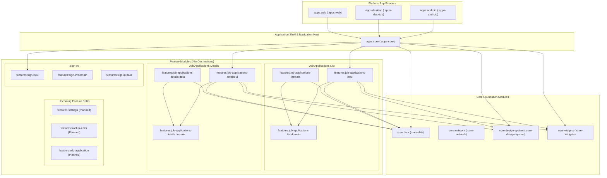

# Architecture Plan: Repackaging shared into apps/core & Job Applications Modularization

**Status:** Completed  
**Date:** 2026-11-04  
**Target:** ui/kmp:apps:core, ui/kmp:features  
**Author:** Antigravity  

---

## 1. Executive Summary & Goals

This plan coordinates two major architectural refactoring tasks in tandem for the KMP Job Tracker:

1. **Relocating Job Application Features (`features-job-applications-[list|details]`)**:
   - Extracting all list and detail UI, domain use cases, and data implementations out of `shared` and relocating them into dedicated multiplatform feature modules:
     - `features/job-applications-list/{ui, domain, data}`
     - `features/job-applications-details/{ui, domain, data}`
   - Decoupling all business logic, ViewModel state, and UI components from the application shell.
2. **Repackaging `shared` into `apps/core` (`:apps-core`)**:
   - Retiring the monolithic `shared` module and placing the shared application coordinator into `apps/core` (`:apps-core`), auto-discovered by the `apps` project collection.
   - Stripping `apps:core` down to its leanest form: a pure application shell, global navigation host (`NavigationState.kt`, `BackHandler`), composite DI root (`KoinModule.kt`), and theme host.
   - Structuring `apps:core` so that **every top-level `NavDestination`** is modeled as a decoupled feature destination. (Treating upcoming feature splits—`features/settings`, `features/tracker-edits`, `features/add-application`—as planned modular destinations).
3. **Continuous Testing Strategy**:
   - Establishing a continuous test daemon and tiered test harness across `core-data`, feature modules, and `apps-core` to ensure zero regressions during every step of relocation.

---

## 2. Target Dependency & Architectural Topology



---

## 3. Package & File Migration Matrix

### 3.1. Foundation Data & Models -> Relocated to `core/data` (`:core-data`)
To completely eliminate circular dependencies between features and `apps:core`, all shared entities, repository contracts, and base data sources reside in `core/data`:

| Source in `shared/` | Destination in `core/data/` | Target Package |
|---|---|---|
| `data/model/JobApplication.kt` | `src/commonMain/.../model/JobApplication.kt` | `dev.fnc314.tools.jobtracker.core.data.model` |
| `data/model/TrackerFit.kt` | `src/commonMain/.../model/TrackerFit.kt` | `dev.fnc314.tools.jobtracker.core.data.model` |
| `data/model/Enums.kt` | `src/commonMain/.../model/Enums.kt` | `dev.fnc314.tools.jobtracker.core.data.model` |
| `data/model/Compensation.kt` | `src/commonMain/.../model/Compensation.kt` | `dev.fnc314.tools.jobtracker.core.data.model` |
| `data/model/TrackerCounts.kt` | `src/commonMain/.../model/TrackerCounts.kt` | `dev.fnc314.tools.jobtracker.core.data.model` |
| `data/model/TrackerArtifact.kt` | `src/commonMain/.../model/TrackerArtifact.kt` | `dev.fnc314.tools.jobtracker.core.data.model` |
| `domain/repository/JobApplicationRepository.kt` | `src/commonMain/.../repository/JobApplicationRepository.kt` | `dev.fnc314.tools.jobtracker.core.data.repository` |
| `domain/repository/StorageRepository.kt` | `src/commonMain/.../repository/StorageRepository.kt` | `dev.fnc314.tools.jobtracker.core.data.repository` |
| `domain/repository/TrackerEditsRepository.kt` | `src/commonMain/.../repository/TrackerEditsRepository.kt` | `dev.fnc314.tools.jobtracker.core.data.repository` |
| `domain/UseCase.kt` | `src/commonMain/.../domain/UseCase.kt` | `dev.fnc314.tools.jobtracker.core.data.domain` |
| `di/Factory.kt` | `src/commonMain/.../factory/Factory.kt` | `dev.fnc314.tools.jobtracker.core.data.factory` |
| `data/firestore/FirestoreJobApplicationRepository.kt` | `src/commonMain/.../repository/FirestoreJobApplicationRepository.kt` | `dev.fnc314.tools.jobtracker.core.data.repository` |
| `data/firestore/JVMJobApplicationRepository.kt` | `src/jvmMain/.../repository/JVMJobApplicationRepository.kt` | `dev.fnc314.tools.jobtracker.core.data.repository` |
| `di/AndroidFirestoreJobApplicationRepository.kt` | `src/androidMain/.../repository/AndroidFirestoreJobApplicationRepository.kt` | `dev.fnc314.tools.jobtracker.core.data.repository` |

---

### 3.2. List Feature -> Relocated to `features/job-applications-list/`

#### A. Domain (`features/job-applications-list/domain`)
- **Package:** `dev.fnc314.tools.jobtracker.features.jobapplicationslist.domain`
- **Files:**
  - `LoadAllJobApplicationsUseCase.kt`
  - `FilterJobApplicationsUseCase.kt`
  - `SortJobApplicationsUseCase.kt`

#### B. Data (`features/job-applications-list/data`)
- **Package:** `dev.fnc314.tools.jobtracker.features.jobapplicationslist.data`
- **Files:**
  - `LoadAllJobApplicationsUseCaseImpl.kt`
  - `FilterJobApplicationsUseCaseImpl.kt`
  - `SortJobApplicationsUseCaseImpl.kt`
  - `JobApplicationsListDataModule.kt` (Koin definitions for list use cases)

#### C. UI (`features/job-applications-list/ui`)
- **Package:** `dev.fnc314.tools.jobtracker.features.jobapplicationslist.ui`
- **Files:**
  - `JobApplicationsListScreen.kt`
  - `JobApplicationsListViewModel.kt`
  - `component/JobApplicationRow.kt`
  - `component/SortMenu.kt`
  - `component/FilterMenu.kt`
  - `component/FilterChip.kt`
  - `util/SemanticTimestampFormatter.kt`

---

### 3.3. Details Feature -> Relocated to `features/job-applications-details/`

#### A. Domain (`features/job-applications-details/domain`)
- **Package:** `dev.fnc314.tools.jobtracker.features.jobapplicationsdetails.domain`
- **Files:**
  - `LoadJobApplicationUseCase.kt`
  - `UpdateApplicationStatusUseCase.kt`
  - `UpdateFitScoreUseCase.kt`
  - `RecordEventUseCase.kt`
  - `GetArtifactSignedUrlUseCase.kt`
  - `LoadCompaniesUseCase.kt`

#### B. Data (`features/job-applications-details/data`)
- **Package:** `dev.fnc314.tools.jobtracker.features.jobapplicationsdetails.data`
- **Files:**
  - `LoadJobApplicationUseCaseImpl.kt`
  - `UpdateApplicationStatusUseCaseImpl.kt`
  - `UpdateFitScoreUseCaseImpl.kt`
  - `RecordEventUseCaseImpl.kt`
  - `GetArtifactSignedUrlUseCaseImpl.kt`
  - `LoadCompaniesUseCaseImpl.kt`
  - `JobApplicationsDetailsModule.kt` (Koin definitions for details use cases)

#### C. UI (`features/job-applications-details/ui`)
- **Package:** `dev.fnc314.tools.jobtracker.features.jobapplicationsdetails.ui`
- **Files:**
  - `JobApplicationDetailScreen.kt`
  - `JobApplicationDetailViewModel.kt`
  - `DetailDialogs.kt` (`UpdateStatusDialog`, `RecordEventDialog`, `UpdateFitScoreDialog`, `MarkdownPreviewDialog`, `EventDetailDialog`)
  - `component/ArtifactsList.kt`
  - `component/EventsTimeline.kt`

---

### 3.4. App Shell & Coordinator -> Relocated to `apps/core` (`:apps-core`)
- **Location:** `apps/core/`
- **Gradle Accessor:** `projects.appsCore`
- **Package:** `dev.fnc314.tools.jobtracker.apps.core`
- **Namespace:** `dev.fnc314.tools.jobtracker.apps.core`
- **Role:** Pure application shell and router coordinating feature destinations:
  - `App.kt`: Root Composable routing between `NavDestination`s (Sign-In, List, Details, Settings, Edits, Add).
  - `navigation/NavigationState.kt`: Back stack & destination definitions.
  - `navigation/BackHandler.*.kt`: Multiplatform back dispatchers.
  - `di/KoinModule.kt`: Root dependency injection graph assembling `jobApplicationsListModule`, `jobApplicationsDetailsModule`, `signInModule`, and platform repositories.
  - `di/PlatformRepository.*.kt`: Platform DI factory bindings.
  - Transitional top-level destination screens (`SettingsScreen`, `TrackerEditsScreen`, `AddJobApplicationScreen`, `AddLeadScreen`) isolated cleanly as prospective candidates for the next feature-split phase.
  - Reusable badges (`StatusBadge.kt`, `FitBadge.kt`) maintained in `core:widgets` or `apps:core`.

---

## 4. Phased Execution Roadmap

### Phase 1: Test Daemon & Pre-Flight Baseline
- [x] Initialize continuous test monitoring daemon.
- [x] Verify baseline tests pass (`:shared:jvmTest`, `:core-data:test`).

### Phase 2: Relocate Foundation Data & Entities to `core/data`
- [x] Move entity models (`JobApplication`, `TrackerFit`, `Enums`, etc.) from `shared` to `core/data`.
- [x] Move repository interfaces (`JobApplicationRepository`, etc.) and `Factory.kt` to `core/data`.
- [x] Move platform Firestore repositories to `core/data`.
- [x] Validate compilation: `./gradlew :core-data:assemble`.

### Phase 3: Relocate `features-job-applications-list`
- [x] Populate `features/job-applications-list/domain`: move list use cases and contracts.
- [x] Populate `features/job-applications-list/data`: move usecase implementations and register `jobApplicationsListModule`.
- [x] Populate `features/job-applications-list/ui`: move `JobApplicationsListScreen`, `JobApplicationsListViewModel`, and components.
- [x] Validate compilation: `./gradlew :features-job-applications-list-ui:assemble`.

### Phase 4: Relocate `features-job-applications-details`
- [x] Populate `features/job-applications-details/domain`: move detail use cases and contracts.
- [x] Populate `features/job-applications-details/data`: move implementations and register `jobApplicationsDetailsModule`.
- [x] Populate `features/job-applications-details/ui`: move `JobApplicationDetailScreen`, `JobApplicationDetailViewModel`, dialogs, and components.
- [x] Validate compilation: `./gradlew :features-job-applications-details-ui:assemble`.

### Phase 5: Create `apps/core` & Retire `shared`
- [x] Create `apps/core/build.gradle.kts` with dependencies on `core-data`, `core-design-system`, `core-widgets`, `features-sign-in-ui`, `features-job-applications-list-ui`, and `features-job-applications-details-ui`.
- [x] Move `App.kt`, `NavigationState.kt`, `BackHandler`, and root `KoinModule.kt` into `apps/core`.
- [x] Update `settings.gradle.kts`: remove `include(":shared")` (`apps/core` is auto-included as `:apps-core` by `registerProjectCollection("apps")`).
- [x] Update `apps/android/build.gradle.kts`, `apps/desktop/build.gradle.kts`, and `apps/web/build.gradle.kts` to depend on `projects.appsCore`.
- [x] Delete retired `shared/` directory.

### Phase 6: Full Verification & Sanity Check
- [x] Run full test suites across all modules (`:apps-core:jvmTest`, `:core-data:test`, etc.).
- [x] Build `:apps-android:assembleDebug` and `:apps-desktop:assemble`.
- [x] Verify clean git status and zero broken dependencies.

---

## 5. Constantly Running Test Strategy

To guarantee that breaking changes, missing imports, or circular dependencies are immediately caught during relocation:

### Tier 1: Continuous Background Test Daemon (Active File Watcher)
Run Gradle in continuous watch mode (`-t` / `--continuous`) targeting the active test suites:
```bash
./gradlew --continuous \
    :core-data:jvmTest \
    :features-job-applications-list-domain:jvmTest \
    :features-job-applications-details-domain:jvmTest \
    :shared:jvmTest
```
*(Transitioning to `:apps-core:jvmTest` once Phase 5 completes).*

### Tier 2: Incremental Domain & UI Test Harness
Unit tests run on JVM without launching Android emulators or desktop windows, providing sub-2-second feedback:
1. **Model & Serialization Tests**: Verify `JobApplication` and `TrackerFit` mapping in `core:data`.
2. **List Sorting & Filtering Tests**: Verify `SortJobApplicationsUseCase` and `FilterJobApplicationsUseCase` in `features:job-applications-list:domain`.
3. **Details Scoring & Status Tests**: Verify `UpdateFitScoreUseCase` and `UpdateApplicationStatusUseCase` in `features:job-applications-details:domain`.

### Tier 3: Binary Compilation Gates
Before declaring any phase complete, compile all entry points:
```bash
./gradlew \
    :apps-core:assemble \
    :features-job-applications-list-ui:assemble \
    :features-job-applications-details-ui:assemble \
    :apps-android:assembleDebug \
    :apps-desktop:assemble
```
