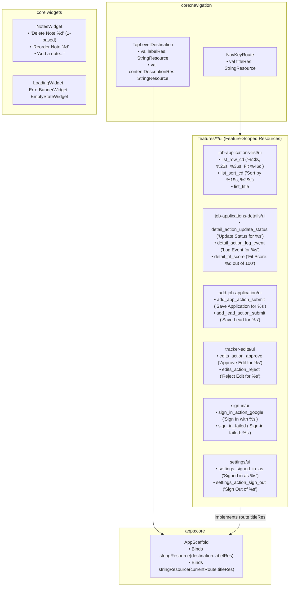

# Architecture Plan: Complete Compose Resources Migration

**Status:** Completed  
**Date:** 2026-11-05  
**Target:** ui/kmp:core:design-system, ui/kmp:features  

---

## Goal Description
Eradicate all hardcoded string literals across the presentation layer (`@Composable` functions, tooltips, dialogs, button labels, content descriptions, and form placeholders) by migrating static and template UI text into Compose Multiplatform `composeResources` (`values/strings.xml`).

Dynamic data (such as company names, dates, email addresses, and status badges) will be formatted into rich localized template strings fed from `*UiModel`s. All scaffold, navigational, and state strings will be accessed via `stringResource(Res.string.<key>, ...)`.

---

## User Review Required

> [!IMPORTANT]
> **Contextual Action Strings (Target-Paired)**:
> In accordance with user guidance, action verbs will NOT be dumped into generic global buckets (e.g. no bare "Save" or "Edit"). Actions are paired with the entity being acted upon (e.g., `"Save %s Job Application"`, `"Approve Edit for %s"`). Resources will be defined locally in the feature where the action occurs.

> [!IMPORTANT]
> **NotesWidget 1-Based Index Announcements**:
> Accessibility announcements and content descriptions in `NotesWidget` will include the 1-based index of the note for deletion/commit (e.g., `"Delete Note 1"`, `"Delete Note 4"`, `"Commit Note 2"`). For reordering, announcements will explicitly specify both the "from" and "to" 1-based positions (e.g., `"Move Note %1$d to position %2$d"`).

> [!IMPORTANT]
> **Route-Driven Navigation Resources (`NavKeyRoute`)**:
> `apps/core` will not hardcode destination titles or bottom-bar labels. Instead, `NavKeyRoute` and `TopLevelDestination` in `core:navigation` will declare `titleRes`, `labelRes`, and `contentDescriptionRes` (`StringResource`), with each feature providing its own localized resource.

> [!NOTE]
> **Reusable State Widgets in `core:widgets`**:
> Instead of storing orphan state strings in common, `core:widgets` will introduce cohesive state widgets (`LoadingWidget`, `ErrorBannerWidget`, `EmptyStateWidget`) that encapsulate their own UI representation and localized default strings.

---

## Resource Layout & Architecture



Each module defines a canonical `packageOfResClass`:
- `core:widgets`: `dev.fnc314.tools.jobtracker.core.widgets.generated.resources` (`publicResClass = true`)
- `features:job-applications-list:ui`: `dev.fnc314.tools.jobtracker.features.jobapplicationslist.ui.generated.resources`
- `features:job-applications-details:ui`: `dev.fnc314.tools.jobtracker.features.jobapplicationsdetails.ui.generated.resources`
- `features:add-job-application:ui`: `dev.fnc314.tools.jobtracker.features.addjobapplication.ui.generated.resources`
- `features:tracker-edits:ui`: `dev.fnc314.tools.jobtracker.features.trackeredits.ui.generated.resources`
- `features:sign-in:ui`: `dev.fnc314.tools.jobtracker.features.signin.ui.generated.resources`
- `features:settings:ui`: `dev.fnc314.tools.jobtracker.features.settings.ui.generated.resources`

---

## Proposed Changes by Component

### 1. `core:navigation` StringResource Contracts

#### [MODIFY] `core/navigation/src/commonMain/kotlin/dev/fnc314/tools/jobtracker/core/navigation/NavKey.kt`
- Add `titleRes: StringResource` to `NavKeyRoute`:
  ```kotlin
  public interface NavKeyRoute {
      public val titleRes: StringResource
  }
  ```

#### [MODIFY] `core/navigation/src/commonMain/kotlin/dev/fnc314/tools/jobtracker/core/navigation/TopLevelDestination.kt`
- Update properties to `StringResource`:
  ```kotlin
  public interface TopLevelDestination {
      public val route: NavKeyRoute
      public val labelRes: StringResource
      public val selectedIcon: ImageVector
      public val unselectedIcon: ImageVector
      public val contentDescriptionRes: StringResource
      ...
  }
  ```

---

### 2. `core:widgets` State Widgets & Notes Accessibility

#### [NEW] `core/widgets/src/commonMain/composeResources/values/strings.xml`
```xml
<resources>
    <!-- NotesWidget Localized Resources -->
    <string name="notes_default_label">Notes</string>
    <string name="notes_placeholder_add">Add a note…</string>
    <string name="notes_label_note">Note %d</string>
    <string name="notes_cd_delete">Delete Note %d</string>
    <string name="notes_cd_reorder">Move Note %1$d to position %2$d</string>
    <string name="notes_cd_commit">Commit Note %d</string>

    <!-- State Widgets Resources -->
    <string name="widget_loading_default">Loading…</string>
    <string name="widget_error_default">An unexpected error occurred</string>
    <string name="widget_retry_action">Retry</string>
</resources>
```

#### [NEW] `core/widgets/.../LoadingWidget.kt`, `ErrorBannerWidget.kt`, `EmptyStateWidget.kt`
- Encapsulate common state layouts into reusable widgets using `core:widgets` resources.

#### [MODIFY] `NotesWidget.kt`
- Pass 1-based indices into content descriptions and text labels:
  - `stringResource(Res.string.notes_cd_delete, index + 1)`
  - `stringResource(Res.string.notes_cd_reorder, fromIndex + 1, toIndex + 1)`
  - `stringResource(Res.string.notes_cd_commit, index + 1)`

---

### 3. `features/sign-in/ui`

#### [NEW] `features/sign-in/ui/src/commonMain/composeResources/values/strings.xml`
```xml
<resources>
    <string name="sign_in_route_title">Sign In</string>
    <string name="sign_in_app_title">Job Application Tracker</string>
    <string name="sign_in_subtitle">Track and manage your job applications</string>
    <string name="sign_in_progress">Signing in…</string>
    <string name="sign_in_failed">Sign-in failed: %s</string>
    <string name="sign_in_action">Sign In with %s</string>
    <string name="sign_in_provider_google">Google</string>
    <string name="sign_in_action_retry">Try Again</string>
</resources>
```

#### [MODIFY] `SignInScreen.kt` & `SignInNavigation.kt`
- `SignInRoute.titleRes = Res.string.sign_in_route_title`.
- Use `stringResource(Res.string.sign_in_action, stringResource(Res.string.sign_in_provider_google))`.

---

### 4. `features/settings/ui`

#### [NEW] `features/settings/ui/src/commonMain/composeResources/values/strings.xml`
```xml
<resources>
    <string name="settings_route_title">Settings</string>
    <string name="settings_cd_back">Navigate back</string>
    <string name="settings_section_appearance">Appearance &amp; Theme</string>
    <string name="settings_theme_mode">Theme Mode</string>
    <string name="settings_theme_system">System</string>
    <string name="settings_theme_light">Light</string>
    <string name="settings_theme_dark">Dark</string>
    <string name="settings_section_seed_color">Seed Color</string>
    <string name="settings_seed_custom_hex">Custom Seed Hex</string>
    <string name="settings_seed_hex_placeholder">#2F5597</string>
    <string name="settings_section_account">Account</string>
    <string name="settings_signed_in_as">Signed in as %s</string>
    <string name="settings_account_anonymous">Signed in</string>
    <string name="settings_action_sign_out">Sign Out of %s</string>
</resources>
```

#### [MODIFY] `SettingsScreen.kt` & `SettingsNavigation.kt`
- `SettingsRoute.titleRes = Res.string.settings_route_title`.
- Bind template strings: `stringResource(Res.string.settings_signed_in_as, model.displayName)`.

---

### 5. `features/job-applications-list/ui`

#### [NEW] `features/job-applications-list/ui/src/commonMain/composeResources/values/strings.xml`
```xml
<resources>
    <string name="list_route_title">Job Applications</string>
    <string name="list_nav_label">Applications</string>
    <string name="list_nav_cd">Job Applications</string>
    <string name="list_empty_title">No job applications found</string>
    <string name="list_empty_subtitle">Try adjusting your filters or search term.</string>
    <string name="list_action_add_application">Add Application</string>
    <string name="list_action_add_lead">Add Lead</string>
    <string name="list_action_edits">Pending Edits</string>
    <string name="list_action_settings">Settings</string>
    <string name="list_action_refresh">Refresh Applications</string>
    <string name="list_filter_tooltip">Filter applications by status and age</string>
    <string name="list_sort_tooltip">Change sorting column and order</string>
    <string name="list_sort_title">Sort Applications</string>
    <string name="list_sort_cd">Sort by %1$s, %2$s</string>
    <string name="list_sort_col_created">Created At</string>
    <string name="list_sort_col_updated">Updated At</string>
    <string name="list_sort_col_company">Company</string>
    <string name="list_sort_col_status">Status</string>
    <string name="list_sort_col_fit">Fit Score</string>
    <string name="list_sort_col_role">Role</string>
    <string name="list_sort_order_asc">Ascending (Oldest first / A → Z)</string>
    <string name="list_sort_order_desc">Descending (Newest first / Z → A)</string>
    <string name="list_filter_status_title">Filter by Status</string>
    <string name="list_filter_age_title">Filter by Age</string>
    <string name="list_filter_reset">Reset Filters</string>
    <string name="list_row_cd">%1$s, %2$s, %3$s%4$s</string>
    <string name="list_row_fit_segment">, Fit %d</string>
    <string name="list_row_click_cd">View details for %s</string>
</resources>
```

#### [MODIFY] `JobApplicationsListScreen.kt`, `SortMenu.kt`, `FilterMenu.kt`, `JobApplicationRow.kt`, `JobApplicationsListNavigation.kt`
- `ListRoute.titleRes = Res.string.list_route_title`.
- Use template strings: `stringResource(Res.string.list_row_click_cd, model.companyName)`.

---

### 6. `features/job-application-details/ui`

#### [NEW] `features/job-application-details/ui/src/commonMain/composeResources/values/strings.xml`
```xml
<resources>
    <string name="detail_route_title">Application Details</string>
    <string name="detail_section_summary">Summary</string>
    <string name="detail_section_timeline">Timeline</string>
    <string name="detail_section_notes">Notes</string>
    <string name="detail_section_artifacts">Artifacts</string>
    <string name="detail_action_update_status">Update Status for %s</string>
    <string name="detail_action_record_event">Log Event for %s</string>
    <string name="detail_action_update_fit">Update Fit Rating for %s</string>
    <string name="detail_link_job">Job Description</string>
    <string name="detail_link_application">Application Portal</string>
    <string name="detail_fit_score_template">Fit Score: %d / 100</string>
    <string name="detail_empty_timeline">No timeline events recorded for %s</string>
    <string name="detail_empty_artifacts">No artifacts attached</string>
    <string name="dialog_update_status_title">Update Status for %s</string>
    <string name="dialog_update_status_date_label">Effective Date</string>
    <string name="dialog_update_status_note_label">Notes (Optional)</string>
    <string name="dialog_record_event_title">Log Event for %s</string>
    <string name="dialog_record_event_type_label">Event Type</string>
    <string name="dialog_record_event_notes_label">Event Notes</string>
    <string name="dialog_update_fit_title">Update Fit Rating for %s</string>
    <string name="dialog_update_fit_score_label">Fit Score (0–100)</string>
    <string name="dialog_action_save">Save Changes for %s</string>
</resources>
```

#### [MODIFY] `JobApplicationDetailsScreen.kt`, `DetailDialogs.kt`, `EventsTimeline.kt`, `ArtifactsList.kt`, `JobApplicationDetailsNavigation.kt`
- `DetailRoute.titleRes = Res.string.detail_route_title`.
- Bind target-paired actions: `stringResource(Res.string.detail_action_update_status, model.companyName)`.

---

### 7. `features/add-job-application/ui`

#### [NEW] `features/add-job-application/ui/src/commonMain/composeResources/values/strings.xml`
```xml
<resources>
    <string name="add_app_route_title">Add Application</string>
    <string name="add_app_company_label">Company *</string>
    <string name="add_app_role_label">Role *</string>
    <string name="add_app_sector_label">Sector</string>
    <string name="add_app_role_type_label">Role Type</string>
    <string name="add_app_work_mode_label">Work Mode</string>
    <string name="add_app_channel_label">Channel</string>
    <string name="add_app_status_label">Status</string>
    <string name="add_app_job_url_label">Job Description URL</string>
    <string name="add_app_app_url_label">Application (ATS) URL</string>
    <string name="add_app_job_id_label">Job ID</string>
    <string name="add_app_location_label">Location</string>
    <string name="add_app_tags_label">Tags (comma-separated)</string>
    <string name="add_app_action_submit_empty">Save Application</string>
    <string name="add_app_action_submit_with_company">Save Application for %s</string>
    <string name="add_app_error_company_required">Company name is required</string>
    <string name="add_app_error_role_required">Role title is required</string>

    <string name="add_lead_route_title">Add Lead</string>
    <string name="add_lead_contact_email_label">Recruiter / Contact Email</string>
    <string name="add_lead_action_submit_empty">Save Lead</string>
    <string name="add_lead_action_submit_with_company">Save Lead for %s</string>
</resources>
```

#### [MODIFY] `AddJobApplicationScreen.kt`, `AddLeadScreen.kt`, `AddJobApplicationNavigation.kt`
- `AddApplicationRoute.titleRes = Res.string.add_app_route_title`.
- `AddLeadRoute.titleRes = Res.string.add_lead_route_title`.
- Dynamically format submit button: if company is entered, `"Save Application for Acme Corp"`, else `"Save Application"`.

---

### 8. `features/tracker-edits/ui`

#### [NEW] `features/tracker-edits/ui/src/commonMain/composeResources/values/strings.xml`
```xml
<resources>
    <string name="edits_route_title">Pending Edits</string>
    <string name="edits_nav_label">Pending Edits</string>
    <string name="edits_empty">No pending edits to review</string>
    <string name="edits_action_approve">Approve Edit for %s</string>
    <string name="edits_action_reject">Reject Edit for %s</string>
    <string name="edits_action_expire_stale">Expire Stale Edits</string>
    <string name="edits_dialog_reject_title">Reject Edit for %s</string>
    <string name="edits_dialog_reject_reason">Reason for rejection (Optional)</string>
</resources>
```

#### [MODIFY] `TrackerEditsScreen.kt`, `TrackerEditsNavigation.kt`
- `EditsRoute.titleRes = Res.string.edits_route_title`.
- Action buttons display entity-paired labels: `stringResource(Res.string.edits_action_approve, item.companyName)`.

---

### 9. `apps:core` Scaffold & Navigation Decoupling

#### [MODIFY] `apps/core/src/commonMain/kotlin/dev/fnc314/tools/jobtracker/ui/AppScaffold.kt`
- Replace hardcoded `when` title block with dynamic route lookup:
  ```kotlin
  val currentRoute = when {
      isListSelected -> ListRoute
      isDetailSelected -> DetailRoute
      isAddAppSelected -> AddApplicationRoute
      isAddLeadSelected -> AddLeadRoute
      isEditsSelected -> EditsRoute
      isSettingsSelected -> SettingsRoute
      else -> ListRoute
  }
  val title = stringResource(currentRoute.titleRes)
  ```
- Top-level destinations bind `stringResource(destination.labelRes)` and `stringResource(destination.contentDescriptionRes)`.
- Global content descriptions (`app_cd_search`, `app_cd_calendar`, `app_cd_navigate_back`) accessed via `apps:core` strings.

---

## Verification Plan

### Automated Tests
1. **Metadata & Resource Generation Compilation**:
   ```bash
   mise exec -- ./gradlew compileCommonMainKotlinMetadata
   ```
2. **UI & Domain Unit Tests**:
   ```bash
   mise exec -- ./gradlew :core-widgets:jvmTest :features-sign-in-ui:jvmTest :features-settings-ui:jvmTest :features-tracker-edits-ui:jvmTest :features-job-applications-list-ui:jvmTest :features-job-applications-details-ui:jvmTest
   ```
3. **Android Target Build (Primary Focus)**:
   ```bash
   mise exec -- ./gradlew :apps-android:assembleDebug
   ```

### Manual Verification
- Deploy/run Android debug build (`mise run ui:kmp:android:assemble`):
  1. Verify the navigation bar and top app bar display route titles dynamically through `route.titleRes`.
  2. In `NotesWidget`, verify that talkback/screen readers announce 1-based indices (e.g. "Delete Note 1", "Delete Note 4").
  3. Verify that action buttons display their paired targets (e.g. "Save Application for Acme Corp", "Approve Edit for Acme Corp", "Sign Out of user@example.com").
  4. Verify that empty states and error banners use the unified state widgets.
