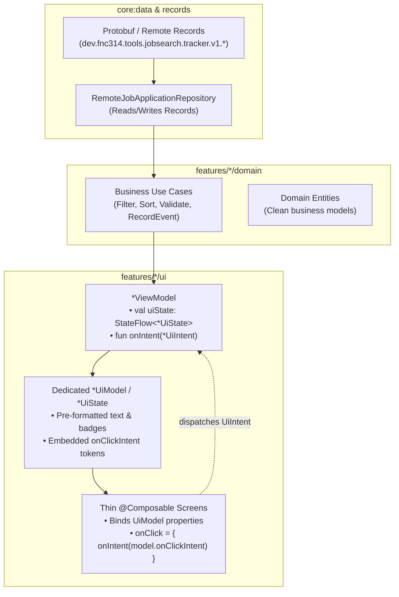

# Architecture Plan: DataSource Abstraction, UI Model Separation, & Strict MVI

**Status:** Completed  
**Date:** 2026-11-05  
**Target:** ui/kmp:features, ui/kmp:core:data  

---

## Goal Description
Modernize the UI and presentation layer across all KMP modules in `ui/kmp` by:
1. **Decoupling Data Layer from UI**: Completely separating DataSource/Record models (driven by `.proto` and backend storage contracts in `core:data`) from Domain entities (`features/*/domain`) and dedicated UI display models (`features/*/ui`). The UI will **never** consume DataSource/Remote models directly.
2. **Thinning Composables**: Transforming all `@Composable` functions into passive rendering trees that merely bind pre-formatted, `@Immutable` UI data classes containing embedded typed `*UiIntent`s.
3. **Strict MVI Protocol**: Refactoring all 7 `*ViewModel`s to expose exactly one `StateFlow<*UiState>` and consume actions through a single `onIntent(intent: *UiIntent)` method, with zero superfluous public methods or properties.
4. **Navigation via State**: Modeling navigation transitions within dedicated `*UiState` branches handled at the screen lifecycle boundary.



---

## User Review Required

> [!IMPORTANT]
> **Single ViewModel Entry Point (`onIntent`)**: Every existing public method on ViewModels (e.g. `setFilter()`, `setSort()`, `refresh()`, `loadApplication()`, `updateCompany()`, `submit()`) is eliminated. All external invocations will go through `viewModel.onIntent(...)`.

> [!IMPORTANT]
> **Zero Direct DataSource Models in UI**: Composable functions will take dedicated UI models (`JobApplicationItemUiModel`, `JobApplicationDetailUiModel`, `AddJobApplicationFormUiModel`, etc.) rather than `JobApplication` or `TrackerEvent`. All timestamps, badges, and labels will be pre-formatted before hitting the Compose tree.

> [!NOTE]
> **Execution Strategy**: Once approved, each of the 6 features will be implemented and verified in parallel using feature-scoped sub-agents, followed by a unified build and test suite run.

---

## MVI Core Protocol Invariants

For every feature `X`:
1. **`XUiState` (Sealed Hierarchy)**:
   - Exclusively models the visual state of the screen and any active terminal states (including navigation):
     ```kotlin
     public sealed interface XUiState {
         public data object Loading : XUiState
         public data class Content(public val model: XContentUiModel) : XUiState
         public data class Error(public val message: String) : XUiState
         public data class NavigateTo(public val target: NavKeyRoute) : XUiState
     }
     ```
2. **`XUiIntent` (Sealed Hierarchy)**:
   - Encapsulates every user interaction, lifecycle trigger, and input parameter:
     - Fixed actions (e.g. clicking an item) are modeled as `data object` or parameter-bound `data class` stored directly on the `*UiModel`.
     - Interactive runtime inputs (e.g. typing in a text field, selecting a dropdown) are parameterized `data class` variants (e.g. `data class UpdateCompanyName(val value: String) : AddJobApplicationUiIntent`).
3. **`XViewModel`**:
   - Exactly one public property: `public val uiState: StateFlow<XUiState>`.
   - Exactly one public method: `public fun onIntent(intent: XUiIntent): Unit`.
   - Zero additional public fields, methods, or mutable state leaks.
4. **Thin Composables**:
   - Composable widgets accept `(model: XUiModel, onIntent: (XUiIntent) -> Unit)`.
   - No business logic, no formatters called inside recomposition, no calculations.

---

## Proposed Changes by Feature Area

### 1. `features/job-applications-list`

#### [NEW] `JobApplicationsListUiState.kt`
- Define `sealed interface JobApplicationsListUiState`:
  - `data object Loading : JobApplicationsListUiState`
  - `data class Content(...) : JobApplicationsListUiState` containing:
    - `applications: ImmutableList<JobApplicationItemUiModel>`
    - `statusFilter: TrackerStatus`
    - `ageFilter: FilterJobApplicationsUseCase.ApplicationAge`
    - `sortColumn: SortJobApplicationsUseCase.SortColumn`
    - `sortAscending: Boolean`
    - `isRefreshing: Boolean`
  - `data class Error(val message: String) : JobApplicationsListUiState`
  - `data class NavigateToDetail(val applicationId: String) : JobApplicationsListUiState`
  - `data object NavigateToAddApplication : JobApplicationsListUiState`
  - `data object NavigateToAddLead : JobApplicationsListUiState`
  - `data object NavigateToEdits : JobApplicationsListUiState`
  - `data object NavigateToSettings : JobApplicationsListUiState`

#### [NEW] `JobApplicationsListUiIntent.kt`
- Define `sealed interface JobApplicationsListUiIntent`:
  - `data class SelectApplication(val id: String) : JobApplicationsListUiIntent`
  - `data class ChangeFilter(val status: TrackerStatus, val age: FilterJobApplicationsUseCase.ApplicationAge) : JobApplicationsListUiIntent`
  - `data class ChangeSort(val column: SortJobApplicationsUseCase.SortColumn, val ascending: Boolean) : JobApplicationsListUiIntent`
  - `data object Refresh : JobApplicationsListUiIntent`
  - `data object ClickAddApplication : JobApplicationsListUiIntent`
  - `data object ClickAddLead : JobApplicationsListUiIntent`
  - `data object ClickEdits : JobApplicationsListUiIntent`
  - `data object ClickSettings : JobApplicationsListUiIntent`

#### [NEW] `JobApplicationItemUiModel.kt`
- Pure `@Immutable` presentation model:
  ```kotlin
  @Immutable
  public data class JobApplicationItemUiModel(
      public val id: String,
      public val companyName: String,
      public val roleTitle: String,
      public val locationText: String?,
      public val statusDisplayName: String,
      public val statusBadgeColorHex: String,
      public val fitScoreText: String?,
      public val formattedCreatedDate: String,
      public val onClickIntent: JobApplicationsListUiIntent,
  )
  ```

#### [MODIFY] `JobApplicationsListViewModel.kt`
- Remove all multiple `StateFlow`s (`statusFilter`, `ageFilter`, `sortColumn`, `sortAscending`, `filteredApplications`, `isLoading`, `error`).
- Expose only `val uiState: StateFlow<JobApplicationsListUiState>`.
- Implement `fun onIntent(intent: JobApplicationsListUiIntent)`.
- Convert `JobApplication` domain entities into `JobApplicationItemUiModel` via a private mapper before updating UI state.

#### [MODIFY] `JobApplicationsListScreen.kt` & `JobApplicationRow.kt`
- Update `JobApplicationsListScreen` to collect `uiState` via `val state by viewModel.uiState.collectAsState()`.
- Use a `when (val s = state)` expression:
  - When `Loading`: render loading indicator.
  - When `Error`: render error message with retry intent.
  - When `Content`: render grid/list passing `item` and `viewModel::onIntent`.
  - When `NavigateTo*`: trigger navigation callback once.
- Update `JobApplicationRow` to accept `JobApplicationItemUiModel` and `onIntent: (JobApplicationsListUiIntent) -> Unit`.
- Click handling becomes: `onClick = { onIntent(item.onClickIntent) }`.

---

### 2. `features/job-applications-details`

#### [NEW] `JobApplicationDetailUiState.kt`
- `sealed interface JobApplicationDetailUiState`:
  - `data object Loading : JobApplicationDetailUiState`
  - `data class Content(val model: JobApplicationDetailUiModel) : JobApplicationDetailUiState`
  - `data class Error(val message: String) : JobApplicationDetailUiState`
  - `data object NavigateBack : JobApplicationDetailUiState`

#### [NEW] `JobApplicationDetailUiIntent.kt`
- `sealed interface JobApplicationDetailUiIntent`:
  - `data class Load(val id: String) : JobApplicationDetailUiIntent`
  - `data class UpdateStatus(val newStatus: TrackerStatus) : JobApplicationDetailUiIntent`
  - `data class UpdateFitScore(val newScore: Int) : JobApplicationDetailUiIntent`
  - `data class RecordEvent(val type: TrackerEventType, val notes: String) : JobApplicationDetailUiIntent`
  - `data class OpenArtifact(val artifactId: String) : JobApplicationDetailUiIntent`
  - `data object ClickBack : JobApplicationDetailUiIntent`

#### [NEW] `JobApplicationDetailUiModel.kt`
- Pre-formats company information, timeline badges, artifacts list, and pre-constructed action intents.

#### [MODIFY] `JobApplicationDetailViewModel.kt`
- Expose solely `val uiState: StateFlow<JobApplicationDetailUiState>`.
- Replace all public mutators with `fun onIntent(intent: JobApplicationDetailUiIntent)`.
- Use `viewModelScope` consistently for async operations.

#### [MODIFY] `JobApplicationDetailScreen.kt` & sub-sections
- Clean up `JobApplicationDetailScreen` and sections (`ApplicationSummarySection`, `ApplicationTimelineSection`, `ApplicationNotesSection`) to take explicit UI models rather than raw data classes.

---

### 3. `features/add-job-application`

#### [NEW] `AddJobApplicationUiState.kt` & `AddLeadUiState.kt`
- `sealed interface AddJobApplicationUiState`:
  - `data class Editing(val form: AddJobApplicationFormUiModel) : AddJobApplicationUiState`
  - `data object Submitting : AddJobApplicationUiState`
  - `data class Success(val applicationId: String) : AddJobApplicationUiState`
  - `data class Error(val message: String) : AddJobApplicationUiState`
  - `data object NavigateBack : AddJobApplicationUiState`
- Similar hierarchy for `AddLeadUiState`.

#### [NEW] `AddJobApplicationUiIntent.kt` & `AddLeadUiIntent.kt`
- Interactive intents with parameter inputs:
  - `data class UpdateCompany(val value: String) : AddJobApplicationUiIntent`
  - `data class UpdateRole(val value: String) : AddJobApplicationUiIntent`
  - `data class UpdateWorkMode(val mode: WorkMode) : AddJobApplicationUiIntent`
  - `data class UpdateChannel(val channel: ApplicationChannel) : AddJobApplicationUiIntent`
  - `data class UpdateStatus(val status: TrackerStatus) : AddJobApplicationUiIntent`
  - `data class UpdateNotes(val notes: ImmutableList<String>) : AddJobApplicationUiIntent`
  - `data object Submit : AddJobApplicationUiIntent`
  - `data object ClickBack : AddJobApplicationUiIntent`

#### [MODIFY] `AddJobApplicationViewModel.kt` & `AddLeadViewModel.kt`
- Consolidate all individual `update*` methods into `onIntent(intent)`.
- Single `uiState: StateFlow<*UiState>` property.

#### [MODIFY] `AddJobApplicationScreen.kt` & `AddLeadScreen.kt`
- Binds inputs directly to `onIntent(...)`.

---

### 4. `features/tracker-edits`

#### [NEW] `TrackerEditsUiState.kt` & `TrackerEditsUiIntent.kt`
- `sealed interface TrackerEditsUiState`:
  - `data object Loading : TrackerEditsUiState`
  - `data class Content(val edits: ImmutableList<TrackerEditItemUiModel>, val isActionInProgress: Boolean) : TrackerEditsUiState`
  - `data class Error(val message: String) : TrackerEditsUiState`
  - `data object NavigateBack : TrackerEditsUiState`
- `sealed interface TrackerEditsUiIntent`:
  - `data object Refresh : TrackerEditsUiIntent`
  - `data class ApproveEdit(val id: String, val note: String? = null) : TrackerEditsUiIntent`
  - `data class RejectEdit(val id: String, val note: String? = null) : TrackerEditsUiIntent`
  - `data object ClickBack : TrackerEditsUiIntent`

#### [NEW] `TrackerEditItemUiModel.kt`
- Contains formatted proposed change description, timestamp, and pre-bound `approveIntent` / `rejectIntent`.

#### [MODIFY] `TrackerEditsViewModel.kt` & `TrackerEditsScreen.kt`
- Align to single `uiState` and `onIntent`.

---

### 5. `features/sign-in`

#### [NEW] `SignInUiIntent.kt`
- `sealed interface SignInUiIntent`:
  - `data object ClickSignIn : SignInUiIntent`
  - `data object ClickSignOut : SignInUiIntent`
  - `data object ClearError : SignInUiIntent`

#### [NEW] `UserAccountUiModel.kt`
- Dedicated presentation model for authenticated user (e.g. `displayName`, `email`, `initialsText`).

#### [MODIFY] `SignInViewModel.kt` & `SignInScreen.kt`
- Update `SignInUiState` to use `UserAccountUiModel` rather than `core.data.model.UserAccount`.
- Expose `fun onIntent(intent: SignInUiIntent)` and remove `onSignInClicked()`, `onSignOutClicked()`, `onSignInWithGoogleClicked()`.

---

### 6. `features/settings`

#### [NEW] `SettingsUiState.kt` & `SettingsUiIntent.kt`
- `sealed interface SettingsUiState`:
  - `data class Content(val model: SettingsUiModel) : SettingsUiState`
- `sealed interface SettingsUiIntent`:
  - `data class ChangeTheme(val themeMode: ThemeMode) : SettingsUiIntent`
  - `data class ChangeSeedColor(val hex: String) : SettingsUiIntent`
  - `data object ClickBack : SettingsUiIntent`

#### [MODIFY] `SettingsViewModel.kt` & `SettingsScreen.kt`
- Wrap `AppSettings` into `SettingsUiModel`.
- Single `onIntent(intent: SettingsUiIntent)`.

---

### 7. `core:data` & DataSource Records Alignment

- `core:data` houses the DataSource representation (`*Record` or entity mapping to/from `dev.fnc314.tools.jobsearch.tracker.v1.*`).
- Ensure `RemoteJobApplicationRepository` platform implementations consume protobufs on JVM/Android while maintaining clean multiplatform repository contracts.
- Clear separation: `core:data` models are **never** imported into `features/*/ui`.

---

## Verification Plan

### Automated Tests
1. **Metadata & Explicit API Verification**:
   ```bash
   mise exec -- ./gradlew compileCommonMainKotlinMetadata
   ```
2. **Domain & Data Unit Tests**:
   ```bash
   mise exec -- ./gradlew :core-data:jvmTest :features-sign-in-domain:jvmTest :features-tracker-edits-data:jvmTest :features-job-applications-details-data:jvmTest :features-job-applications-list-domain:jvmTest
   ```
3. **Android Target Build (Primary Focus)**:
   ```bash
   mise exec -- ./gradlew :apps-android:assembleDebug
   ```

### Manual Verification
- Deploy/run Android debug build (`mise run ui:kmp:android:assemble`):
  1. The Job Applications List displays all cards correctly with status badges and fit ratings.
  2. Sorting and filtering chips react instantly through MVI intents.
  3. Clicking a job card triggers navigation to the detail screen via `JobApplicationsListUiState.NavigateToDetail`.
  4. Creating a new job application and lead properly dispatches form intents and returns to the list upon success.
