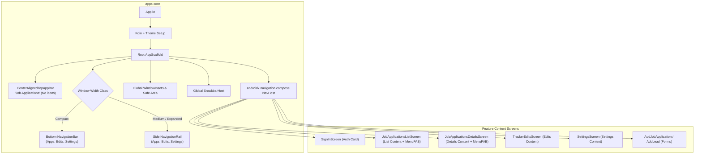

# Architecture Plan: Root Scaffold & Navigation Backstack Enhancement

**Status:** Completed  
**Date:** 2026-11-05  
**Target:** ui/kmp:apps:core, ui/kmp:features  

---

## 1. Executive Summary & Design Decisions

Layout, scaffolding, and navigation responsibilities are being inverted so that `apps-core` serves as the central root orchestrator:
1. **Root `CenterAlignedTopAppBar`**: Clean, centered `"Job Applications"` header with no icons on either side (for now).
2. **Adaptive Navigation Scaffolding**:
   - **Compact width** (Mobile): Bottom `NavigationBar` for primary destinations (`Applications`, `Pending Edits`, `Settings`).
   - **Expanded width** (Desktop / Tablet): Side `NavigationRail` for primary destinations, maximizing horizontal canvas efficiency.
3. **MenuFAB for Screen Actions**:
   - Details screen actions (Update Status, Record Event, Adjust Fit Score) transition from TopAppBar action icons to a dedicated expandable **MenuFAB** (matching the treatment on the Applications List screen).
4. **Type-Safe `androidx.navigation`**:
   - Standardize on `org.jetbrains.androidx.navigation:navigation-compose:2.10.0` with `@Serializable` route contracts.
   - Assemble all feature content screens cleanly inside `apps-core`'s `NavHost`.
5. **Centralized Insets & Safe Area**:
   - Root `Scaffold` manages `safeDrawing` window insets, delivering inner padding to child content to prevent overlaps with system bars or cutouts.

---

## 2. Target Architecture Overview



---

## 3. Detailed Component Design

### A. Root `CenterAlignedTopAppBar` & Header
- **Component:** `CenterAlignedTopAppBar` from Material 3.
- **Title:** `Text("Job Applications", style = MaterialTheme.typography.titleLarge)`.
- **Navigation Icon:** None (`navigationIcon = {}`).
- **Actions:** None (`actions = {}`).
- **Insets:** `TopAppBarDefaults.windowInsets`.

### B. Adaptive Navigation Hierarchy (Rail vs. BottomBar)
Using `LocalWindowSizeClass.current`:
- When `windowWidthSizeClass == WindowWidthSizeClass.Compact`:
  - Show bottom `NavigationBar` with 3 items:
    1. **Applications** (`ListRoute`)
    2. **Pending Edits** (`EditsRoute`)
    3. **Settings** (`SettingsRoute`)
  - Hidden on non-tab routes (`DetailRoute`, `AddApplicationRoute`, `AddLeadRoute`, `SignInRoute`).
- When `windowWidthSizeClass == WindowWidthSizeClass.Medium` or `WindowWidthSizeClass.Expanded`:
  - Show side `NavigationRail` placed on the leading edge beside the main content canvas.
  - Active tab highlighting matches current route in the backstack.

### C. Details Screen `MenuFAB`
On [`JobApplicationsDetailsScreen`](file:///Users/fnc314/Work/Search/waleedtarbosh-ai-job-search/ui/kmp/features/job-application-details/ui/src/commonMain/kotlin/dev/fnc314/tools/jobtracker/features/jobapplicationsdetails/ui/JobApplicationsDetailsScreen.kt):
- Remove `TopAppBar` and its 3 action buttons.
- Introduce an expandable `MenuFAB` in the bottom-right corner:
  - Main FAB: Primary action or Menu toggle (`Icons.Default.Edit` or `Icons.Default.MoreVert`).
  - Speed-dial / Expanded options:
    - **Update Status** (`Icons.Sharp.Notifications`)
    - **Record Event** (`Icons.Sharp.Edit`)
    - **Update Fit Score** (`Icons.Default.Build`)
- Triggers the existing `UpdateStatusDialog`, `RecordEventDialog`, and `UpdateFitScoreDialog`.

### D. Centralized Insets & Safe Area Management
- Root `Scaffold` manages `contentWindowInsets = WindowInsets.safeDrawing`.
- Inner padding `paddingValues` is applied to the root content container using:
  ```kotlin
  Modifier
      .fillMaxSize()
      .padding(paddingValues)
      .consumeWindowInsets(paddingValues)
  ```
- All child feature screens receive clean bounding boxes without needing individual status/navigation bar compensations.

### E. Navigation 2.10.0 Type-Safe Routing
- Replace handwritten `NavigationState.kt` / `Navigator` with standard `androidx.navigation.compose`:
  ```kotlin
  val navController = rememberNavController()

  NavHost(
      navController = navController,
      startDestination = if (isAuthenticated) ListRoute else SignInRoute,
      modifier = Modifier.fillMaxSize()
  ) {
      composable<SignInRoute> {
          SignInScreen(
              viewModel = koinViewModel(),
              onSignInSuccess = {
                  navController.navigate(ListRoute) {
                      popUpTo(SignInRoute) { inclusive = true }
                  }
              }
          )
      }
      composable<ListRoute> {
          JobApplicationsListScreen(...)
      }
      composable<DetailRoute> { backStackEntry ->
          val route: DetailRoute = backStackEntry.toRoute()
          JobApplicationsDetailsScreen(applicationId = route.applicationId, ...)
      }
      composable<AddApplicationRoute> {
          AddJobApplicationScreen(...)
      }
      composable<AddLeadRoute> {
          AddLeadScreen(...)
      }
      composable<EditsRoute> {
          TrackerEditsScreen(...)
      }
      composable<SettingsRoute> {
          SettingsScreen(...)
      }
  }
  ```

---

## 4. Implementation Steps & Sequence

1. **Step 1: Details Screen MenuFAB Transition**
   - Update `JobApplicationsDetailsScreen` in `features/job-application-details/ui` to replace TopAppBar actions with the MenuFAB.
   - Remove internal `TopAppBar` and prepare screen as content layout.

2. **Step 2: Streamline Other Feature Screens**
   - Remove internal `TopAppBar` and redundant `Scaffold` elements from `JobApplicationsListScreen`, `TrackerEditsScreen`, `SettingsScreen`, `AddJobApplicationScreen`, `AddLeadScreen`, and `SignInScreen`.

3. **Step 3: Build Root `AppScaffold` in `apps-core`**
   - Implement `AppScaffold.kt`:
     - `CenterAlignedTopAppBar` with `"Job Applications"`.
     - Adaptive `NavigationRail` (for medium/expanded) and `NavigationBar` (for compact).
     - Global `SnackbarHost`.
     - Proper window insets consumption.

4. **Step 4: Adopt `androidx.navigation.compose` in `apps-core`**
   - Wire up `NavHost` and `rememberNavController()` with `@Serializable` routes.
   - Retire handwritten `NavigationState.kt` (`Navigator`, `NavDisplay`, `entryProvider`).
   - Connect authenticated/unauthenticated routing.

5. **Step 5: Full Build & Test Verification**
   - Run compilation and tests across all targets (`jvmTest`, `apps-android:assembleDebug`, `apps-desktop:assemble`).
