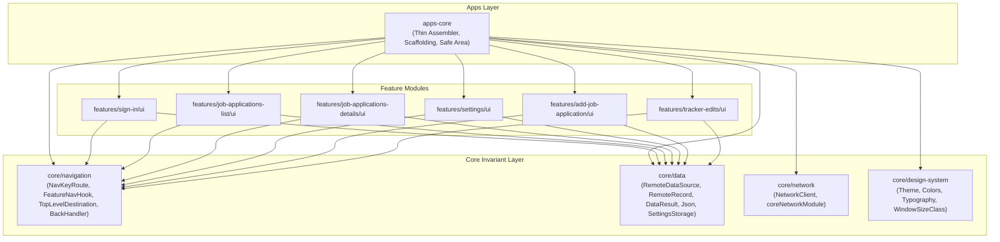

# Implementation Plan: Thinning `apps-core` & Establishing `core/navigation`

## 1. Goal Description & Architectural Principles

The application is transitioning to a strictly decoupled, layered architecture:
1. **Direction of Dependencies**: `core/*` **never** depends on `features/*`. `core` defines invariant, lifecycle-agnostic, and usecase-agnostic entities and infrastructure.
2. **Role of `apps-core`**: `apps-core` is the thin client assembler. It connects the feature modules (`features/*`) and core modules (`core/*`) into a cohesive application, and defines platform app-level responsibilities (such as root safe-area boundaries, status bar styling, and root scaffolding).
3. **Role of `core/navigation`**: Defines invariant navigation contracts (`NavKeyRoute : NavKey`, `FeatureNavigationHook`, `TopLevelDestination`) and multiplatform back-navigation abstractions. Features depend on `core/navigation` to declare their own routes (`*Route : NavKeyRoute`) and provide navigation hooks. `apps-core` consumes these hooks to assemble the final `Nav3` / `Navigation Compose` graph.
4. **Role of `core/data`**: Supplies shared data infrastructure—specifically `RemoteDataSource` (using domain-agnostic `RemoteRecord` and `DataResult`), planning for an offline-first local `Room` caching layer, global `Json` configuration for `kotlinx.serialization`, and persistent `SettingsStorage`. Feature-specific repositories belong inside their respective feature modules.
5. **Role of `core/network`**: Houses HTTP client creation and exports `coreNetworkModule` so `apps-core` and other consumers do not manually instantiate `HttpClient` or depend directly on Ktor.
6. **Code Style Invariants**: **Zero wildcard imports** (`import foo.*` is strictly forbidden) and **zero inline fully qualified names** (explicit top-level imports only).

---

## 2. Review Notes & Solutions

### A. Navigation3 Bundles & Gradle Tools SourceSet Extensions (Addressing L142, L177, L178, L109)
- **`libs.versions.toml`**: Add `navigation3 = ["navigation3-runtime", "navigation3-ui"]`.
- **`KotlinSourceSetExtensions.kt`**:
  - Add internal extension functions/properties on `KotlinMultiplatformExtension` (`commonMain`, `commonTest`, `androidMain`, `jvmMain`, `iosMain`) to eliminate repeated calls across all convention plugins.
  - Add internal helper on `Project`:
    ```kotlin
    internal val Project.kotlinMultiplatform: KotlinMultiplatformExtension
        get() = extensions.getByType(KotlinMultiplatformExtension::class.java)

    internal inline fun Project.kotlinMultiplatform(crossinline configure: KotlinMultiplatformExtension.() -> Unit): Unit {
        extensions.configure(KotlinMultiplatformExtension::class.java) { configure() }
    }
    ```
- **`NavigationDependenciesConventionPlugin.kt`**: Expose `local.dependencies.navigation` in `gradle/tools/project-plugins`. Consuming modules (e.g., `core/navigation`) simply apply this plugin; build scripts do **not** repeat dependencies manually.

### B. `NavKey` & `NavKeyRoute` in Navigation 3 & KMP (Addressing L33, L192, L220, L255)
- **Navigation 3 Multiplatform Compatibility**: As documented in Google AndroidX and Compose Multiplatform guides, Navigation 3 is built from the ground up for Compose and Compose Multiplatform. The foundational artifact is `navigation3-runtime` providing `androidx.navigation3.runtime.NavKey` alongside `navigation3-ui` (`NavDisplay`).
- **Unified Navigation Contract**: In `core/navigation`, we define:
  ```kotlin
  public interface NavKeyRoute : NavKey
  ```
  Where `NavKey` is the core identity contract from Navigation 3.
- **Convention Plugin Integration**: `local.dependencies.navigation` adds the `navigation3` bundle directly into `commonMain` so that all targets (Android, JVM/Desktop, iOS, Web/Wasm) share the exact same Navigation 3 interfaces and type-safe routes.
- Each feature UI module (`features/<name>/ui`) defines its own route contracts implementing `NavKeyRoute` (e.g., `ListRoute : NavKeyRoute`, `DetailRoute(...) : NavKeyRoute`).
- `core/navigation` remains completely agnostic of any specific feature route.

### C. Functional `FeatureNavigationHook` (Addressing L236)
- Define `FeatureNavigationHook` as a functional interface (`fun interface`) with `public operator fun invoke`:
  ```kotlin
  public fun interface FeatureNavigationHook {
      public operator fun invoke(
          navGraphBuilder: NavGraphBuilder,
          navController: NavHostController,
      )
  }
  ```
- Allows SAM lambda instantiation and direct invocable syntax `hook(navGraphBuilder, navController)` when assembling graphs in `apps-core`.

### D. ABI-Stable & Type-Safe `TopLevelDestination` (Addressing L221, L260)
- Expose `TopLevelDestination` as a public `interface` with `val route: NavKeyRoute` (strictly typed, replacing `Any`), with a `companion object.from(...)` factory backed by `internal data class TopLevelDestinationImpl`.
- Prevents leaking `.copy()` and positional destructuring `.componentN()` methods to public consumers, preserving ABI stability.

### E. TopAppBar Design Specification (Reflecting Uploaded Mock)
- In [`AppScaffold.kt`](file:///Users/fnc314/Work/Search/waleedtarbosh-ai-job-search/ui/kmp/apps/core/src/commonMain/kotlin/dev/fnc314/tools/jobtracker/ui/AppScaffold.kt):
  - **Navigation Icon:** When a previous back stack entry exists (or when on a detail/child screen), render a back arrow (`IconButton` with `Icons.AutoMirrored.Filled.ArrowBack`) triggering `navController.popBackStack()`.
  - **Title ("Headline"):** Dynamically displays the current screen title (e.g., "Job Applications", "Application Details", "Pending Edits", "Settings").
  - **Actions:** Trailing action buttons for **Search** (`Icons.Filled.Search`) and **Calendar** (`Icons.Filled.DateRange`).

### F. Eliminating Raw `Any?` and `Unit` in `RemoteDataSource` (Addressing L317, L397)
- Swap provider-specific "Firebase" naming for source-agnostic `Remote*` conventions.
- Introduce `RemoteRecord` to encapsulate document fields and typed accessors, replacing raw `Map<String, Any?>`.
- Introduce `DataResult` (`Success`, `Failure(Throwable)`), replacing raw `Result<Unit>`.
- Define `RemoteDataSource` as the universal remote data contract in `core/data`.

### G. Encapsulating Network in `core/network` (Addressing L382)
- `core/network` defines and exports `coreNetworkModule: Module` providing `HttpClient`.
- `apps-core` includes `coreNetworkModule` in its `appModule` assembly, completely removing Ktor dependencies from `apps-core`.

### H. Multiplatform Navigation & ViewModel Dependency Strategy (Addressing L77)

#### 1. Navigation: `org.jetbrains.androidx.navigation:navigation-compose` vs `androidx.navigation3`
Based on [Kotlin Multiplatform Compose Navigation documentation](https://kotlinlang.org/docs/multiplatform/compose-navigation.html):
- **Selected Dependency**: `org.jetbrains.androidx.navigation:navigation-compose:2.10.0`
- **Why this dependency**:
  1. **Cross-Platform Parity**: `navigation-compose` is the official, stable, multiplatform port maintained by JetBrains with full first-class runtime support across Android, JVM Desktop, iOS, and Web (Wasm/JS).
  2. **Type-Safe Routing**: Full support for Kotlinx Serialization type-safe routes (`composable<Route> { ... }`, `navController.navigate(Route)`), eliminating legacy string-based URLs and unsafe bundles.
  3. **Architectural Fit**: Matches our decoupled `FeatureNavigationHook` design (`navGraphBuilder: NavGraphBuilder, navController: NavHostController`), letting feature modules contribute to the graph while `apps-core` hosts the root `NavHost`.
  4. **Navigation 3 Forward-Compatibility**: By defining `public interface NavKeyRoute` in `core/navigation` and marking all feature routes with it, the route contracts remain completely agnostic. If/when the ecosystem transitions to Navigation 3 (`NavDisplay`), feature route classes require zero contract alterations.

#### 2. ViewModel & Lifecycle: `lifecycle-viewmodel-compose` + `koin-compose-viewmodel`
Based on [Kotlin Multiplatform Compose ViewModel documentation](https://kotlinlang.org/docs/multiplatform/compose-viewmodel.html):
- **Selected Dependencies**:
  - `org.jetbrains.androidx.lifecycle:lifecycle-viewmodel-compose:2.11.0` (in `libs.bundles.androidx.lifecycle.compose`)
  - `org.jetbrains.androidx.lifecycle:lifecycle-runtime-compose:2.11.0` (for `collectAsStateWithLifecycle`)
  - `io.insert-koin:koin-compose-viewmodel:4.2.2` (in `libs.bundles.koin`)
  - `org.jetbrains.kotlinx:kotlinx-coroutines-swing` (in Desktop JVM source set)
- **Why this dependency setup**:
  1. **Unified ViewModel Lifecycle**: JetBrains' `lifecycle-viewmodel-compose` provides standard `androidx.lifecycle.ViewModel` lifecycle retention and scoping across all KMP platforms.
  2. **Desktop Threading Safety**: `kotlinx-coroutines-swing` provides `Dispatchers.Main.immediate` on desktop platforms, ensuring `viewModelScope` coroutines execute safely on the Swing/AWT UI thread.
  3. **Koin Integration**: Feature screens obtain view models using `koinViewModel()`, decoupling screen composables from DI container construction.

---

## 3. Architecture & Dependency Flow



---

## 4. Proposed Changes

### Component 1: `gradle/tools/project-plugins` & Version Catalog

#### [MODIFY] `gradle/libs.versions.toml`
Add `navigation3` bundle:
```toml
[bundles]
navigation3 = [
  "navigation3-runtime",
  "navigation3-ui",
]
```

#### [MODIFY] `gradle/tools/project-plugins/src/main/kotlin/dev/fnc314/tools/jobtracker/kmp/gradle/catalog/CatalogTypes.kt`
Add `NAVIGATION_COMPOSE` to `CatalogTypes.Libraries` and `NAVIGATION3` to `CatalogTypes.Bundles`:
```kotlin
// In CatalogTypes.Libraries:
NAVIGATION_COMPOSE("navigation-compose"),

// In CatalogTypes.Bundles:
NAVIGATION3("navigation3"),
```

#### [NEW] `gradle/tools/project-plugins/src/main/kotlin/dev/fnc314/tools/jobtracker/kmp/gradle/plugins/KotlinSourceSetExtensions.kt`
Define stream-lined sourceSet extensions:
```kotlin
package dev.fnc314.tools.jobtracker.kmp.gradle.plugins

import org.jetbrains.kotlin.gradle.dsl.KotlinMultiplatformExtension
import org.jetbrains.kotlin.gradle.plugin.KotlinSourceSet

internal val KotlinMultiplatformExtension.commonMain: KotlinSourceSet
    get() = sourceSets.getByName("commonMain")

internal fun KotlinMultiplatformExtension.commonMain(configure: KotlinSourceSet.() -> Unit): KotlinSourceSet =
    commonMain.apply(configure)

internal val KotlinMultiplatformExtension.commonTest: KotlinSourceSet
    get() = sourceSets.getByName("commonTest")

internal fun KotlinMultiplatformExtension.commonTest(configure: KotlinSourceSet.() -> Unit): KotlinSourceSet =
    commonTest.apply(configure)

internal val KotlinMultiplatformExtension.androidMain: KotlinSourceSet?
    get() = sourceSets.findByName("androidMain")

internal fun KotlinMultiplatformExtension.androidMain(configure: KotlinSourceSet.() -> Unit) {
    androidMain?.apply(configure)
}

internal val KotlinMultiplatformExtension.jvmMain: KotlinSourceSet?
    get() = sourceSets.findByName("jvmMain")

internal fun KotlinMultiplatformExtension.jvmMain(configure: KotlinSourceSet.() -> Unit) {
    jvmMain?.apply(configure)
}

internal val KotlinMultiplatformExtension.iosMain: KotlinSourceSet?
    get() = sourceSets.findByName("iosMain")

internal fun KotlinMultiplatformExtension.iosMain(configure: KotlinSourceSet.() -> Unit) {
    iosMain?.apply(configure)
}

internal val Project.kotlinMultiplatform: KotlinMultiplatformExtension
    get() = extensions.getByType(KotlinMultiplatformExtension::class.java)

internal inline fun Project.kotlinMultiplatform(crossinline configure: KotlinMultiplatformExtension.() -> Unit): Unit {
    extensions.configure(KotlinMultiplatformExtension::class.java) { configure() }
}
```

#### [NEW] `gradle/tools/project-plugins/src/main/kotlin/dev/fnc314/tools/jobtracker/kmp/gradle/plugins/config/NavigationDependenciesConventionPlugin.kt`
Convention plugin `dev.fnc314.tools.jobtracker.dependencies.navigation` using the streamlined extension helpers:
```kotlin
package dev.fnc314.tools.jobtracker.kmp.gradle.plugins.config

import dev.fnc314.tools.jobtracker.kmp.gradle.catalog.CatalogTypes
import dev.fnc314.tools.jobtracker.kmp.gradle.plugins.BaseConventionPlugin
import dev.fnc314.tools.jobtracker.kmp.gradle.plugins.androidMain
import dev.fnc314.tools.jobtracker.kmp.gradle.plugins.commonMain
import dev.fnc314.tools.jobtracker.kmp.gradle.plugins.kotlinMultiplatform
import org.gradle.api.Plugin
import org.gradle.api.Project

public class NavigationDependenciesConventionPlugin : Plugin<Project>, BaseConventionPlugin {
    override fun apply(target: Project): Unit {
        target.configurePlugin()
    }

    override fun Project.configurePlugin(): Unit {
        kotlinMultiplatform {
            commonMain {
                dependencies {
                    implementation(CatalogTypes.Libraries.KOTLINX_SERIALIZATION_JSON(project))
                    implementation(CatalogTypes.Libraries.NAVIGATION_COMPOSE(project))
                }
            }
        }
    }
}
```

---

### Component 2: `core/navigation` (New Module)

#### [NEW] `core/navigation/build.gradle.kts`
Lean build script utilizing convention plugins without duplicate dependency declarations:
```kotlin
plugins {
    alias(libs.plugins.local.kotlin.multiplatform)
    alias(libs.plugins.local.android.kmp.library)
    alias(libs.plugins.local.compose)
    alias(libs.plugins.local.dependencies.compose)
    alias(libs.plugins.local.dependencies.serialization)
    alias(libs.plugins.local.dependencies.navigation)
}
```

#### [NEW] `core/navigation/src/commonMain/kotlin/dev/fnc314/tools/jobtracker/core/navigation/NavKey.kt`
NavKeyRoute extending the official Navigation 3 `NavKey` in `commonMain`:
```kotlin
package dev.fnc314.tools.jobtracker.core.navigation

import androidx.navigation3.runtime.NavKey

/**
 * App-wide route contract extending Navigation 3 NavKey for destination routes.
 */
public interface NavKeyRoute : NavKey
```

#### [NEW] `core/navigation/src/commonMain/kotlin/dev/fnc314/tools/jobtracker/core/navigation/FeatureNavigationHook.kt`
Feature contribution contract as a functional interface (`fun interface`) with invocable operator:
```kotlin
package dev.fnc314.tools.jobtracker.core.navigation

import androidx.navigation.NavGraphBuilder
import androidx.navigation.NavHostController

public fun interface FeatureNavigationHook {
    public operator fun invoke(
        navGraphBuilder: NavGraphBuilder,
        navController: NavHostController,
    )
}
```

#### [NEW] `core/navigation/src/commonMain/kotlin/dev/fnc314/tools/jobtracker/core/navigation/TopLevelDestination.kt`
ABI-stable interface typed to `NavKeyRoute` with companion factory:
```kotlin
package dev.fnc314.tools.jobtracker.core.navigation

import androidx.compose.ui.graphics.vector.ImageVector

public interface TopLevelDestination {
    public val route: NavKeyRoute
    public val label: String
    public val selectedIcon: ImageVector
    public val unselectedIcon: ImageVector
    public val contentDescription: String

    public companion object {
        public fun from(
            route: NavKeyRoute,
            label: String,
            selectedIcon: ImageVector,
            unselectedIcon: ImageVector,
            contentDescription: String,
        ): TopLevelDestination = TopLevelDestinationImpl(
            route = route,
            label = label,
            selectedIcon = selectedIcon,
            unselectedIcon = unselectedIcon,
            contentDescription = contentDescription,
        )
    }
}

internal data class TopLevelDestinationImpl(
    override val route: NavKeyRoute,
    override val label: String,
    override val selectedIcon: ImageVector,
    override val unselectedIcon: ImageVector,
    override val contentDescription: String,
) : TopLevelDestination
```

#### [NEW] `core/navigation/src/commonMain/kotlin/dev/fnc314/tools/jobtracker/core/navigation/BackHandler.kt`
Multiplatform back handler declaration:
```kotlin
package dev.fnc314.tools.jobtracker.core.navigation

import androidx.compose.runtime.Composable

@Composable
public expect fun BackHandler(enabled: Boolean = true, onBack: () -> Unit)
```

#### [NEW] Platform BackHandler Actuals
- `androidMain`: hooks into `androidx.activity.compose.BackHandler`
- `jvmMain`, `iosMain`, `jsMain`, `wasmJsMain`: platform implementations.

---

### Component 3: Feature Route Contracts (`features/<NAME>/ui`)

Each feature defines its own `@Serializable` `NavKeyRoute` and `FeatureNavigationHook`.

1. **`features/sign-in/ui`**:
   - `public data object SignInRoute : NavKeyRoute`
   - `public val signInNavHook: FeatureNavigationHook`
2. **`features/job-applications-list/ui`**:
   - `public data object ListRoute : NavKeyRoute`
   - `public val jobApplicationsListNavHook: FeatureNavigationHook`
3. **`features/job-applications-details/ui`**:
   - `public data class DetailRoute(val applicationId: String) : NavKeyRoute`
   - `public val jobApplicationsDetailsNavHook: FeatureNavigationHook`
4. **`features/settings/ui`**:
   - `public data object SettingsRoute : NavKeyRoute`
   - `public val settingsNavHook: FeatureNavigationHook`
5. **`features/add-job-application/ui`**:
   - `public data object AddApplicationRoute : NavKeyRoute`
   - `public data object AddLeadRoute : NavKeyRoute`
   - `public val addJobApplicationNavHook: FeatureNavigationHook`
6. **`features/tracker-edits/ui`**:
   - `public data object EditsRoute : NavKeyRoute`
   - `public val trackerEditsNavHook: FeatureNavigationHook`

---

### Component 4: `core/data` (Infrastructure & Storage)

#### [MODIFY] `core/data/build.gradle.kts`
Add `local.dependencies.koin` for dependency injection:
```kotlin
plugins {
    alias(libs.plugins.local.kotlin.multiplatform)
    alias(libs.plugins.local.android.kmp.library)
    alias(libs.plugins.local.compose)
    alias(libs.plugins.local.dependencies.compose)
    alias(libs.plugins.local.dependencies.serialization)
    alias(libs.plugins.local.dependencies.koin)
}
```

#### [NEW] `core/data/src/commonMain/kotlin/dev/fnc314/tools/jobtracker/core/data/json/JsonProvider.kt`
Global `Json` configuration for `kotlinx.serialization`:
```kotlin
package dev.fnc314.tools.jobtracker.core.data.json

import kotlinx.serialization.json.Json

public val globalJson: Json = Json {
    ignoreUnknownKeys = true
    isLenient = true
    encodeDefaults = true
    coerceInputValues = true
    prettyPrint = false
}
```

#### [NEW] `core/data/src/commonMain/kotlin/dev/fnc314/tools/jobtracker/core/data/source/RemoteRecord.kt`
Abstracts raw document data away from `Map<String, Any?>`:
```kotlin
package dev.fnc314.tools.jobtracker.core.data.source

public interface RemoteRecord {
    public val id: String
    public val fields: Map<String, Any?>
    public fun getString(key: String): String?
    public fun getLong(key: String): Long?
    public fun getBoolean(key: String): Boolean?
}
```

#### [NEW] `core/data/src/commonMain/kotlin/dev/fnc314/tools/jobtracker/core/data/source/DataResult.kt`
Explicit operation outcome, replacing raw `Result<Unit>`:
```kotlin
package dev.fnc314.tools.jobtracker.core.data.source

public sealed interface DataResult {
    public data object Success : DataResult
    public data class Failure(public val error: Throwable) : DataResult
}
```

#### [NEW] `core/data/src/commonMain/kotlin/dev/fnc314/tools/jobtracker/core/data/source/RemoteDataSource.kt`
Multiplatform abstraction for remote database/document operations:
```kotlin
package dev.fnc314.tools.jobtracker.core.data.source

import kotlinx.coroutines.flow.Flow

public interface RemoteDataSource {
    public fun observeCollection(collectionPath: String): Flow<List<RemoteRecord>>
    public suspend fun getDocument(collectionPath: String, documentId: String): RemoteRecord?
    public suspend fun setDocument(collectionPath: String, documentId: String, record: RemoteRecord): DataResult
    public suspend fun updateDocument(collectionPath: String, documentId: String, record: RemoteRecord): DataResult
}
```

#### [NEW] `core/data/src/jvmMain/kotlin/dev/fnc314/tools/jobtracker/core/data/platform/RemoteJVM.kt`
Relocate `FirebaseJVM` from `apps/core` into `core/data` as `RemoteJVM` (`internal`).

#### [NEW] `core/data/src/commonMain/kotlin/dev/fnc314/tools/jobtracker/core/data/di/CoreDataModule.kt`
Export core data infrastructure via Koin (no feature-specific repositories):
```kotlin
package dev.fnc314.tools.jobtracker.core.data.di

import dev.fnc314.tools.jobtracker.core.data.json.globalJson
import dev.fnc314.tools.jobtracker.core.data.platform.PlatformFileOpener
import dev.fnc314.tools.jobtracker.core.data.settings.SettingsStorage
import dev.fnc314.tools.jobtracker.core.data.settings.createSettingsStorage
import dev.fnc314.tools.jobtracker.core.data.source.RemoteDataSource
import org.koin.core.module.Module
import org.koin.dsl.module

public val coreDataModule: Module = module {
    single { globalJson }
    single<SettingsStorage> { createSettingsStorage() }
    single { PlatformFileOpener() }
}
```

---

### Component 5: `core/network` (Network Infrastructure)

#### [NEW] `core/network/src/commonMain/kotlin/dev/fnc314/tools/jobtracker/core/network/di/CoreNetworkModule.kt`
Export `HttpClient` through Koin:
```kotlin
package dev.fnc314.tools.jobtracker.core.network.di

import dev.fnc314.tools.jobtracker.core.network.createJsonHttpClient
import io.ktor.client.HttpClient
import org.koin.core.module.Module
import org.koin.dsl.module

public val coreNetworkModule: Module = module {
    single<HttpClient> { createJsonHttpClient() }
}
```

---

### Component 6: `apps-core` (Thin Presentation Assembler)

#### [MODIFY] `apps/core/build.gradle.kts`
Remove all backend/storage/protocol dependencies:
- Drop `libs.bundles.firebase.android`, `libs.bundles.firebase.jvm`
- Drop `libs.records.proto`, `libs.records.parser`
- Drop `libs.bundles.ktor.client.*`
- Drop `libs.kotlinx.coroutinesPlayServices`
- Add: `implementation(projects.coreNavigation)`, `implementation(projects.coreNetwork)`
- Keep: `projects.coreData`, `projects.coreDesignSystem`, and feature `:ui` modules.

#### [MODIFY] `apps/core/src/commonMain/kotlin/dev/fnc314/tools/jobtracker/di/KoinModule.kt`
Assemble all feature modules and core infrastructure cleanly with explicit imports and zero FQNames:
```kotlin
package dev.fnc314.tools.jobtracker.di

import dev.fnc314.tools.jobtracker.core.data.di.coreDataModule
import dev.fnc314.tools.jobtracker.core.network.di.coreNetworkModule
import dev.fnc314.tools.jobtracker.features.addjobapplication.ui.addJobApplicationFeatureModule
import dev.fnc314.tools.jobtracker.features.jobapplicationsdetails.ui.jobApplicationsDetailsFeatureModule
import dev.fnc314.tools.jobtracker.features.jobapplicationslist.ui.jobApplicationsListFeatureModule
import dev.fnc314.tools.jobtracker.features.settings.ui.settingsFeatureModule
import dev.fnc314.tools.jobtracker.features.signin.ui.signInFeatureModule
import dev.fnc314.tools.jobtracker.features.trackeredits.ui.trackerEditsFeatureModule
import org.koin.core.module.Module
import org.koin.dsl.module

public val appModule: Module = module {
    includes(
        coreDataModule,
        coreNetworkModule,
        signInFeatureModule,
        settingsFeatureModule,
        addJobApplicationFeatureModule,
        trackerEditsFeatureModule,
        jobApplicationsListFeatureModule,
        jobApplicationsDetailsFeatureModule,
    )
}
```

#### [MODIFY] `apps/core/src/commonMain/kotlin/dev/fnc314/tools/jobtracker/App.kt`
Thin client orchestrator:
- Consumes `FeatureNavigationHook`s from each feature `:ui` module to build the `NavHost`.
- Observes auth state and handles top-level routing between unauthenticated and authenticated states.
- Applies `JobTrackerTheme` and `ProvideWindowSizeClass`.

#### [MODIFY] `apps/core/src/commonMain/kotlin/dev/fnc314/tools/jobtracker/ui/AppScaffold.kt`
Root presentation layout matching the TopAppBar and Navigation specifications:
- **`CenterAlignedTopAppBar`**:
  - `navigationIcon`: Back arrow button (`IconButton` with `Icons.AutoMirrored.Filled.ArrowBack`) rendered whenever `navController.previousBackStackEntry != null` (can go back), invoking `navController.popBackStack()`.
  - `title`: Dynamic headline text reflecting the current destination route (`"Job Applications"`, `"Application Details"`, `"Pending Edits"`, `"Settings"`).
  - `actions`: Action icons for **Search** (`Icons.Filled.Search`) and **Calendar** (`Icons.Filled.DateRange`) with trailing placement.
- **Adaptive Layout**: Uses `TopLevelDestination.from(...)` (typed with `NavKeyRoute`) for bottom `NavigationBar` on compact viewports and side `NavigationRail` on medium/expanded viewports.
- Consumes `WindowInsets.safeDrawing`.

#### [DELETE] Purge Dead & Residual Files from `apps-core`
1. `apps/core/.../domain/repository/TrackerEditsRepository.kt`
2. `apps/core/.../domain/UseCase.kt`
3. `apps/core/.../Greeting.kt` & `GreetingUtil.kt`
4. `apps/core/.../Platform.kt` and all platform variants
5. `apps/core/.../platform/PlatformAuth.kt` and all platform variants
6. `apps/core/.../platform/PlatformFileOpener.kt` and all platform variants
7. `apps/core/.../platform/FirebaseJVM.kt`
8. `apps/core/.../di/PlatformRepository.kt` and all platform variants
9. `apps/core/.../navigation/BackHandler.kt` and all platform variants
10. `apps/core/.../navigation/NavRoutes.kt`
11. `apps/core/.../util/EnumDisplay.kt`
12. `apps/core/.../util/SemanticTimestampFormatter.kt`
13. `apps/core/.../SharedCommonTest.kt`, `SharedLogicDesktopTest.kt`, `SharedLogicAndroidHostTest.kt`, `SharedLogicIOSTest.kt`, `SharedLogicWebTest.kt`

---

## 5. Verification Plan

### Automated Tests
Run compilation, code quality checks, and tests:
```bash
./gradlew \
    :core-navigation:compileKotlinJvm \
    :core-network:compileKotlinJvm \
    :core-data:jvmTest \
    :apps-core:compileKotlinJvm \
    :features-sign-in-ui:compileKotlinJvm \
    :features-job-applications-list-ui:compileKotlinJvm \
    :features-job-applications-details-ui:compileKotlinJvm \
    :features-settings-ui:compileKotlinJvm \
    :features-add-job-application-ui:compileKotlinJvm \
    :features-tracker-edits-ui:compileKotlinJvm \
    :apps-desktop:assemble \
    :apps-android:assembleDebug
```

### Manual Inspection
1. Confirm `find apps/core/src -type f` returns only:
   - `App.kt`
   - `ui/AppScaffold.kt`
   - `di/KoinModule.kt`
   - `iosMain/.../MainViewController.kt`
2. Verify zero wildcard imports (`grep -rn "import .*\*" apps/core core/navigation core/data core/network`).
3. Verify zero inline FQNames in code.
4. Verify `core/` has zero dependencies pointing to `features/`.
