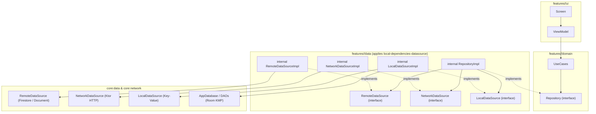

# Implementation Plan: Clean Architecture DataSources & Repositories Realignment with Room KMP & Multi-Target Sourcing

## Goal Description
Resolve naming confusion and structural layer mixing across `ui/kmp` by strictly enforcing Clean Architecture conventions and integrating **AndroidX Room Kotlin Multiplatform** with full multi-target dependency support:
1. **`core:data` provides raw engines only**:
   - `RemoteDataSource`: Cloud document/Firestore observation and CRUD engine.
   - `NetworkDataSource`: Ktor HTTP transport engine.
   - `LocalDataSource`: Key-value storage engine (`SettingsStorage` / `SharedPreferences` / `NSUserDefaults` / `LocalStorage`).
   - `RoomDataSource` / `AppDatabase`: SQLite/Room relational persistence engine.
   - Eliminates monolithic `JobApplicationRepository`, `StorageRepository`, and `TrackerEditsRepository` from `core:data`.
2. **Room KMP Multi-Target Setup (Web, iOS, Android, JVM)**:
   - Add Room 3.x (`androidx.room3:room3-runtime`) to `commonMain`.
   - Add `androidx.sqlite:sqlite-bundled` to native (`iosMain`), JVM (`jvmMain`), and Android (`androidMain`).
   - Add `androidx.sqlite:sqlite-web` and `wrappers-browser` to Web (`jsMain` & `wasmJsMain`).
   - Define dedicated version catalog bundles: `room`, `sqlite-bundled`, `sqlite-web`.
   - Create local configuration plugin `local-dependencies-datasource` (`DataSourceDependenciesConventionPlugin`) in `project-plugins` to automatically inject target-specific bundles into `commonMain`, `iosMain`, `wasmJsMain`, `jsMain`, `androidMain`, and `jvmMain`.
3. **Every feature module owns its domain repository and feature data sources**:
   - `(Remote|Network|Local)<Feature>DataSource`: Interface in `features/<feature>/data/source/`.
   - `(Remote|Network|Local)<Feature>DataSourceImpl`: **Strictly `internal`** in `features/<feature>/data/source/`.
   - `<Feature>Repository`: Domain interface in `features/<feature>/domain/repository/`.
   - `<Feature>RepositoryImpl`: **Strictly `internal`** in `features/<feature>/data/repository/` coordinating its data sources.
   - `<Feature>UseCases`: Pure domain use cases in `features/<feature>/domain/usecase/` consuming `<Feature>Repository`.
   - `<Feature>ViewModel` & `<Feature>Screen`: UI layer in `features/<feature>/ui/` consuming `<Feature>UseCases`.
4. **Visibility Invariant**: Zero `Impl` classes will be declared `public`. All implementations remain strictly `internal`.

---

## User Review Required

> [!IMPORTANT]
> **Multi-Target Dependencies for Web and iOS**:
> - **iOS (`iosMain`)**: Consumes `androidx.room3:room3-runtime` (from `commonMain`), `androidx.sqlite:sqlite-bundled`, and `ktor-client-darwin`.
> - **Web (`wasmJsMain` & `jsMain`)**: Consumes `androidx.room3:room3-runtime` (from `commonMain`), `androidx.sqlite:sqlite-web`, `wrappers-browser`, and `ktor-client-js`.
> - **JVM Desktop (`jvmMain`)**: Consumes `androidx.sqlite:sqlite-bundled`, `ktor-client-cio`, and `firebase-admin`.
> - **Android (`androidMain`)**: Consumes `androidx.sqlite:sqlite-bundled`, `ktor-client-okhttp`, and `firebase-android`.

> [!NOTE]
> **Zero Public `Impl`s**: All `*RepositoryImpl` and `*DataSourceImpl` classes are declared `internal`. Consuming modules and DI access them strictly via their public `interface` contracts.

---

## Multi-Target Dependency Matrix

| Target | Platform Layer | Network Transport Engine | Local / Database Engine | Room / SQLite Driver |
| :--- | :--- | :--- | :--- | :--- |
| **`commonMain`** | Universal Multiplatform | `ktor-client-core`, `ktor-content-negotiation` | `LocalDataSource` (interface) | `androidx.room3:room3-runtime` |
| **`iosMain`** | Native (iOS / Apple) | `ktor-client-darwin` | `NSUserDefaults` | `androidx.sqlite:sqlite-bundled` |
| **`wasmJsMain`** | WebAssembly | `ktor-client-js` | Browser LocalStorage / IndexedDB | `androidx.sqlite:sqlite-web` |
| **`jsMain`** | Browser JavaScript | `ktor-client-js` | Browser LocalStorage / IndexedDB | `androidx.sqlite:sqlite-web` |
| **`jvmMain`** | Desktop JVM | `ktor-client-cio` | Java Preferences / File | `androidx.sqlite:sqlite-bundled` |
| **`androidMain`** | Android Native | `ktor-client-okhttp` | Android `SharedPreferences` | `androidx.sqlite:sqlite-bundled` |

---

## Architecture Flow



---

## Proposed Changes Across Components

### 1. Version Catalog (`gradle/libs.versions.toml`)

#### [MODIFY] `gradle/libs.versions.toml`
Add Room & SQLite multiplatform versions, libraries, and target-specific bundles:
```toml
[versions]
  androidx-room3 = "3.0.3"
  androidx-sqlite = "2.7.1"

[libraries]
  androidx-room3-runtime = { module = "androidx.room3:room3-runtime", version.ref = "androidx-room3" }
  androidx-sqlite-bundled = { module = "androidx.sqlite:sqlite-bundled", version.ref = "androidx-sqlite" }
  androidx-sqlite-web = { module = "androidx.sqlite:sqlite-web", version.ref = "androidx-sqlite" }

[bundles]
  room = [
    "androidx-room3-runtime",
  ]
  sqlite-bundled = [
    "androidx-sqlite-bundled",
  ]
  sqlite-web = [
    "androidx-sqlite-web",
    "wrappers-browser",
  ]

[plugins]
  local-dependencies-datasource = { id = "dev.fnc314.tools.jobtracker.dependencies.datasource" }
```

---

### 2. Convention Toolchain (`gradle/tools/project-plugins`)

#### [NEW] `dev/fnc314/tools/jobtracker/kmp/gradle/plugins/config/DataSourceDependenciesConventionPlugin.kt`
Configures Room runtime in `commonMain` and automatically dispatches target-specific drivers to `iosMain`, `wasmJsMain`, `jsMain`, `jvmMain`, and `androidMain`:
```kotlin
package dev.fnc314.tools.jobtracker.kmp.gradle.plugins.config

import dev.fnc314.tools.jobtracker.kmp.gradle.catalog.CatalogTypes
import dev.fnc314.tools.jobtracker.kmp.gradle.plugins.BaseConventionPlugin
import dev.fnc314.tools.jobtracker.kmp.gradle.plugins.commonMain
import dev.fnc314.tools.jobtracker.kmp.gradle.plugins.kotlinMultiplatform
import org.gradle.api.Plugin
import org.gradle.api.Project

public class DataSourceDependenciesConventionPlugin : Plugin<Project>, BaseConventionPlugin {
    override fun apply(target: Project): Unit {
        target.configurePlugin()
    }

    override fun Project.configurePlugin(): Unit {
        kotlinMultiplatform {
            commonMain {
                dependencies {
                    implementation(CatalogTypes.Bundles.ROOM(project))
                }
            }
            sourceSets.matching { it.name == "iosMain" }.configureEach {
                dependencies {
                    implementation(CatalogTypes.Bundles.SQLITE_BUNDLED(project))
                }
            }
            sourceSets.matching { it.name == "jvmMain" }.configureEach {
                dependencies {
                    implementation(CatalogTypes.Bundles.SQLITE_BUNDLED(project))
                }
            }
            sourceSets.matching { it.name == "androidMain" }.configureEach {
                dependencies {
                    implementation(CatalogTypes.Bundles.SQLITE_BUNDLED(project))
                }
            }
            sourceSets.matching { it.name == "wasmJsMain" || it.name == "jsMain" }.configureEach {
                dependencies {
                    implementation(CatalogTypes.Bundles.SQLITE_WEB(project))
                }
            }
        }
    }
}
```

#### [MODIFY] `gradle/tools/project-plugins/build.gradle.kts`
Register `dependencies-datasource`:
```kotlin
    create("dependencies-datasource") {
      id = libs.plugins.local.dependencies.datasource.map { it.pluginId }.get()
      description = "Applies Room and SQLite data source dependency bundles across targets"
      implementationClass = "dev.fnc314.tools.jobtracker.kmp.gradle.plugins.config.DataSourceDependenciesConventionPlugin"
      displayName = "Data Source Dependencies Convention"
    }
```

#### [MODIFY] `CatalogTypes.kt`
Add `CatalogTypes.Bundles.ROOM("room")`, `SQLITE_BUNDLED("sqlite-bundled")`, `SQLITE_WEB("sqlite-web")`.

---

### 3. Core Data Engines (`core:data` & `core:network`)

#### [NEW] `core/data/src/commonMain/kotlin/.../source/LocalDataSource.kt`
Multiplatform key-value persistence engine contract.
Platform implementations:
- `androidMain`: `AndroidSharedPreferencesLocalDataSource`
- `iosMain`: `IosUserDefaultsLocalDataSource`
- `wasmJsMain` / `jsMain`: `WebLocalStorageDataSource`
- `jvmMain`: `JvmPreferencesLocalDataSource`

#### [NEW] `core/data/src/commonMain/kotlin/.../source/NetworkDataSource.kt`
Multiplatform HTTP engine contract (wrapping Ktor `HttpClient`).

#### [NEW] `core/data/src/commonMain/kotlin/.../database/AppDatabase.kt` & Entities
Room 3.x database contract:
```kotlin
package dev.fnc314.tools.jobtracker.core.data.database

import androidx.room.Database
import androidx.room.RoomDatabase
import dev.fnc314.tools.jobtracker.core.data.database.dao.JobApplicationDao
import dev.fnc314.tools.jobtracker.core.data.database.entity.JobApplicationEntity

@Database(entities = [JobApplicationEntity::class], version = 1)
public abstract class AppDatabase : RoomDatabase() {
    public abstract fun jobApplicationDao(): JobApplicationDao
}
```

#### [DELETE / CLEANUP] Monolithic Repositories in `core:data`
- Delete `JobApplicationRepository.kt`, `StorageRepository.kt`, `NetworkStorageRepository.kt`.
- Rename `RemoteJobApplicationRepository` (android/jvm) to `AndroidRemoteDataSource` and `JvmRemoteDataSource` implementing `RemoteDataSource`.

---

### 4. `features:job-applications-list`

#### [NEW] `features/job-applications-list/domain/.../repository/JobApplicationsListRepository.kt`
```kotlin
package dev.fnc314.tools.jobtracker.features.jobapplicationslist.domain.repository

import dev.fnc314.tools.jobtracker.core.data.model.JobApplication

public interface JobApplicationsListRepository {
    public suspend fun getJobApplications(): List<JobApplication>
}
```

#### [NEW] `features/job-applications-list/data/.../source/RemoteJobApplicationsListDataSource.kt`
Public interface with `internal class RemoteJobApplicationsListDataSourceImpl(remoteDataSource: RemoteDataSource)`.

#### [NEW] `features/job-applications-list/data/.../source/LocalJobApplicationsListDataSource.kt`
Public interface with `internal class LocalJobApplicationsListDataSourceImpl(appDatabase: AppDatabase?, localDataSource: LocalDataSource)`.

#### [NEW] `features/job-applications-list/data/.../repository/JobApplicationsListRepositoryImpl.kt`
`internal class JobApplicationsListRepositoryImpl(remoteDataSource, localDataSource) : JobApplicationsListRepository`.

#### [MODIFY] `LoadAllJobApplicationsUseCaseImpl.kt`
Consumes `JobApplicationsListRepository`.

---

### 5. `features:job-applications-details`

#### [NEW] `features/job-applications-details/domain/.../repository/JobApplicationsDetailsRepository.kt`
```kotlin
package dev.fnc314.tools.jobtracker.features.jobapplicationsdetails.domain.repository

import dev.fnc314.tools.jobtracker.core.data.model.*

public interface JobApplicationsDetailsRepository {
    public suspend fun getJobApplication(id: String): JobApplication?
    public suspend fun getCompanies(): List<Company>
    public suspend fun updateStatus(id: String, status: TrackerStatus, date: String?, note: String?): JobApplication
    public suspend fun recordEvent(event: TrackerEvent): String
    public suspend fun updateFitScore(id: String, score: Int): JobApplication
    public suspend fun getArtifactSignedUrl(path: String): String
}
```

#### [NEW] Data Sources in `features/job-applications-details/data/.../source/`
- `RemoteJobApplicationsDetailsDataSource` + `internal class RemoteJobApplicationsDetailsDataSourceImpl`
- `NetworkJobApplicationsDetailsDataSource` + `internal class NetworkJobApplicationsDetailsDataSourceImpl`
- `LocalJobApplicationsDetailsDataSource` + `internal class LocalJobApplicationsDetailsDataSourceImpl`

#### [NEW] `features/job-applications-details/data/.../repository/JobApplicationsDetailsRepositoryImpl.kt`
`internal class JobApplicationsDetailsRepositoryImpl(...) : JobApplicationsDetailsRepository`.

#### [MODIFY] Use Cases in `features:job-applications-details:data`
Update all 6 use cases to consume `JobApplicationsDetailsRepository`.

---

### 6. `features:add-job-application`

#### [NEW] `features/add-job-application/domain/.../repository/AddJobApplicationRepository.kt`
```kotlin
package dev.fnc314.tools.jobtracker.features.addjobapplication.domain.repository

import dev.fnc314.tools.jobtracker.core.data.model.JobApplication
import dev.fnc314.tools.jobtracker.core.data.model.TrackerEvent

public interface AddJobApplicationRepository {
    public suspend fun saveJobApplication(application: JobApplication): String
    public suspend fun recordEvent(event: TrackerEvent): String
}
```

#### [NEW] Data Sources in `features/add-job-application/data/.../source/`
- `RemoteAddJobApplicationDataSource` + `internal class RemoteAddJobApplicationDataSourceImpl`
- `LocalAddJobApplicationDataSource` + `internal class LocalAddJobApplicationDataSourceImpl`

#### [NEW] `features/add-job-application/data/.../repository/AddJobApplicationRepositoryImpl.kt`
`internal class AddJobApplicationRepositoryImpl(...) : AddJobApplicationRepository`.

#### [MODIFY] Use Cases in `features:add-job-application:data`
`CreateJobApplicationUseCaseImpl` and `CreateLeadUseCaseImpl` consume `AddJobApplicationRepository`.

---

### 7. `features:tracker-edits`

#### [MODIFY] `features/tracker-edits/domain/.../repository/TrackerEditsRepository.kt`
Feature-scoped repository interface in domain.

#### [NEW] Data Sources in `features/tracker-edits/data/.../source/`
- `RemoteTrackerEditsDataSource` + `internal class RemoteTrackerEditsDataSourceImpl`
- `LocalTrackerEditsDataSource` + `internal class LocalTrackerEditsDataSourceImpl`

#### [NEW] `features/tracker-edits/data/.../repository/TrackerEditsRepositoryImpl.kt`
`internal class TrackerEditsRepositoryImpl(...) : TrackerEditsRepository`.

---

### 8. `features:sign-in`

#### [MODIFY] `features/sign-in/domain/.../repository/AuthRepository.kt`
Feature-scoped repository interface in domain.

#### [NEW] Data Sources in `features/sign-in/data/.../source/`
- `RemoteAuthDataSource` + `internal class RemoteAuthDataSourceImpl`
- `LocalAuthDataSource` + `internal class LocalAuthDataSourceImpl`

#### [RENAME & REFACTOR] `DefaultAuthRepository` → `AuthRepositoryImpl`
`internal class AuthRepositoryImpl(...) : AuthRepository`.

---

### 9. `features:settings`

#### [NEW] Data Sources in `features/settings/data/.../source/`
- `LocalSettingsDataSource` + `internal class LocalSettingsDataSourceImpl`

#### [MODIFY] `features/settings/data/.../SettingsRepositoryImpl.kt`
`internal class SettingsRepositoryImpl(localDataSource: LocalSettingsDataSource) : SettingsRepository`.

---

### 10. Unit Test Realignment & 5:1 Coverage
All test suites across all 6 features will be updated to test against the new feature-scoped `Repository` interfaces and `DataSource` contracts with dedicated `Fake<Feature>Repository` and `Fake<Feature>DataSource` instances.

---

## Verification Plan

### Automated Tests
1. **Compile Convention Plugins**:
   ```bash
   ./gradlew :tools:project-plugins:compileKotlin
   ```
2. **Compile All Multiplatform Metadata (verifies all targets: JVM, iOS, Web, Android)**:
   ```bash
   ./gradlew compileCommonMainKotlinMetadata
   ```
3. **Execute Full Unit Test Suite Across All Modules**:
   ```bash
   ./gradlew :core-data:jvmTest \
             :features-job-applications-list-domain:jvmTest \
             :features-job-applications-details-data:jvmTest \
             :features-add-job-application-data:jvmTest \
             :features-tracker-edits-data:jvmTest \
             :features-settings-data:jvmTest \
             :features-sign-in-domain:jvmTest
   ```
4. **Assemble Android Debug APK**:
   ```bash
   ./gradlew :apps-android:assembleDebug
   ```
5. **Validate Module READMEs**:
   ```bash
   mise run //:ui:kmp:docs:readmes
   ```

### Manual Verification
- Verify that **zero** `Impl` classes across `core:data` and `features/*/data` are declared `public`.
- Verify that every feature's domain layer is cleanly isolated from transport mechanisms.
- Verify that Room and SQLite drivers resolve correctly across iOS (`sqlite-bundled`), Web (`sqlite-web`), Android, and JVM.
