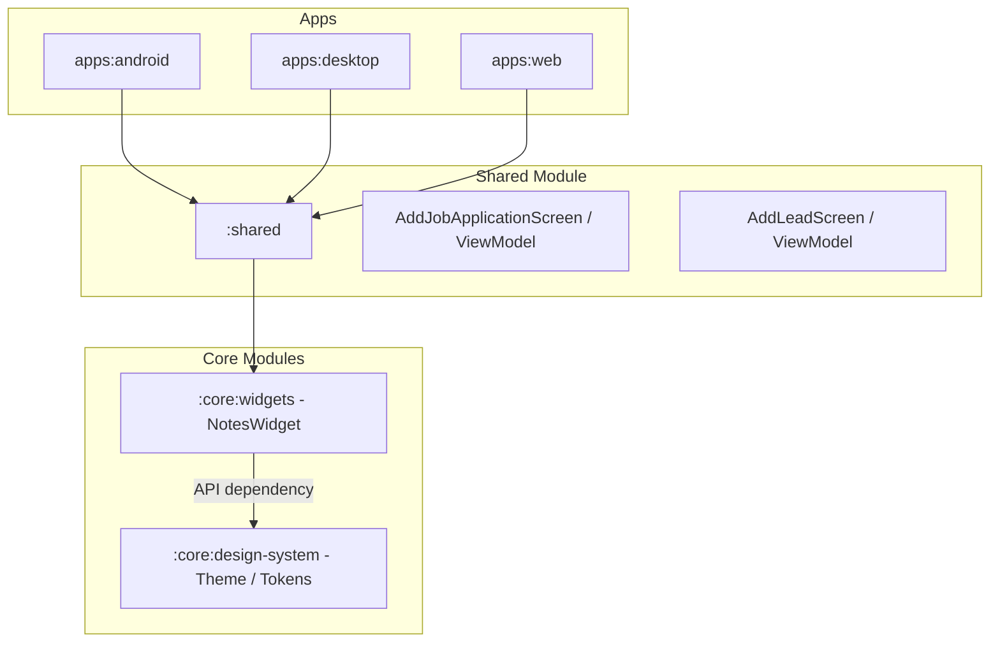

# Requirements

### Overview & Goals
Extract shared UI primitives into two dedicated core modules (`:core:design-system` and `:core:widgets`) and implement a new interactive `NotesWidget` in `:core:widgets`. Integrate the `NotesWidget` into existing form experiences (`AddJobApplicationScreen` and `AddLeadScreen`) to provide a rich note-taking user experience with swipe-to-delete, reordering, and focus-dependent text expansion.

### Scope
- **In Scope**:
  - Register the `core` project collection using `registerProjectCollection("core")` in `settings.gradle.kts`.
  - Create `core/design-system/build.gradle.kts` and move `Theme.kt`, platform system bar setup, colors, typography, and spacing tokens into `:core:design-system`.
  - Create `core/widgets/build.gradle.kts` declaring `api(projects.core.designSystem)` using Type-Safe Project Accessors.
  - Build `NotesWidget` in `:core:widgets` supporting an auto-spawning empty drafting input with '+' button/Enter key commit, horizontal swipe-to-delete, item reordering, and 1-line unfocused / expanded focused text behavior.
  - Update `shared/build.gradle.kts` to depend on `:core:widgets` via `implementation(projects.core.widgets)`.
  - Integrate `NotesWidget` into `AddJobApplicationScreen` and `AddLeadScreen` and update form ViewModels to process filled notes inputs for System of Record submission.
- **Out of Scope**:
  - Creating custom Gradle build plugins (configurations will be copied directly into module `build.gradle.kts` files).
  - Database or network API protocol schema changes.

### User Stories
- **As a user**, I want an interactive notes widget when filling out job application and lead forms so that I can easily add, edit, reorder, and swipe to delete individual notes.
- **As a developer**, I want design tokens and common UI widgets isolated in `:core:design-system` and `:core:widgets` modules so that UI components are cleanly modularized and reusable across feature modules.

### Functional Requirements
1. **Module Layout**:
   - `:core:design-system` exports Material 3 theme, color scheme, typography, and spacing primitives.
   - `:core:widgets` exposes UI widgets and brings in `:core:design-system` via `api` dependency.
2. **Notes Input Box & Drafting**:
   - `NotesWidget` always maintains an empty drafting input at the end of the collection.
   - Pressing '+' or the Enter key commits the currently drafting note (if it has text inside) and spawns a new empty input in the collection.
3. **Notes List Entries**:
   - **Focus Collapse/Expand**: When a note entry is out of focus, it collapses to 1 line with trailing ellipsis (`...`). When focused, it expands to allow multi-line viewing and editing.
   - **Swipe to Delete**: Swiping a note entry horizontally deletes it from the list.
   - **Resorting**: Users can reorder/resort notes up and down in the list.
4. **Form & System of Record Integration**:
   - `NotesWidget` invokes `onNotesChanged: (List<String>) -> Unit` upon any note addition, edit, reorder, or deletion.
   - The callback receives only inputs *with text inside*, ignoring the empty drafting input when publishing updates.

# Technical Design

### Current Implementation
- `shared/src/commonMain/kotlin/dev/fnc314/tools/jobtracker/ui/component/Theme.kt` (and platform variants) defines `JobTrackerTheme` directly inside `:shared`.
- `AddJobApplicationScreen` and `AddLeadScreen` currently use plain multi-line `OutlinedTextField` composables bound to a single string `notes` property in their respective ViewModels.

### Key Decisions
1. **Module Hierarchy & Type-Safe Project Accessors**:
   - Type-Safe Project Accessors (`projects.core.designSystem` and `projects.core.widgets`) are used for inter-module Gradle dependencies.
   - `:core:widgets` depends on `:core:design-system` via `api(projects.core.designSystem)`.
   - `:shared` depends on `:core:widgets` via `implementation(projects.core.widgets)`, gaining transitive access to `:core:design-system` tokens without needing a separate direct dependency.
2. **Configuration Copying (No Plugins)**:
   - Copy required Kotlin Multiplatform and Compose Multiplatform DSL blocks into `core/design-system/build.gradle.kts` and `core/widgets/build.gradle.kts` directly, keeping Gradle plugins out of scope.
3. **Widget State & Drafting Experience**:
   - `NotesWidget` maintains internal state where an empty drafting input is always present at the end of the collection.
   - Pressing `Enter` or `+` commits the drafting note and spawns a new empty input entry.
   - `onNotesChanged: (List<String>) -> Unit` publishes the list of all inputs with text inside, filtering out the trailing empty drafting input.
4. **Focus-Based Text Expansion**:
   - Note item text fields track focus via `Modifier.onFocusChanged`.
   - Unfocused state sets `maxLines = 1` and `overflow = TextOverflow.Ellipsis`.
   - Focused state unsets line limits to expand text for full multi-line editing.
5. **Horizontal Swipe-to-Delete**:
   - Implemented using Material 3 `SwipeToDismissBox` on each note item row.

### Proposed Changes
- **Module Structure**:
  - Register the `core` project collection using `registerProjectCollection("core")` inside `projectCollections` in `settings.gradle.kts`.
  - Create `core/design-system/build.gradle.kts` and `core/widgets/build.gradle.kts` using Type-Safe Project Accessors (`projects.core.designSystem`).
  - Move `Theme.kt` and platform system bar code into `dev.fnc314.tools.jobtracker.core.designsystem`.
- **Widgets**:
  - Implement `NotesWidget.kt` in `dev.fnc314.tools.jobtracker.core.widgets` with an auto-spawning empty drafting input and filtering out empty inputs on `onNotesChanged`.
- **Feature Integration**:
  - Update `shared/build.gradle.kts` to add `implementation(projects.core.widgets)`.
  - Update `AddJobApplicationScreen` and `AddLeadScreen` to replace text fields with `NotesWidget`.
  - Update `AddJobApplicationViewModel` and `AddLeadViewModel` form states and submit handlers to calculate notes count from filled inputs and format notes string for System of Record.

### Architecture Diagram

### File Structure
- **New Files**:
  - `core/design-system/build.gradle.kts`
  - `core/design-system/src/commonMain/kotlin/dev/fnc314/tools/jobtracker/core/designsystem/Theme.kt`
  - `core/design-system/src/commonMain/kotlin/dev/fnc314/tools/jobtracker/core/designsystem/Spacing.kt`
  - `core/design-system/src/androidMain/kotlin/dev/fnc314/tools/jobtracker/core/designsystem/Theme.android.kt`
  - `core/design-system/src/iosMain/kotlin/dev/fnc314/tools/jobtracker/core/designsystem/Theme.ios.kt`
  - `core/design-system/src/jsMain/kotlin/dev/fnc314/tools/jobtracker/core/designsystem/Theme.js.kt`
  - `core/design-system/src/jvmMain/kotlin/dev/fnc314/tools/jobtracker/core/designsystem/Theme.jvm.kt`
  - `core/design-system/src/wasmJsMain/kotlin/dev/fnc314/tools/jobtracker/core/designsystem/Theme.wasmJs.kt`
  - `core/widgets/build.gradle.kts`
  - `core/widgets/src/commonMain/kotlin/dev/fnc314/tools/jobtracker/core/widgets/NotesWidget.kt`
- **Modified Files**:
  - `settings.gradle.kts`
  - `shared/build.gradle.kts`
  - `shared/src/commonMain/kotlin/dev/fnc314/tools/jobtracker/App.kt`
  - `shared/src/commonMain/kotlin/dev/fnc314/tools/jobtracker/ui/add/AddJobApplicationScreen.kt`
  - `shared/src/commonMain/kotlin/dev/fnc314/tools/jobtracker/ui/add/AddJobApplicationViewModel.kt`
  - `shared/src/commonMain/kotlin/dev/fnc314/tools/jobtracker/ui/lead/AddLeadScreen.kt`
  - `shared/src/commonMain/kotlin/dev/fnc314/tools/jobtracker/ui/lead/AddLeadViewModel.kt`
- **Moved Files**:
  - `shared/src/.../ui/component/Theme.kt` -> `core/design-system/src/.../core/designsystem/Theme.kt`

# Testing

### Validation Approach
Verify multi-module build configuration and test `NotesWidget` functionality within the application experiences.

### Key Scenarios
1. **Module Compilation & Linking**:
   - Verify that `:core:design-system` and `:core:widgets` compile cleanly and that `:shared` imports `:core:widgets` and `:core:design-system` symbols without resolution errors.
2. **Notes Input & Keyboard Handling**:
   - Type text in the `NotesWidget` input box and press '+' icon or Enter key.
   - Verify the note is added to the list and the input box resets to 1 line empty state.
3. **Focus Expansion & Collapse**:
   - Select a note entry and verify it expands for full text viewing/editing.
   - Focus away from the note entry and verify it collapses to 1 line with trailing `...`.
4. **Swipe-to-Delete**:
   - Swipe a note entry horizontally and verify it is removed from the list.
5. **Notes Reordering**:
   - Reorder notes and verify that `onNotesChanged` fires with the updated order.
6. **System of Record Form Integration**:
   - Submit a form in `AddJobApplicationScreen` or `AddLeadScreen` with filled and blank note inputs.
   - Verify that filled inputs are counted and formatted correctly for submission.

# Delivery Steps

### ✓ Step 1: Create core:design-system module and move design system definitions
The `:core:design-system` Gradle subproject is registered in `settings.gradle.kts` with theme and token definitions moved from `:shared`.

- Register `registerProjectCollection("core")` in `settings.gradle.kts` to automatically include all `:core:*` subprojects (`:core:design-system`, `:core:widgets`).
- Create `core/design-system/build.gradle.kts` copying Kotlin Multiplatform and Compose Multiplatform configurations.
- Move `Theme.kt` and platform-specific `SetupSystemBars` implementations from `shared` to `dev.fnc314.tools.jobtracker.core.designsystem`.
- Add spacing and design tokens in `core/design-system` to establish complete Material3 styling primitives.

### ✓ Step 2: Create core:widgets module and implement NotesWidget
The `:core:widgets` module is created with an `api` dependency on `:core:design-system` using Type-Safe Project Accessors, exporting the interactive `NotesWidget`.

- Create `core/widgets/build.gradle.kts` with `api(projects.core.designSystem)` dependency.
- Implement `NotesWidget.kt` in `core/widgets` ensuring an empty drafting input is always present at the end of the collection.
- Pressing '+' or the Enter key commits the current drafting text and spawns a new empty input entry.
- Invoke `onNotesChanged: (List<String>) -> Unit` with text of inputs with content inside, ignoring the empty drafting input.
- Implement focus-dependent note row presentation (1 line with trailing `...` when unfocused, fully expanded multiline when focused).
- Implement horizontal swipe-to-delete using Material 3 `SwipeToDismissBox`.
- Implement note reordering capabilities via reorder controls.

### ✓ Step 3: Integrate NotesWidget into existing form experiences
`AddJobApplicationScreen` and `AddLeadScreen` use `NotesWidget` and pass non-blank filled notes to their ViewModels.

- Add `implementation(projects.core.widgets)` to `shared/build.gradle.kts` using Type-Safe Project Accessors.
- Replace existing plain text field notes inputs in `AddJobApplicationScreen` and `AddLeadScreen` with `NotesWidget`.
- Update `AddJobApplicationViewModel` and `AddLeadViewModel` form states to store `List<String>` notes.
- Implement filtering/counting of filled inputs in ViewModels when serializing notes for System of Record submission.
- Verify multi-module build and experience behavior across targets.

### * Step 4: Fix swipe-to-delete animation and replace up-down buttons with gripper handles in NotesWidget
Improve the UX in `NotesWidget` by fixing the swipe-to-delete jump/glitch and replacing up/down arrows with drag/reorder gripper handles.

- Animate item exit (fade/shrink) or use `AnimatedVisibility` so deletion collapses cleanly without wonky visual artifacts.
- Replace arrow buttons (▲/▼) with vertical drag gripper handle icons (`Icons.Default.DragHandle` / `⠿`).

###   Step 5: Migrate navigation to Jetpack Navigation 3 with system back button support
Adopt Navigation 3 so the back button navigates backwards through app screens instead of closing the app.

- Add Navigation 3 dependency (`androidx.navigation3:navigation3-ui` / `runtime` or appropriate multiplatform-compatible integration) and back handler support.
- Implement `NavDisplay` or back stack management in `App.kt` routing between List, Detail, AddApplication, AddLead, and Edits.
- Support system back button to pop destinations until the list screen before exiting.