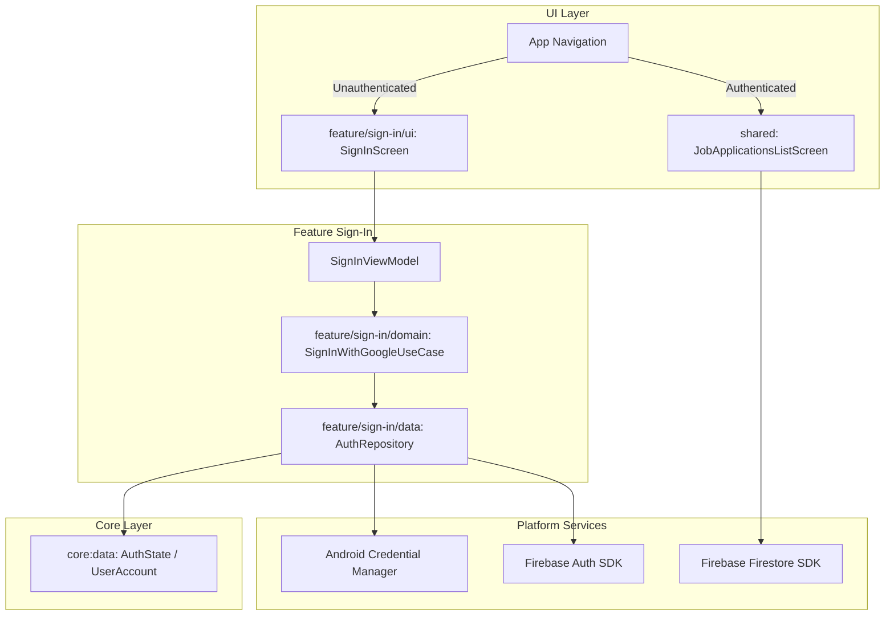

# Requirements

## Notes
1. Firebase PLIST is in the repo
  2. https://github.com/firebase/firebase-ios-sdk
3. Use `core/` and `features` and exernal-to-`shared` homes for as much code as possible, even if just `interface` definitions
4. `ktor` for networking

### Overview & Goals
Integrate Firebase into the Android application so users can sign in with their Google Account and view their job search data (applications, companies, timeline, events) stored in Cloud Firestore.
Structure the architecture according to modular separation:
- Common abstractions, models, and shared configs live outside `shared`, inside `core:data` (and `core:network` where appropriate).
- Authentication logic is isolated inside `feature/sign-in/domain`, `feature/sign-in/data`, and `feature/sign-in/ui`.
- Provide an integration blueprint and roadmap for the subsequent platforms targeted (iOS, Desktop JVM, Web/Wasm).

### Scope
- **In Scope (Current Milestone - Android)**:
  - Add `google-services.json` and network permissions (`INTERNET`, `ACCESS_NETWORK_STATE`) to `apps/android`.
  - Establish `core:data` and `core:network` modules for common models and contracts.
  - Create `feature/sign-in/domain`, `feature/sign-in/data`, and `feature/sign-in/ui` modules.
  - Implement Google Sign-In on Android using Android Credential Manager + Firebase Auth.
  - Update Firestore Security Rules to permit access to authenticated user accounts.
  - Wire authentication gating in navigation so `JobApplicationsListScreen` and `JobApplicationDetailScreen` display live Firestore data once signed in.
- **In Scope (Subsequent Platforms Roadmap)**:
  - Clear architectural steps and interfaces for iOS, Desktop (JVM), and Web/Wasm using the platform-specific SDK strategy.
- **Out of Scope**:
  - Full production execution of iOS/Desktop/Web sign-in flows (detailed in design roadmap only).
  - Modifying backend python synchronization scripts.

### User Stories
- **As an Android user**, I want to sign in using my Google Account so that I can securely authenticate with Firebase.
- **As an Android user**, I want to view my imported job search applications, statuses, tags, and timeline on my Android phone directly from Firestore.
- **As an engineer**, I want auth and core data modularized into `feature/sign-in/*` and `core:data` so that each platform can implement its native Firebase integration without tangling UI and platform-specific dependencies.

### Functional Requirements
- Unauthenticated users must be prompted with a Sign-In screen offering "Sign in with Google".
- Upon successful authentication, Firebase credentials must be established in `FirebaseAuth.getInstance()`.
- The Android app must navigate to `JobApplicationsListScreen` upon authentication and fetch live documents from Firestore collection `applications`.
- If user signs out or authentication expires, the app returns to the sign-in state.
- Security rules on Firestore must validate `request.auth != null` (and optional whitelist check) before granting read/write access.

# Technical Design

### Current Implementation
- `apps/android/build.gradle.kts` has the Google Services plugin (`com.google.gms.google-services`) and Firebase dependencies (`firebase-bom`, `firebase-firestore`, `firebase-auth`).
- `apps/android/src/main/AndroidManifest.xml` currently lacks the `INTERNET` permission.
- `apps/android/google-services.json` is missing (client metadata identified in Firebase project `job-search-fnc314-dev`: app ID `1:399944190604:android:039c88290beda151adc9a9`, package `dev.fnc314.tools.jobtracker`).
- Firestore security rules currently deny all client read/write (`allow read, write: if false;`).
- `AndroidFirestoreJobApplicationRepository` already exists in `shared/src/androidMain` mapping Firestore snapshots to `JobApplication` models.

### Key Decisions
1. **Modular Architecture Outside `shared`**:
   - `core:data`: Contains shared domain models (`UserAccount`, `AuthState`), common repository contracts (`AuthRepository`), and config.
   - `core:network`: Optional HTTP/Ktor client configs or token interceptors.
   - `feature/sign-in/domain`: Pure Kotlin use cases (`SignInWithGoogleUseCase`, `SignOutUseCase`, `ObserveAuthStateUseCase`).
   - `feature/sign-in/data`: Implements `AuthRepository` with multiplatform expectation and platform-specific implementations (Android uses `FirebaseAuth` + Credential Manager).
   - `feature/sign-in/ui`: Jetpack Compose / Compose Multiplatform screen and `SignInViewModel`.
2. **Platform-Specific SDK Strategy**:
   - Android uses native `com.google.firebase:firebase-auth` and `com.google.firebase:firebase-firestore`.
   - Desktop (JVM) continues using `com.google.firebase:firebase-admin` or ADC.
   - iOS will implement the `AuthRepository` / `JobApplicationRepository` via native Firebase iOS SDK / Swift bridge.
   - Web / Wasm will implement them via Firebase JS SDK.
3. **Authentication Mechanism**:
   - Google Account Sign-In via Android Credential Manager API (`androidx.credentials:credentials`), passing Google ID token to `FirebaseAuth.signInWithCredential(GoogleAuthProvider.getCredential(idToken, null))`.
4. **Firestore Security Rules**:
   - Update from catch-all `deny` to require authenticated user (`request.auth != null`), allowing the authenticated mobile client to query `applications` and `companies`.

### Architecture Diagram


### Module Structure
```
ui/kmp/
├── apps/
│   └── android/
│       ├── google-services.json          (Added)
│       └── src/main/AndroidManifest.xml  (Add INTERNET permission)
├── core/
│   ├── data/                             (New module: UserAccount, AuthState, AuthRepository)
│   ├── network/                          (New/Optional: Network utilities)
│   ├── design-system/
│   └── widgets/
├── features/
│   └── sign-in/
│       ├── domain/                       (New module: Use cases)
│       ├── data/                         (New module: AuthRepositoryImpl + Android FirebaseAuth)
│       └── ui/                           (New module: SignInScreen + ViewModel)
└── shared/                               (List/Detail UI, existing repositories)
```

# Testing

### Validation Approach
Automated compilation checks, module dependency verification, unit tests on use cases/view models, and instrumented Android verification.

### Key Scenarios
1. **Google Services Configuration**:
   - Verify Gradle builds `apps/android` without `google-services.json missing` warnings or errors.
2. **Permission Check**:
   - Ensure `INTERNET` and `ACCESS_NETWORK_STATE` permissions are merged into final manifest.
3. **Authentication Flow (Android)**:
   - Initial state is unauthenticated -> app presents Sign-In screen.
   - Triggering Google Sign-In initiates credential request.
   - On credential receipt, Firebase Auth signs in and emits authenticated state.
   - App navigates to job applications list.
4. **Firestore Data Retrieval**:
   - Verify `getAllJobApplications()` successfully queries `applications` collection without `PERMISSION_DENIED` errors.
   - Verify applications and companies render properly on the Android UI.

### Edge Cases
- **User cancels Google Sign-In sheet**: Handle cancellation gracefully without crash or loading lock.
- **Offline / No Network**: Show clear snackbar/banner informing user of connectivity status; verify Firestore offline persistence behavior.
- **Token Expiry / Auth Revoked**: Auth state listener emits unauthenticated state; user is navigated back to sign-in screen.

# Subsequent Platforms Roadmap

### Roadmap for Subsequent Platforms

Following the **Platform-Specific SDKs** architecture, subsequent platforms plug into the shared contracts established in `core:data` and `features/sign-in`:

#### 1. iOS Target
- **Dependencies**: Add Firebase iOS SDK (via CocoaPods or SPM in Xcode workspace / KMP build):
  - `FirebaseCore`, `FirebaseAuth`, `FirebaseFirestore`.
- **Sign-In (`feature/sign-in/data/src/iosMain`)**:
  - Implement `AuthRepository` for iOS using `GIDSignIn` (Google Sign-In iOS SDK) + `Auth.auth().signIn(with: credential)`.
  - Leave room for `Sign In with Apple` functionality
- **Firestore Repository (`shared/src/iosMain`)**:
  - Implement `JobApplicationRepository` wrapping native iOS `Firestore.firestore()`.
- **Platform Setup**:
  - Download `GoogleService-Info.plist` from Firebase console into the iOS app project bundle.

#### 2. Desktop (JVM Target)
- **Current State**: Already has `JVMJobApplicationRepository` using `firebase-admin`.
- **Sign-In (`feature/sign-in/data/src/jvmMain`)**:
  - For local desktop use, authenticate via Application Default Credentials (ADC) or OAuth 2.0 loopback browser flow (`GoogleAuthorizationCodeFlow`).
  - Bridge the authenticated user token into the shared `AuthState`.

#### 3. Web (Wasm / JS Target)
- **Dependencies**: Add Firebase Web JS SDK (via npm / kotlin-wrappers in `jsMain` / `wasmJsMain`).
- **Sign-In (`feature/sign-in/data/src/jsMain`)**:
  - Implement `AuthRepository` calling `signInWithPopup(auth, new GoogleAuthProvider())` via Firebase JS SDK.
- **Firestore Repository (`shared/src/jsMain`)**:
  - Query Firestore using `getDocs(collection(db, "applications"))` through Kotlin/JS external declarations.
- **Platform Setup**:
  - Initialize Firebase in Web via Firebase Web App configuration object (`apiKey`, `authDomain`, `projectId`, etc.).

# Delivery Steps

### ✓ Step 1: Configure Android Firebase Credentials and Manifest Permissions
Place Firebase client configuration in the Android app and grant network permissions.
- Retrieve and generate `apps/android/google-services.json` using the Firebase app configuration for package `dev.fnc314.tools.jobtracker` (App ID `1:399944190604:android:039c88290beda151adc9a9`).
- Update `apps/android/src/main/AndroidManifest.xml` to include `<uses-permission android:name="android.permission.INTERNET" />` and `<uses-permission android:name="android.permission.ACCESS_NETWORK_STATE" />`.
- Verify the Android application builds cleanly with the `google-services` Gradle plugin processing the configuration.

### ✓ Step 2: Establish core:data and core:network Infrastructure Modules
Create independent, reusable modules for data models, repository abstractions, and common Firebase configs.
- Register `core/data` (and if needed `features` collection) in `settings.gradle.kts`.
- Implement shared user identity model (e.g., `UserAccount(uid, email, displayName, photoUrl)`), auth state representation (`AuthState`), and base `AuthRepository` interface in `core:data`.
- Provide platform-agnostic network/auth contracts and DI bindings that other feature modules can depend on.

### * Step 3: Implement feature/sign-in Data & Domain Modules with Android Google Sign-In
Implement the domain and data layer for Firebase authentication supporting platform-specific implementations.
- Create `feature/sign-in/domain` housing sign-in use cases (`SignInWithGoogleUseCase`, `SignOutUseCase`, `ObserveAuthStateUseCase`, `GetCurrentUserUseCase`).
- Create `feature/sign-in/data` implementing `AuthRepository`.
- In `feature/sign-in/data`'s Android source set, implement Google Sign-In using Android Credential Manager (`androidx.credentials`) and `FirebaseAuth.signInWithCredential(GoogleAuthProvider.getCredential(...))`.
- Update Firestore security rules in Firebase to authorize reads and writes for verified Google authenticated accounts.

###   Step 4: Implement feature/sign-in UI and Wire Navigation/Data Display on Android
Build the sign-in user interface and gate navigation until the user signs in with Google.
- Create `feature/sign-in/ui` with Compose Multiplatform UI components for the Google Account Sign-In screen and account status.
- Implement `SignInViewModel` managing `SignInUiState` (Unauthenticated, SigningIn, Authenticated, Error).
- Integrate the Sign-In route into the app's top-level navigation, redirecting unauthenticated users to Sign-In and routing authenticated users directly to `JobApplicationsListScreen`.
- Connect the authenticated user context to Firestore queries and verify the Android application successfully retrieves and displays documents from the `applications` collection.