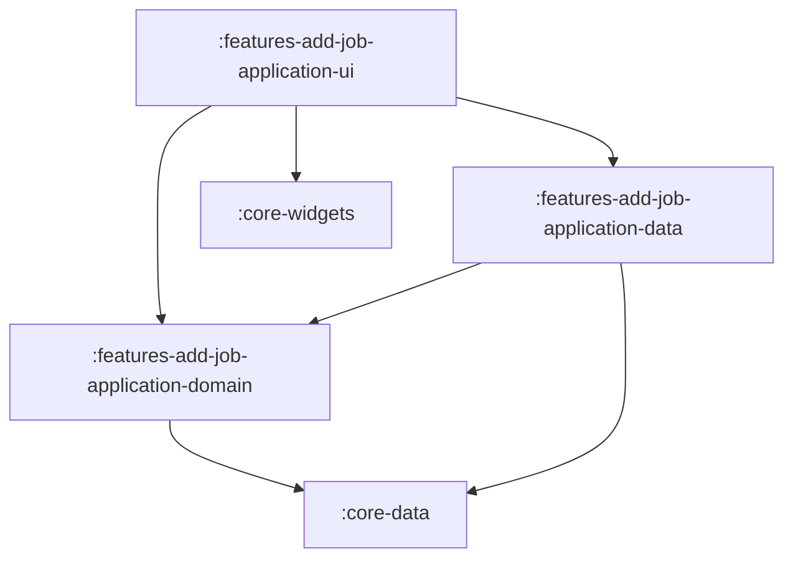

# Feature: Add Job Application & Lead

> [!NOTE]
> **Quick Facts**
> - **Gradle Project IDs**: `:features-add-job-application-domain`, `:features-add-job-application-data`, `:features-add-job-application-ui`
> - **Module Tier**: Feature / User Experience (Clean Architecture: Domain, Data, UI)
> - **Package Base**: `dev.fnc314.tools.jobtracker.features.addjobapplication`
> - **Target Platforms**: Android (`androidTarget`), Desktop JVM (`jvm`), iOS (`iosX64`, `iosArm64`, `iosSimulatorArm64`), Web (`js`, `wasmJs`)
> - **Internal Project Dependencies**:
>   - Domain: `:core-data`
>   - Data: `:features-add-job-application-domain`, `:core-data`
>   - UI: `:features-add-job-application-domain`, `:features-add-job-application-data`, `:core-widgets`, `:core-navigation`, `:core-data`

---

## Overview

The `features/add-job-application` module provides intake workflows for candidate opportunities. It supports two entry modalities:
1. **Full Job Application Entry**: Capturing company, role, sector, role type, work mode (`REMOTE`, `HYBRID`, `ONSITE`), initial lifecycle status, compensation ranges, posting URLs, and recruiter contacts.
2. **Quick Lead Creation**: Lightweight capture for early-stage discovery, recruiter cold outreach, informal networking connections, and prospective leads.

---

## Architectural Breakdown & Subprojects

The feature is organized across three Clean Architecture subprojects:



### 1. `:features-add-job-application-domain`
Defines intake business contracts:
- [`CreateJobApplicationUseCase`](file:///Users/fnc314/Work/Search/waleedtarbosh-ai-job-search/ui/kmp/features/add-job-application/domain/src/commonMain/kotlin/dev/fnc314/tools/jobtracker/features/addjobapplication/domain/usecase/CreateJobApplicationUseCase.kt): Saves a validated `JobApplication` entity into Firestore and returns the generated document ID.
- [`CreateLeadUseCase`](file:///Users/fnc314/Work/Search/waleedtarbosh-ai-job-search/ui/kmp/features/add-job-application/domain/src/commonMain/kotlin/dev/fnc314/tools/jobtracker/features/addjobapplication/domain/usecase/CreateLeadUseCase.kt): Transforms unstructured lead data into a `DRAFTING` application record with initial notes and channel metadata.

### 2. `:features-add-job-application-data`
Implements intake use cases backed by `:core-data`:
- [`CreateJobApplicationUseCaseImpl`](file:///Users/fnc314/Work/Search/waleedtarbosh-ai-job-search/ui/kmp/features/add-job-application/data/src/commonMain/kotlin/dev/fnc314/tools/jobtracker/features/addjobapplication/data/CreateJobApplicationUseCaseImpl.kt)
- [`CreateLeadUseCaseImpl`](file:///Users/fnc314/Work/Search/waleedtarbosh-ai-job-search/ui/kmp/features/add-job-application/data/src/commonMain/kotlin/dev/fnc314/tools/jobtracker/features/addjobapplication/data/CreateLeadUseCaseImpl.kt)
- [`addJobApplicationDataModule`](file:///Users/fnc314/Work/Search/waleedtarbosh-ai-job-search/ui/kmp/features/add-job-application/data/src/commonMain/kotlin/dev/fnc314/tools/jobtracker/features/addjobapplication/data/AddJobApplicationDataModule.kt): Koin DI declarations.

### 3. `:features-add-job-application-ui`
Supplies Compose screens, form states, and input validation:
- [`AddJobApplicationScreen`](file:///Users/fnc314/Work/Search/waleedtarbosh-ai-job-search/ui/kmp/features/add-job-application/ui/src/commonMain/kotlin/dev/fnc314/tools/jobtracker/features/addjobapplication/ui/AddJobApplicationScreen.kt): Multi-field intake form with dropdown selectors for work mode, channel, and status, with dynamic note entry via `NotesWidget`.
- [`AddApplicationRoute`](file:///Users/fnc314/Work/Search/waleedtarbosh-ai-job-search/ui/kmp/features/add-job-application/ui/src/commonMain/kotlin/dev/fnc314/tools/jobtracker/features/addjobapplication/ui/AddJobApplicationNavigation.kt): Type-safe destination key implementing `NavKeyRoute`.
- [`AddLeadRoute`](file:///Users/fnc314/Work/Search/waleedtarbosh-ai-job-search/ui/kmp/features/add-job-application/ui/src/commonMain/kotlin/dev/fnc314/tools/jobtracker/features/addjobapplication/ui/AddJobApplicationNavigation.kt): Type-safe destination key implementing `NavKeyRoute`.
- [`addJobApplicationNavHook`](file:///Users/fnc314/Work/Search/waleedtarbosh-ai-job-search/ui/kmp/features/add-job-application/ui/src/commonMain/kotlin/dev/fnc314/tools/jobtracker/features/addjobapplication/ui/AddJobApplicationNavigation.kt): `FeatureNavigationHook` registering `composable<AddApplicationRoute>` and `composable<AddLeadRoute>` in the root `NavGraphBuilder`.
- [`AddJobApplicationViewModel`](file:///Users/fnc314/Work/Search/waleedtarbosh-ai-job-search/ui/kmp/features/add-job-application/ui/src/commonMain/kotlin/dev/fnc314/tools/jobtracker/features/addjobapplication/ui/AddJobApplicationViewModel.kt): Manages `AddApplicationFormState` and form submission.
- [`AddLeadScreen`](file:///Users/fnc314/Work/Search/waleedtarbosh-ai-job-search/ui/kmp/features/add-job-application/ui/src/commonMain/kotlin/dev/fnc314/tools/jobtracker/features/addjobapplication/ui/AddLeadScreen.kt): Fast-entry screen optimized for rapid note-taking and lead logging.
- [`AddLeadViewModel`](file:///Users/fnc314/Work/Search/waleedtarbosh-ai-job-search/ui/kmp/features/add-job-application/ui/src/commonMain/kotlin/dev/fnc314/tools/jobtracker/features/addjobapplication/ui/AddLeadViewModel.kt): Manages `AddLeadFormState` and lead creation.
- [`addJobApplicationUiModule`](file:///Users/fnc314/Work/Search/waleedtarbosh-ai-job-search/ui/kmp/features/add-job-application/ui/src/commonMain/kotlin/dev/fnc314/tools/jobtracker/features/addjobapplication/ui/AddJobApplicationUiModule.kt): Koin factories for both ViewModels.
- [`addJobApplicationFeatureModule`](file:///Users/fnc314/Work/Search/waleedtarbosh-ai-job-search/ui/kmp/features/add-job-application/ui/src/commonMain/kotlin/dev/fnc314/tools/jobtracker/features/addjobapplication/ui/AddJobApplicationUiModule.kt): Umbrella DI module.

---

## Deep-Link Support

The intake destinations are registered with distinct type-safe navigation routes:

| Route Type | URI Pattern | Description |
| :--- | :--- | :--- |
| `AddApplicationRoute` | `jobtracker://applications/new` | Opens the full application intake form. |
| `AddLeadRoute` | `jobtracker://leads/new` | Opens the fast lead intake form. |

Both routes support back-navigation (`onNavigateBack`) popping back to the previous screen or returning to `ListRoute`.

---

## Key Gradle Tasks

Run the following commands from the `ui/kmp` directory:

```bash
# Compile CommonMain Kotlin metadata across all 3 subprojects
./gradlew :features-add-job-application-domain:compileCommonMainKotlinMetadata \
          :features-add-job-application-data:compileCommonMainKotlinMetadata \
          :features-add-job-application-ui:compileCommonMainKotlinMetadata

# Run unit tests
./gradlew :features-add-job-application-domain:allTests \
          :features-add-job-application-data:allTests \
          :features-add-job-application-ui:allTests

# Assemble Android debug variant for UI module
./gradlew :features-add-job-application-ui:assembleDebug
```
