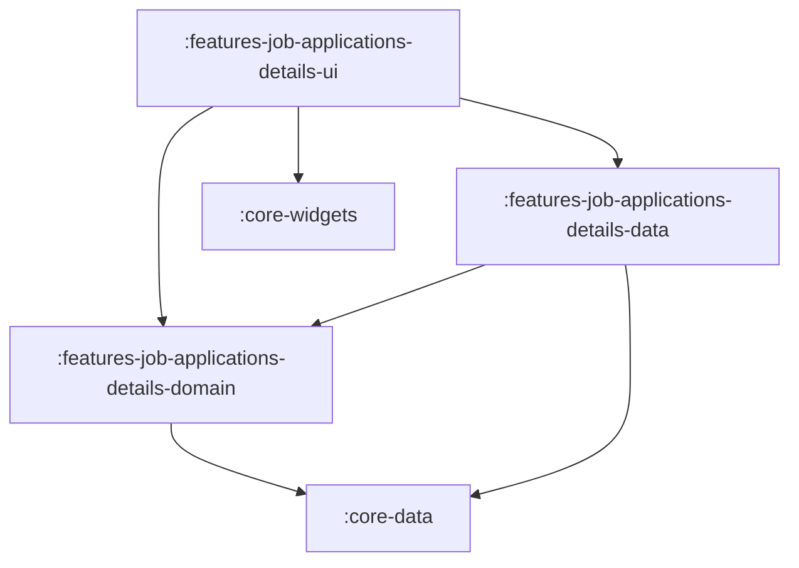

# Feature: Job Applications Details

> [!NOTE]
> **Quick Facts**
> - **Gradle Project IDs**: `:features-job-applications-details-domain`, `:features-job-applications-details-data`, `:features-job-applications-details-ui`
> - **Module Tier**: Feature / User Experience (Clean Architecture: Domain, Data, UI)
> - **Package Base**: `dev.fnc314.tools.jobtracker.features.jobapplicationsdetails`
> - **Target Platforms**: Android (`androidTarget`), Desktop JVM (`jvm`), iOS (`iosX64`, `iosArm64`, `iosSimulatorArm64`), Web (`js`, `wasmJs`)
> - **Internal Project Dependencies**:
>   - Domain: `:core-data`
>   - Data: `:features-job-applications-details-domain`, `:core-data`
>   - UI: `:features-job-applications-details-domain`, `:features-job-applications-details-data`, `:core-widgets`, `:core-navigation`, `:core-data`

---

## Overview

The `features/job-applications-details` module presents the deep-dive record of an individual job application. It enables inspecting metadata, tracking interview stages, modifying application statuses with notes, adjusting fit scores, viewing generated artifacts (CVs and cover letters via signed cloud storage URLs), recording audit events, and reviewing associated company details.

---

## Architectural Breakdown & Subprojects

The feature is divided into three Clean Architecture layers:



### 1. `:features-job-applications-details-domain`
Houses pure Kotlin business logic contracts:
- [`JobApplicationsDetailsRepository`](file:///Users/fnc314/Work/Search/waleedtarbosh-ai-job-search/ui/kmp/features/job-applications-details/domain/src/commonMain/kotlin/dev/fnc314/tools/jobtracker/features/jobapplicationsdetails/domain/repository/JobApplicationsDetailsRepository.kt): Central domain repository interface defining operations for loading details, updating status and fit score, appending timeline events, and fetching signed artifact URLs.
- [`LoadJobApplicationUseCase`](file:///Users/fnc314/Work/Search/waleedtarbosh-ai-job-search/ui/kmp/features/job-applications-details/domain/src/commonMain/kotlin/dev/fnc314/tools/jobtracker/features/jobapplicationsdetails/domain/usecase/LoadJobApplicationUseCase.kt): Retrieves a single `JobApplication` by unique ID.
- [`LoadCompaniesUseCase`](file:///Users/fnc314/Work/Search/waleedtarbosh-ai-job-search/ui/kmp/features/job-applications-details/domain/src/commonMain/kotlin/dev/fnc314/tools/jobtracker/features/jobapplicationsdetails/domain/usecase/LoadCompaniesUseCase.kt): Fetches company profiles and metadata.
- [`UpdateApplicationStatusUseCase`](file:///Users/fnc314/Work/Search/waleedtarbosh-ai-job-search/ui/kmp/features/job-applications-details/domain/src/commonMain/kotlin/dev/fnc314/tools/jobtracker/features/jobapplicationsdetails/domain/usecase/UpdateApplicationStatusUseCase.kt): Transitions application status (`TrackerStatus`) with audit timestamps and optional notes.
- [`UpdateFitScoreUseCase`](file:///Users/fnc314/Work/Search/waleedtarbosh-ai-job-search/ui/kmp/features/job-applications-details/domain/src/commonMain/kotlin/dev/fnc314/tools/jobtracker/features/jobapplicationsdetails/domain/usecase/UpdateFitScoreUseCase.kt): Adjusts candidate-job fit rating.
- [`RecordEventUseCase`](file:///Users/fnc314/Work/Search/waleedtarbosh-ai-job-search/ui/kmp/features/job-applications-details/domain/src/commonMain/kotlin/dev/fnc314/tools/jobtracker/features/jobapplicationsdetails/domain/usecase/RecordEventUseCase.kt): Appends a timeline event (`TrackerEvent`) to the application record.
- [`GetArtifactSignedUrlUseCase`](file:///Users/fnc314/Work/Search/waleedtarbosh-ai-job-search/ui/kmp/features/job-applications-details/domain/src/commonMain/kotlin/dev/fnc314/tools/jobtracker/features/jobapplicationsdetails/domain/usecase/GetArtifactSignedUrlUseCase.kt): Generates signed URLs for cloud-stored documents (e.g. PDFs).

### 2. `:features-job-applications-details-data`
Provides concrete data sources and repository implementations:
- [`JobApplicationsDetailsRepositoryImpl`](file:///Users/fnc314/Work/Search/waleedtarbosh-ai-job-search/ui/kmp/features/job-applications-details/data/src/commonMain/kotlin/dev/fnc314/tools/jobtracker/features/jobapplicationsdetails/data/repository/JobApplicationsDetailsRepositoryImpl.kt): `internal` repository implementation coordinating `RemoteJobApplicationsDetailsDataSource`, `NetworkJobApplicationsDetailsDataSource`, and `LocalJobApplicationsDetailsDataSource`.
- [`RemoteJobApplicationsDetailsDataSource`](file:///Users/fnc314/Work/Search/waleedtarbosh-ai-job-search/ui/kmp/features/job-applications-details/data/src/commonMain/kotlin/dev/fnc314/tools/jobtracker/features/jobapplicationsdetails/data/source/RemoteJobApplicationsDetailsDataSource.kt): Remote data source interface and `internal class RemoteJobApplicationsDetailsDataSourceImpl` backed by `RemoteDataSource` / Firestore.
- [`NetworkJobApplicationsDetailsDataSource`](file:///Users/fnc314/Work/Search/waleedtarbosh-ai-job-search/ui/kmp/features/job-applications-details/data/src/commonMain/kotlin/dev/fnc314/tools/jobtracker/features/jobapplicationsdetails/data/source/NetworkJobApplicationsDetailsDataSource.kt): Network data source interface and `internal class NetworkJobApplicationsDetailsDataSourceImpl` backed by `NetworkDataSource`.
- [`LocalJobApplicationsDetailsDataSource`](file:///Users/fnc314/Work/Search/waleedtarbosh-ai-job-search/ui/kmp/features/job-applications-details/data/src/commonMain/kotlin/dev/fnc314/tools/jobtracker/features/jobapplicationsdetails/data/source/LocalJobApplicationsDetailsDataSource.kt): Local data source interface and `internal class LocalJobApplicationsDetailsDataSourceImpl` backed by Room 3 SQLite database (`DatabaseHolder` / `JobApplicationDao`) with in-memory fallback.
- [`LoadJobApplicationUseCaseImpl`](file:///Users/fnc314/Work/Search/waleedtarbosh-ai-job-search/ui/kmp/features/job-applications-details/data/src/commonMain/kotlin/dev/fnc314/tools/jobtracker/features/jobapplicationsdetails/data/LoadJobApplicationUseCaseImpl.kt): Queries `JobApplicationsDetailsRepository`.
- [`UpdateApplicationStatusUseCaseImpl`](file:///Users/fnc314/Work/Search/waleedtarbosh-ai-job-search/ui/kmp/features/job-applications-details/data/src/commonMain/kotlin/dev/fnc314/tools/jobtracker/features/jobapplicationsdetails/data/UpdateApplicationStatusUseCaseImpl.kt): Delegates mutation to `JobApplicationsDetailsRepository`.
- [`UpdateFitScoreUseCaseImpl`](file:///Users/fnc314/Work/Search/waleedtarbosh-ai-job-search/ui/kmp/features/job-applications-details/data/src/commonMain/kotlin/dev/fnc314/tools/jobtracker/features/jobapplicationsdetails/data/UpdateFitScoreUseCaseImpl.kt): Delegates mutation to `JobApplicationsDetailsRepository`.
- [`RecordEventUseCaseImpl`](file:///Users/fnc314/Work/Search/waleedtarbosh-ai-job-search/ui/kmp/features/job-applications-details/data/src/commonMain/kotlin/dev/fnc314/tools/jobtracker/features/jobapplicationsdetails/data/RecordEventUseCaseImpl.kt): Delegates event recording to `JobApplicationsDetailsRepository`.
- [`GetArtifactSignedUrlUseCaseImpl`](file:///Users/fnc314/Work/Search/waleedtarbosh-ai-job-search/ui/kmp/features/job-applications-details/data/src/commonMain/kotlin/dev/fnc314/tools/jobtracker/features/jobapplicationsdetails/data/GetArtifactSignedUrlUseCaseImpl.kt): Delegates signed URL retrieval to `JobApplicationsDetailsRepository`.
- [`JobApplicationsDetailsDataModule`](file:///Users/fnc314/Work/Search/waleedtarbosh-ai-job-search/ui/kmp/features/job-applications-details/data/src/commonMain/kotlin/dev/fnc314/tools/jobtracker/features/jobapplicationsdetails/data/JobApplicationsDetailsDataModule.kt): Koin DI declarations registering data sources and repository.

### 3. `:features-job-applications-details-ui`
Renders detail presentation, interactive editing dialogs, and artifact launchers following an MVI pattern with decoupled UI models:
- [`JobApplicationsDetailsScreen`](file:///Users/fnc314/Work/Search/waleedtarbosh-ai-job-search/ui/kmp/features/job-applications-details/ui/src/commonMain/kotlin/dev/fnc314/tools/jobtracker/features/jobapplicationsdetails/ui/JobApplicationsDetailsScreen.kt): Comprehensive screen observing `JobApplicationDetailUiState` and dispatching `JobApplicationDetailUiIntent` to `JobApplicationDetailViewModel`. Binds `JobApplicationDetailUiModel` to sub-sections (`ApplicationSummarySection`, `ApplicationTimelineSection`, `CompanyProfileSection`).
- [`JobApplicationDetailViewModel`](file:///Users/fnc314/Work/Search/waleedtarbosh-ai-job-search/ui/kmp/features/job-applications-details/ui/src/commonMain/kotlin/dev/fnc314/tools/jobtracker/features/jobapplicationsdetails/ui/JobApplicationDetailViewModel.kt): Coordinates MVI flow, exposing `uiState: StateFlow<JobApplicationDetailUiState>` and `onIntent(intent: JobApplicationDetailUiIntent): Unit`.
- [`JobApplicationDetailUiState`](file:///Users/fnc314/Work/Search/waleedtarbosh-ai-job-search/ui/kmp/features/job-applications-details/ui/src/commonMain/kotlin/dev/fnc314/tools/jobtracker/features/jobapplicationsdetails/ui/JobApplicationDetailUiState.kt): Sealed interface representing UI states (`Loading`, `Content` holding `JobApplicationDetailUiModel` and `isUpdating`, `Error`, `NavigateBack`).
- [`JobApplicationDetailUiIntent`](file:///Users/fnc314/Work/Search/waleedtarbosh-ai-job-search/ui/kmp/features/job-applications-details/ui/src/commonMain/kotlin/dev/fnc314/tools/jobtracker/features/jobapplicationsdetails/ui/JobApplicationDetailUiIntent.kt): Sealed interface defining user intents (`Load`, `UpdateStatus`, `UpdateFitScore`, `RecordEvent`, `OpenArtifact`, `ClickBack`).
- [`JobApplicationDetailUiModel`](file:///Users/fnc314/Work/Search/waleedtarbosh-ai-job-search/ui/kmp/features/job-applications-details/ui/src/commonMain/kotlin/dev/fnc314/tools/jobtracker/features/jobapplicationsdetails/ui/JobApplicationDetailUiModel.kt): Dedicated `@Immutable` UI model holding pre-formatted details (company name, role, status display text, formatted compensation, formatted location, tags list, notes list, timeline events, artifacts, etc.). Composable components consume this model instead of `JobApplication` directly.
- [`DetailRoute`](file:///Users/fnc314/Work/Search/waleedtarbosh-ai-job-search/ui/kmp/features/job-applications-details/ui/src/commonMain/kotlin/dev/fnc314/tools/jobtracker/features/jobapplicationsdetails/ui/JobApplicationsDetailsNavigation.kt): Type-safe destination key (`applicationId: String`) implementing `NavKeyRoute`.
- [`jobApplicationsDetailsNavHook`](file:///Users/fnc314/Work/Search/waleedtarbosh-ai-job-search/ui/kmp/features/job-applications-details/ui/src/commonMain/kotlin/dev/fnc314/tools/jobtracker/features/jobapplicationsdetails/ui/JobApplicationsDetailsNavigation.kt): `FeatureNavigationHook` registering the `composable<DetailRoute>` entry in the root `NavGraphBuilder`.
- [`jobApplicationsDetailsUiModule`](file:///Users/fnc314/Work/Search/waleedtarbosh-ai-job-search/ui/kmp/features/job-applications-details/ui/src/commonMain/kotlin/dev/fnc314/tools/jobtracker/features/jobapplicationsdetails/ui/JobApplicationsDetailsUiModule.kt): Koin factory for `JobApplicationDetailViewModel`.
- [`jobApplicationsDetailsFeatureModule`](file:///Users/fnc314/Work/Search/waleedtarbosh-ai-job-search/ui/kmp/features/job-applications-details/ui/src/commonMain/kotlin/dev/fnc314/tools/jobtracker/features/jobapplicationsdetails/ui/JobApplicationsDetailsUiModule.kt): Umbrella module uniting data and UI layers.

---

## Deep-Link Support

The details destination requires a parameterized target application ID:

| Route Type | URI Pattern | Description |
| :--- | :--- | :--- |
| `DetailRoute(val applicationId: String)` | `jobtracker://applications/{id}` | Direct deep link to a specific job application record. |

When navigated via deep link, the `NavHost` extracts `applicationId`, instantiates `JobApplicationDetailViewModel`, and fetches the corresponding document from Firestore via `:core-data`.

---

## Key Gradle Tasks

Run the following commands from the `ui/kmp` directory:

```bash
# Compile CommonMain Kotlin metadata across all 3 subprojects
./gradlew :features-job-applications-details-domain:compileCommonMainKotlinMetadata \
          :features-job-applications-details-data:compileCommonMainKotlinMetadata \
          :features-job-applications-details-ui:compileCommonMainKotlinMetadata

# Run unit tests
./gradlew :features-job-applications-details-domain:allTests \
          :features-job-applications-details-data:allTests \
          :features-job-applications-details-ui:allTests

# Assemble Android debug variant for UI module
./gradlew :features-job-applications-details-ui:assembleDebug
```
