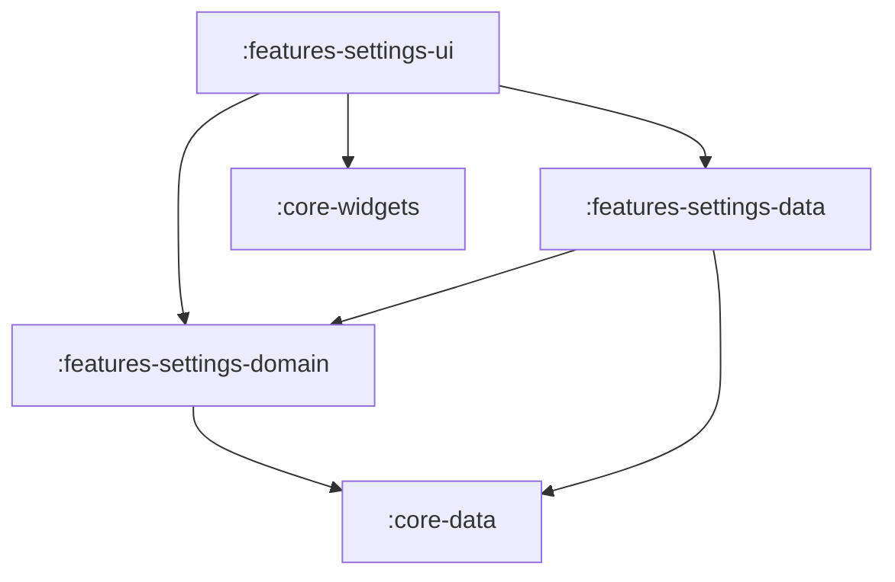

# Feature: Settings

> [!NOTE]
> **Quick Facts**
> - **Gradle Project IDs**: `:features-settings-domain`, `:features-settings-data`, `:features-settings-ui`
> - **Module Tier**: Feature / User Experience (Clean Architecture: Domain, Data, UI)
> - **Package Base**: `dev.fnc314.tools.jobtracker.features.settings`
> - **Target Platforms**: Android (`androidTarget`), Desktop JVM (`jvm`), iOS (`iosX64`, `iosArm64`, `iosSimulatorArm64`), Web (`js`, `wasmJs`)
> - **Internal Project Dependencies**:
>   - Domain: `:core-data`
>   - Data: `:features-settings-domain`, `:core-data`
>   - UI: `:features-settings-domain`, `:features-settings-data`, `:core-widgets`, `:core-data`

---

## Overview

The `features/settings` module provides configuration and preference management for the application. It governs UI theme mode (System, Light, Dark), dynamic Material 3 color seed selection (persisted via hexadecimal strings), backend environment preferences, and diagnostics.

---

## Architectural Breakdown & Subprojects

The feature is organized into three Clean Architecture layers:



### 1. `:features-settings-domain`
Defines contracts for observing and mutating user preferences:
- [`SettingsRepository`](file:///Users/fnc314/Work/Search/waleedtarbosh-ai-job-search/ui/kmp/features/settings/domain/src/commonMain/kotlin/dev/fnc314/tools/jobtracker/features/settings/domain/repository/SettingsRepository.kt): Core interface exposing `val settings: StateFlow<AppSettings>` and `fun updateSettings(settings: AppSettings)`.
- [`ObserveSettingsUseCase`](file:///Users/fnc314/Work/Search/waleedtarbosh-ai-job-search/ui/kmp/features/settings/domain/src/commonMain/kotlin/dev/fnc314/tools/jobtracker/features/settings/domain/usecase/ObserveSettingsUseCase.kt): Provides reactive observation of application settings.
- [`UpdateSettingsUseCase`](file:///Users/fnc314/Work/Search/waleedtarbosh-ai-job-search/ui/kmp/features/settings/domain/src/commonMain/kotlin/dev/fnc314/tools/jobtracker/features/settings/domain/usecase/UpdateSettingsUseCase.kt): Dispatches setting mutations to the repository.

### 2. `:features-settings-data`
Persists settings across app sessions:
- [`SettingsRepositoryImpl`](file:///Users/fnc314/Work/Search/waleedtarbosh-ai-job-search/ui/kmp/features/settings/data/src/commonMain/kotlin/dev/fnc314/tools/jobtracker/features/settings/data/SettingsRepositoryImpl.kt): Serializes `AppSettings` using `kotlinx.serialization` into `SettingsStorage` (backed by platform key-value stores such as NSUserDefaults, SharedPreferences, or localStorage).
- [`settingsDataModule`](file:///Users/fnc314/Work/Search/waleedtarbosh-ai-job-search/ui/kmp/features/settings/data/src/commonMain/kotlin/dev/fnc314/tools/jobtracker/features/settings/data/SettingsDataModule.kt): Koin DI declarations.

### 3. `:features-settings-ui`
Renders the preference controls:
- [`SettingsScreen`](file:///Users/fnc314/Work/Search/waleedtarbosh-ai-job-search/ui/kmp/features/settings/ui/src/commonMain/kotlin/dev/fnc314/tools/jobtracker/features/settings/ui/SettingsScreen.kt): Composable view containing theme mode selectors (System/Light/Dark), seed color pickers (sourced centrally from `SeedColors` in `:core-design-system`), custom color hex input, and back navigation.
- [`SettingsViewModel`](file:///Users/fnc314/Work/Search/waleedtarbosh-ai-job-search/ui/kmp/features/settings/ui/src/commonMain/kotlin/dev/fnc314/tools/jobtracker/features/settings/ui/SettingsViewModel.kt): Bridges the domain use cases to UI state.
- [`settingsUiModule`](file:///Users/fnc314/Work/Search/waleedtarbosh-ai-job-search/ui/kmp/features/settings/ui/src/commonMain/kotlin/dev/fnc314/tools/jobtracker/features/settings/ui/SettingsUiModule.kt): Koin DI factory for `SettingsViewModel`.
- [`settingsFeatureModule`](file:///Users/fnc314/Work/Search/waleedtarbosh-ai-job-search/ui/kmp/features/settings/ui/src/commonMain/kotlin/dev/fnc314/tools/jobtracker/features/settings/ui/SettingsUiModule.kt): Umbrella DI module.

---

## Deep-Link Support

The settings screen is registered in the Compose Navigation graph:

| Route Type | URI Pattern | Description |
| :--- | :--- | :--- |
| `SettingsRoute` | `jobtracker://settings` | Navigates to user preferences and theme settings. |

---

## Key Gradle Tasks

Run the following commands from the `ui/kmp` directory:

```bash
# Compile CommonMain Kotlin metadata across all 3 subprojects
./gradlew :features-settings-domain:compileCommonMainKotlinMetadata \
          :features-settings-data:compileCommonMainKotlinMetadata \
          :features-settings-ui:compileCommonMainKotlinMetadata

# Run unit tests
./gradlew :features-settings-domain:allTests \
          :features-settings-data:allTests \
          :features-settings-ui:allTests

# Assemble Android debug variant for UI module
./gradlew :features-settings-ui:assembleDebug
```
