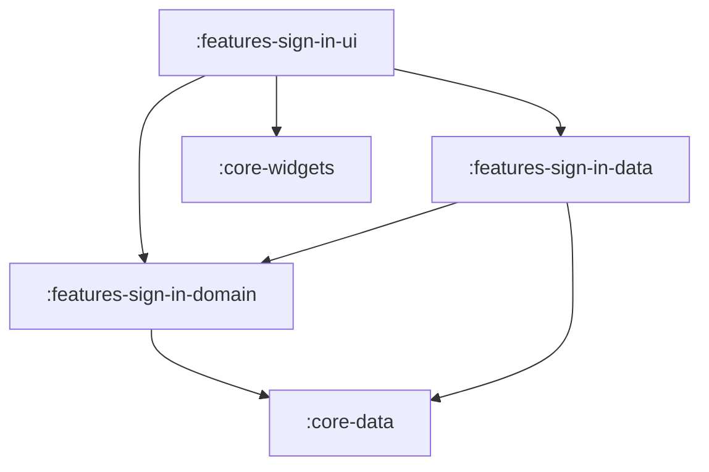

# Feature: Sign In

> [!NOTE]
> **Quick Facts**
> - **Gradle Project IDs**: `:features-sign-in-domain`, `:features-sign-in-data`, `:features-sign-in-ui`
> - **Module Tier**: Feature / User Experience (Clean Architecture: Domain, Data, UI)
> - **Package Base**: `dev.fnc314.tools.jobtracker.features.signin`
> - **Target Platforms**: Android (`androidTarget`), Desktop JVM (`jvm`), iOS (`iosX64`, `iosArm64`, `iosSimulatorArm64`), Web (`js`, `wasmJs`)
> - **Internal Project Dependencies**:
>   - Domain: `:core-data`
>   - Data: `:features-sign-in-domain`, `:core-data`
>   - UI: `:features-sign-in-domain`, `:features-sign-in-data`, `:core-widgets`, `:core-navigation`, `:core-data`

---

## Overview

The `features/sign-in` module provides the candidate authentication and identity onboarding experience for the application. It orchestrates user authentication with Google Identity and Firebase Authentication across all supported Kotlin Multiplatform targets, exposes real-time authentication state flows, and provides a Material 3 login screen.

---

## Architectural Breakdown & Subprojects

The feature is decomposed across three subprojects adhering strictly to Clean Architecture:



### 1. `:features-sign-in-domain`
Defines pure Kotlin business contracts and use cases with no UI or platform framework dependencies:
- [`SignInWithGoogleUseCase`](file:///Users/fnc314/Work/Search/waleedtarbosh-ai-job-search/ui/kmp/features/sign-in/domain/src/commonMain/kotlin/dev/fnc314/tools/jobtracker/features/signin/domain/usecase/SignInWithGoogleUseCase.kt): Triggers the Google Sign-In authentication flow.
- [`ObserveAuthStateUseCase`](file:///Users/fnc314/Work/Search/waleedtarbosh-ai-job-search/ui/kmp/features/sign-in/domain/src/commonMain/kotlin/dev/fnc314/tools/jobtracker/features/signin/domain/usecase/ObserveAuthStateUseCase.kt): Streams the reactive `StateFlow<AuthState>`.
- [`GetCurrentUserUseCase`](file:///Users/fnc314/Work/Search/waleedtarbosh-ai-job-search/ui/kmp/features/sign-in/domain/src/commonMain/kotlin/dev/fnc314/tools/jobtracker/features/signin/domain/usecase/GetCurrentUserUseCase.kt): Retrieves the currently signed-in `UserAccount?`.
- [`SignOutUseCase`](file:///Users/fnc314/Work/Search/waleedtarbosh-ai-job-search/ui/kmp/features/sign-in/domain/src/commonMain/kotlin/dev/fnc314/tools/jobtracker/features/signin/domain/usecase/SignOutUseCase.kt): Signs the candidate out and invalidates cached credentials.

### 2. `:features-sign-in-data`
Implements the domain use cases and delegates to platform-specific sign-in handlers:
- [`PlatformSignInHandler`](file:///Users/fnc314/Work/Search/waleedtarbosh-ai-job-search/ui/kmp/features/sign-in/data/src/commonMain/kotlin/dev/fnc314/tools/jobtracker/features/signin/data/DefaultAuthRepository.kt): `expect`/`actual` bridge managing native authentication (e.g. Credential Manager on Android, web popup, native iOS auth).
- [`DefaultAuthRepository`](file:///Users/fnc314/Work/Search/waleedtarbosh-ai-job-search/ui/kmp/features/sign-in/data/src/commonMain/kotlin/dev/fnc314/tools/jobtracker/features/signin/data/DefaultAuthRepository.kt): Concrete repository managing the session state and bridging `PlatformSignInHandler`.
- [`signInDataModule`](file:///Users/fnc314/Work/Search/waleedtarbosh-ai-job-search/ui/kmp/features/sign-in/data/src/commonMain/kotlin/dev/fnc314/tools/jobtracker/features/signin/data/SignInDataModule.kt): Koin DI module registering use case implementations and platform auth bindings.

### 3. `:features-sign-in-ui`
Encapsulates the Jetpack Compose user interface and screen presentation logic:
- [`SignInRoute`](file:///Users/fnc314/Work/Search/waleedtarbosh-ai-job-search/ui/kmp/features/sign-in/ui/src/commonMain/kotlin/dev/fnc314/tools/jobtracker/features/signin/ui/SignInNavigation.kt): Type-safe `NavKeyRoute` destination object.
- [`signInNavHook`](file:///Users/fnc314/Work/Search/waleedtarbosh-ai-job-search/ui/kmp/features/sign-in/ui/src/commonMain/kotlin/dev/fnc314/tools/jobtracker/features/signin/ui/SignInNavigation.kt): `FeatureNavigationHook` registering `composable<SignInRoute>` into the application `NavHost`.
- [`SignInScreen`](file:///Users/fnc314/Work/Search/waleedtarbosh-ai-job-search/ui/kmp/features/sign-in/ui/src/commonMain/kotlin/dev/fnc314/tools/jobtracker/features/signin/ui/SignInScreen.kt): Composable screen providing responsive branding, Google Sign-In call to action, loading indicators, and error snackbar notifications.
- [`SignInViewModel`](file:///Users/fnc314/Work/Search/waleedtarbosh-ai-job-search/ui/kmp/features/sign-in/ui/src/commonMain/kotlin/dev/fnc314/tools/jobtracker/features/signin/ui/SignInViewModel.kt): Manages `SignInUiState` (`Unauthenticated`, `SigningIn`, `Authenticated`, `Error`) and exposes actions.
- [`signInUiModule`](file:///Users/fnc314/Work/Search/waleedtarbosh-ai-job-search/ui/kmp/features/sign-in/ui/src/commonMain/kotlin/dev/fnc314/tools/jobtracker/features/signin/ui/SignInUiModule.kt): Koin DI factory for `SignInViewModel`.
- [`signInFeatureModule`](file:///Users/fnc314/Work/Search/waleedtarbosh-ai-job-search/ui/kmp/features/sign-in/ui/src/commonMain/kotlin/dev/fnc314/tools/jobtracker/features/signin/ui/SignInUiModule.kt): Umbrella module including both `signInDataModule` and `signInUiModule`.

---

## Deep-Link Support

The sign-in destination is defined in the type-safe Compose Navigation graph:

| Route Type | URI Pattern | Description |
| :--- | :--- | :--- |
| `SignInRoute` | `jobtracker://login` | Navigates unauthenticated users to the identity sign-in screen. |

When launched with an unauthenticated session or when an active session expires, the root `NavHost` automatically routes to `SignInRoute`. Upon successful authentication, the reactive `AuthState` stream triggers navigation to the primary applications dashboard (`ListRoute`).

---

## Key Gradle Tasks

Run the following commands from the `ui/kmp` directory:

```bash
# Compile CommonMain Kotlin metadata across all 3 subprojects
./gradlew :features-sign-in-domain:compileCommonMainKotlinMetadata \
          :features-sign-in-data:compileCommonMainKotlinMetadata \
          :features-sign-in-ui:compileCommonMainKotlinMetadata

# Run unit tests
./gradlew :features-sign-in-domain:allTests \
          :features-sign-in-data:allTests \
          :features-sign-in-ui:allTests

# Assemble Android debug variant for UI module
./gradlew :features-sign-in-ui:assembleDebug
```
