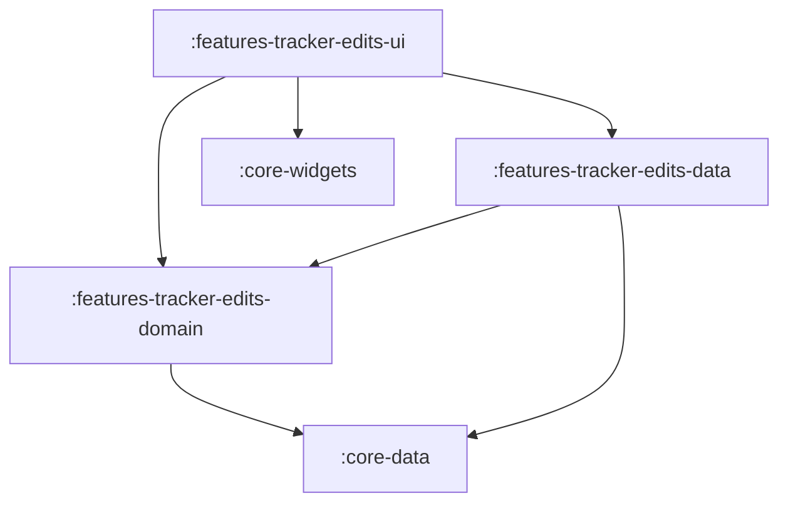

# Feature: Tracker Edits

> [!NOTE]
> **Quick Facts**
> - **Gradle Project IDs**: `:features-tracker-edits-domain`, `:features-tracker-edits-data`, `:features-tracker-edits-ui`
> - **Module Tier**: Feature / User Experience (Clean Architecture: Domain, Data, UI)
> - **Package Base**: `dev.fnc314.tools.jobtracker.features.trackeredits`
> - **Target Platforms**: Android (`androidTarget`), Desktop JVM (`jvm`), iOS (`iosX64`, `iosArm64`, `iosSimulatorArm64`), Web (`js`, `wasmJs`)
> - **Internal Project Dependencies**:
>   - Domain: `:core-data`
>   - Data: `:features-tracker-edits-domain`, `:core-data`
>   - UI: `:features-tracker-edits-domain`, `:features-tracker-edits-data`, `:core-widgets`, `:core-navigation`, `:core-data`

---

## Overview

The `features/tracker-edits` module manages proposed edits, automated status sync suggestions (e.g. from Gmail scraper jobs or Composio workflows), and human-in-the-loop review queues. It allows candidates to review suggested modifications to their application pipeline, approve changes with optional audit notes, reject proposals with reasons, and expire stale edits.

---

## Architectural Breakdown & Subprojects

The feature is organized across three Clean Architecture subprojects:



### 1. `:features-tracker-edits-domain`
Defines contracts for reviewing and managing pending edits:
- [`LoadPendingEditsUseCase`](file:///Users/fnc314/Work/Search/waleedtarbosh-ai-job-search/ui/kmp/features/tracker-edits/domain/src/commonMain/kotlin/dev/fnc314/tools/jobtracker/features/trackeredits/domain/usecase/LoadPendingEditsUseCase.kt): Fetches all active pending proposal edits (`List<TrackerEdit>`).
- [`ApproveEditUseCase`](file:///Users/fnc314/Work/Search/waleedtarbosh-ai-job-search/ui/kmp/features/tracker-edits/domain/src/commonMain/kotlin/dev/fnc314/tools/jobtracker/features/trackeredits/domain/usecase/ApproveEditUseCase.kt): Applies a proposed edit to the underlying application document.
- [`RejectEditUseCase`](file:///Users/fnc314/Work/Search/waleedtarbosh-ai-job-search/ui/kmp/features/tracker-edits/domain/src/commonMain/kotlin/dev/fnc314/tools/jobtracker/features/trackeredits/domain/usecase/RejectEditUseCase.kt): Dismisses a proposed edit with a rejection reason.
- [`ExpireStaleEditsUseCase`](file:///Users/fnc314/Work/Search/waleedtarbosh-ai-job-search/ui/kmp/features/tracker-edits/domain/src/commonMain/kotlin/dev/fnc314/tools/jobtracker/features/trackeredits/domain/usecase/ExpireStaleEditsUseCase.kt): Automatically expires unreviewed edits beyond the retention window.

### 2. `:features-tracker-edits-data`
Implements the domain contracts:
- [`RemoteTrackerEditsRepository`](file:///Users/fnc314/Work/Search/waleedtarbosh-ai-job-search/ui/kmp/features/tracker-edits/data/src/commonMain/kotlin/dev/fnc314/tools/jobtracker/features/trackeredits/data/RemoteTrackerEditsRepository.kt): Remote repository communicating with backend data collections.
- [`LoadPendingEditsUseCaseImpl`](file:///Users/fnc314/Work/Search/waleedtarbosh-ai-job-search/ui/kmp/features/tracker-edits/data/src/commonMain/kotlin/dev/fnc314/tools/jobtracker/features/trackeredits/data/LoadPendingEditsUseCaseImpl.kt)
- [`ApproveEditUseCaseImpl`](file:///Users/fnc314/Work/Search/waleedtarbosh-ai-job-search/ui/kmp/features/tracker-edits/data/src/commonMain/kotlin/dev/fnc314/tools/jobtracker/features/trackeredits/data/ApproveEditUseCaseImpl.kt)
- [`RejectEditUseCaseImpl`](file:///Users/fnc314/Work/Search/waleedtarbosh-ai-job-search/ui/kmp/features/tracker-edits/data/src/commonMain/kotlin/dev/fnc314/tools/jobtracker/features/trackeredits/data/RejectEditUseCaseImpl.kt)
- [`ExpireStaleEditsUseCaseImpl`](file:///Users/fnc314/Work/Search/waleedtarbosh-ai-job-search/ui/kmp/features/tracker-edits/data/src/commonMain/kotlin/dev/fnc314/tools/jobtracker/features/trackeredits/data/ExpireStaleEditsUseCaseImpl.kt)
- [`trackerEditsDataModule`](file:///Users/fnc314/Work/Search/waleedtarbosh-ai-job-search/ui/kmp/features/tracker-edits/data/src/commonMain/kotlin/dev/fnc314/tools/jobtracker/features/trackeredits/data/TrackerEditsDataModule.kt): Koin DI declarations.

### 3. `:features-tracker-edits-ui`
Renders review queues, comparison cards, and action controls:
- [`TrackerEditsScreen`](file:///Users/fnc314/Work/Search/waleedtarbosh-ai-job-search/ui/kmp/features/tracker-edits/ui/src/commonMain/kotlin/dev/fnc314/tools/jobtracker/features/trackeredits/ui/TrackerEditsScreen.kt): Review queue screen displaying edit proposals, original vs proposed values, timestamp metadata, approve/reject dialogs, and refresh triggers.
- [`TrackerEditsViewModel`](file:///Users/fnc314/Work/Search/waleedtarbosh-ai-job-search/ui/kmp/features/tracker-edits/ui/src/commonMain/kotlin/dev/fnc314/tools/jobtracker/features/trackeredits/ui/TrackerEditsViewModel.kt): Manages `TrackerEditsUiState` (`edits`, `loading`, `error`, `actionInProgress`).
- [`EditsRoute`](file:///Users/fnc314/Work/Search/waleedtarbosh-ai-job-search/ui/kmp/features/tracker-edits/ui/src/commonMain/kotlin/dev/fnc314/tools/jobtracker/features/trackeredits/ui/TrackerEditsNavigation.kt): Type-safe destination key implementing `NavKeyRoute`.
- [`trackerEditsNavHook`](file:///Users/fnc314/Work/Search/waleedtarbosh-ai-job-search/ui/kmp/features/tracker-edits/ui/src/commonMain/kotlin/dev/fnc314/tools/jobtracker/features/trackeredits/ui/TrackerEditsNavigation.kt): `FeatureNavigationHook` registering `composable<EditsRoute>` in the root `NavGraphBuilder`.
- [`trackerEditsUiModule`](file:///Users/fnc314/Work/Search/waleedtarbosh-ai-job-search/ui/kmp/features/tracker-edits/ui/src/commonMain/kotlin/dev/fnc314/tools/jobtracker/features/trackeredits/ui/TrackerEditsUiModule.kt): Koin DI factory for `TrackerEditsViewModel`.
- [`trackerEditsFeatureModule`](file:///Users/fnc314/Work/Search/waleedtarbosh-ai-job-search/ui/kmp/features/tracker-edits/ui/src/commonMain/kotlin/dev/fnc314/tools/jobtracker/features/trackeredits/ui/TrackerEditsUiModule.kt): Umbrella DI module.

---

## Deep-Link Support

The review queue destination is registered in the Compose Navigation graph:

| Route Type | URI Pattern | Description |
| :--- | :--- | :--- |
| `EditsRoute` | `jobtracker://edits` | Navigates to the pending tracker edits review queue. |

---

## Key Gradle Tasks

Run the following commands from the `ui/kmp` directory:

```bash
# Compile CommonMain Kotlin metadata across all 3 subprojects
./gradlew :features-tracker-edits-domain:compileCommonMainKotlinMetadata \
          :features-tracker-edits-data:compileCommonMainKotlinMetadata \
          :features-tracker-edits-ui:compileCommonMainKotlinMetadata

# Run unit tests
./gradlew :features-tracker-edits-domain:allTests \
          :features-tracker-edits-data:allTests \
          :features-tracker-edits-ui:allTests

# Assemble Android debug variant for UI module
./gradlew :features-tracker-edits-ui:assembleDebug
```
